# YCGrid

**YCGrid is a spreadsheet that works like Excel, keeps up with live markets (more than a million cell updates a
second while the screen stays smooth at the monitor's refresh rate) and is driven by Python, so an AI agent can build
any trading or research screen you describe, fast and tested, and you can still change it by hand like any sheet.**

**You don't need to write a line of code.** Tell Claude Code, Codex or GitHub Copilot what you want to see, and it
builds the screen in YCGrid and checks it in the live window: a quote board, a market-watch screen with live charts,
a statistical analysis, a backtest with its profit and loss, or any other screen you can put into words. The agent
puts it together from YCGrid's building blocks (live tables fed through shared memory, charts of ten million points,
record and replay, an order path with risk limits and a kill switch), and those blocks carry the speed and the
stability, so every screen it makes runs on the same fast, tested engine instead of code written for the occasion.

[繁體中文](README.zh-TW.md) · [Changelog](CHANGELOG.md) · [Contributing](CONTRIBUTING.md) · [Support YCGrid](#support-ycgrid)

[](https://github.com/ycgrid/ycgrid/actions/workflows/checks.yml)
[](https://github.com/ycgrid/ycgrid/releases/latest)
[](LICENSE)


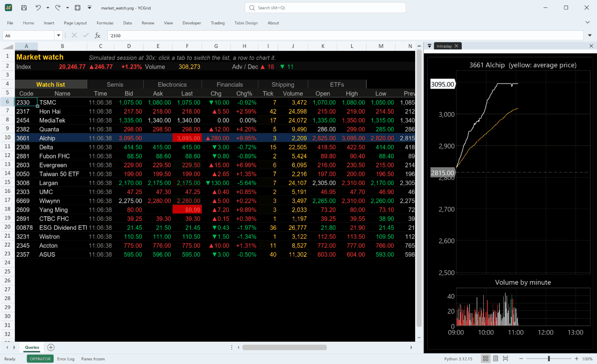

- **If you live in Excel:** YCGrid looks and works like it. The ribbon, the formula bar, the shortcuts, 513 functions,
  PivotTables, charts, conditional formatting. It opens your `.xlsx` files.
- **If you write Python:** you drive it with Excel's object model (`Range("A1").Value`, `Worksheet_Change`,
  `Cells(i, 2)`), from a separate process that can crash, pause in a debugger or be replaced without touching the
  spreadsheet. A pandas DataFrame becomes a live table in one call.
- **If you run a trading system (HFT, market making, algorithmic trading):** YCGrid is its trading UI. Live tables
  fed through shared memory reach the screen in as little as 12 ms (median) from Python, pushing never blocks your
  engine, and an order manager with risk limits, heartbeats and a kill switch guard what the screen sends. Your
  microsecond path stays in its own process; YCGrid shows its quotes, orders and positions.
- **If you do research (a quant research UI):** charts of ten million points, backtest reports, parameter sweeps,
  record and replay of a whole session, the Analysis ToolPak and Solver, pandas spilled into cells. All of it is
  building blocks you compose; the screens and the maths stay yours.
- **If you work with an AI agent (AI-generated UI):** YCGrid ships the skill and the MCP tools that Claude Code, Codex
  or GitHub Copilot needs to generate the whole screen from a sentence and check it in the live window. One click
  (**Developer → VS Code**) sets the project up.

## Screens built with YCGrid

Every picture below is a sheet: cells, formats, formulas and tables, with charts docked beside them. Each one is an
example project you can open, read and change (simulated data, a paper exchange); more are in
[What people build with it](#what-people-build-with-it).

**Multi-symbol quotes** (`market_watch`): prices colored against the previous close, change arrows, the 10% limit
filled, tabs that switch the list, and the selected symbol's intraday line and volume beside it.

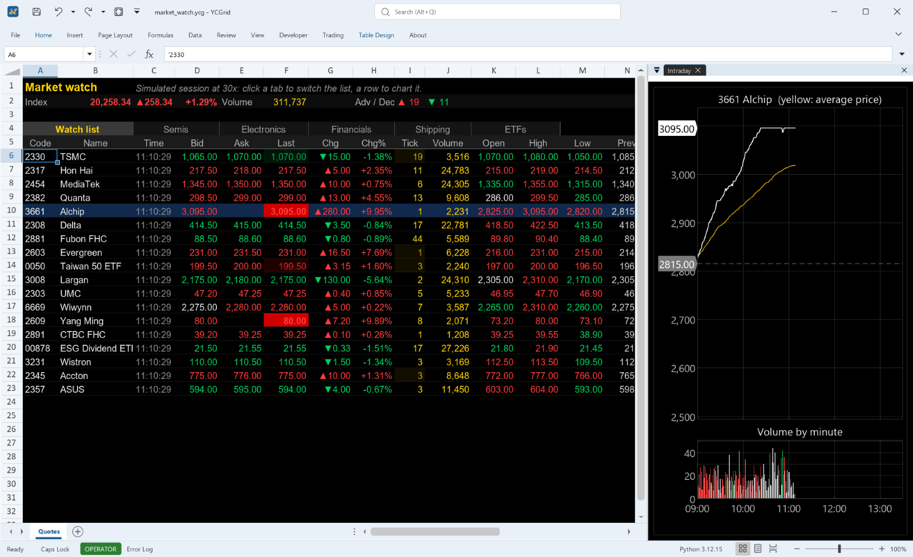

**T-style option chain** (`option_chain`): calls, strike, puts; the money side shaded, the at-the-money strike lit,
expiry tabs; the smile of every expiry and the open interest by strike.

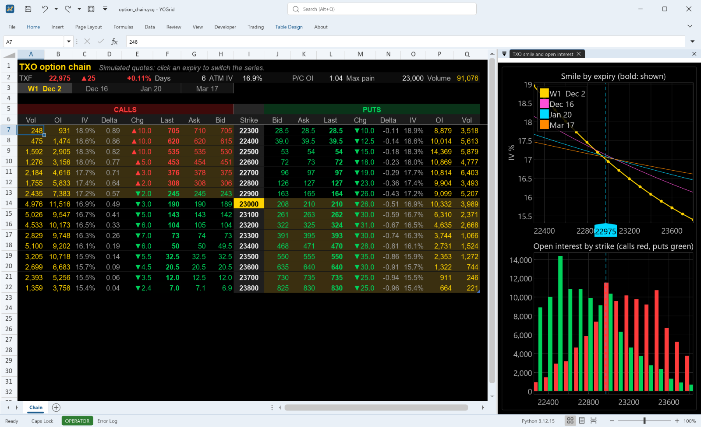

**Technical chart** (`technical_chart`): daily candles with moving averages and Bollinger bands, volume, MACD and KD
in four linked plots; click a day in the table and the charts mark it.

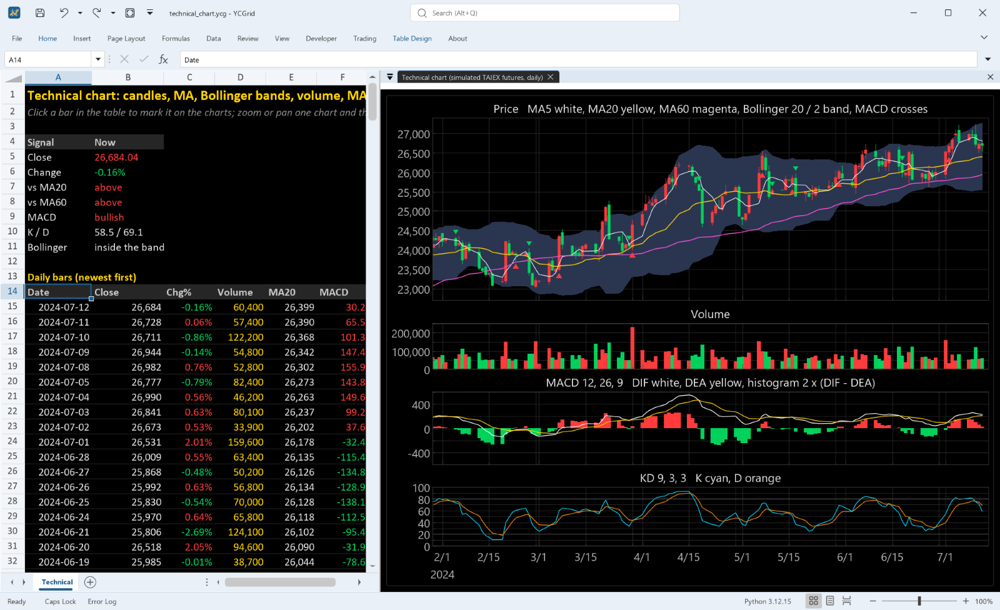

**A trading screen of your own** (`trading_desk`): a watch list, order buttons, a click-to-trade ladder, the
position and the fills, and live candles that mark every fill and the average price.

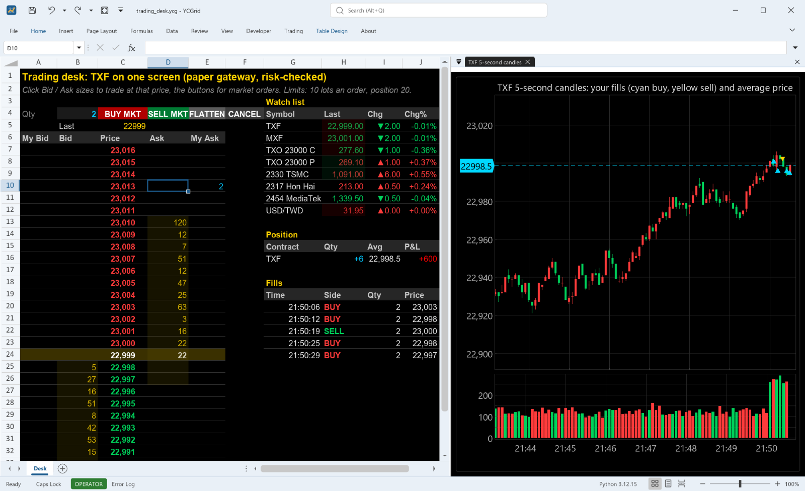

## The problem it solves

A trader's or a researcher's screen is a spreadsheet: a grid of numbers, some typed, some computed, some arriving
many times a second. Nothing on the market does all three well.

- **Excel** is the grid everyone knows, but live data must enter through COM on its UI thread, and RTD is throttled
  to two seconds by default. A few hundred ticking cells and the window stutters.
- **Web dashboards** (Perspective, Grafana, a React grid) stream well, but they are not spreadsheets: no formulas
  typed into cells, no PivotTables, no Solver, nothing a non-programmer can change at their desk.
- **Python plotting and notebooks** are fine for research, but a notebook isn't a screen you watch all day, and
  matplotlib redraws a ten-million-point line in 61 ms.

YCGrid is a native Windows spreadsheet (C++20, Dear ImGui, ImPlot, Direct3D 11) whose core was designed around live
data from the first line: **one writer, immutable snapshots, and work proportional only to what changed and what is
visible**. Python drives it from the outside, so your code, your packages and your agent stay where they are.

## How it works

```
         your Python, in its own processes                         ycgrid.exe (C++20)
 ┌───────────────────────────────┐                  ┌──────────────────────────────────────────────┐
 │ main.py, sheets/, modules/    │ Excel object     │  Engine thread: the only writer              │
 │ (events, macros, UDFs)        │ model over a     │   · cells, formulas, the dependency graph    │
 │                               │ ──── pipe ─────▶ │   · recalculates only what changed, on all   │
 │ feeds/*.py (market data)      │ ◀── events ───── │     cores                                    │
 │                               │                  │   · publishes an immutable snapshot every    │
 │ scripts, notebooks, agents    │ shared memory    │     16–100 ms (you choose)                   │
 │ (yc.connect())                │ ── tables, ────▶ │                      │                       │
 │                               │ topics, plots    │                      ▼                       │
 └───────────────────────────────┘                  │  UI thread: ImGui + ImPlot on Direct3D 11    │
                                                    │   · reads the snapshot, never waits on a     │
                                                    │     lock, Python or a recalculation          │
                                                    │   · draws only the visible cells, ~0.4 ms    │
                                                    └──────────────────────────────────────────────┘
```

Four principles explain most of the design:

1. **One writer, immutable snapshots.** Only the engine thread changes the workbook. Every 16–100 ms it publishes a
   snapshot; the UI and every Python reader see a consistent moment (a bid and ask in the same row are never one new
   and one old), and the UI never waits for anyone.
2. **The latest value wins.** Market data is conflated, not queued: a topic keeps its last value, so there is no
   backlog to catch up on when a feed bursts. Pushing never blocks the sender.
3. **Cost follows the change, not the sheet.** Recalculation walks only the dirty part of the dependency graph, in
   parallel. Drawing costs the visible cells, not the million rows underneath. Idle means idle: with nothing changing,
   YCGrid draws about one frame a second.
4. **Python is a neighbour, not a tenant.** Your code runs in its own process (several, if you like) and talks over
   a named pipe and shared memory. A crash, a breakpoint or a reload leaves the spreadsheet running; a feed process
   keeps pushing while you debug the strategy next to it.

## See it in 60 seconds

Start YCGrid, then run this with any Python that has the `yc` package (the bundled one, or your own after
`pip install` of the wheel):

```python
# board.py
import time
import numpy as np, pandas as pd
import yc
from yc.excel import *
from yc import plot

yc.connect()                                            # the running YCGrid (yc.launch() starts one)
ws = Worksheets.Add(Name="Board")

# 1. A DataFrame becomes a table that Python updates by key
syms = ["TXF", "MXF", "2330", "2317"]
px = np.array([23000.0, 23000.0, 1050.0, 210.5]); base = px.copy()
board = ws.bind(pd.DataFrame({"Symbol": syms, "Last": px, "Change": 0.0}),
                key="Symbol", name="Board", at="A1",
                formats={"Last": "#,##0.0", "Change": "+0.00%;-0.00%"},
                flash=["Last"], stale_after=3)          # up / down flashes; rows gray out if the feed stops

# 2. Cells and formulas, with Excel's names
ws.Range("E1").Value = "Average move"
ws.Range("E2").Formula = "=AVERAGE(Board[Change])"      # recalculates as the table changes
ws.Range("E2").NumberFormat = "0.00%"

# 3. A live chart in a window of its own
fig = plot.figure("TXF", theme="dark")
line = fig[0].line([], [], label="TXF", capacity=100_000)
fig[0].set(time=True, follow=60)                        # the x axis shows the last 60 seconds

# 4. Stream (simulated here): only the changed rows travel, through shared memory
rng = np.random.default_rng()
while True:
    px *= 1 + rng.normal(0, 0.0005, len(px))
    board.update({"Symbol": syms, "Last": px, "Change": px / base - 1})
    line.append([time.time()], [px[0]])
    time.sleep(0.1)
```

What you get: a sheet with a four-row table whose prices flash red and green ten times a second, a formula next to it
that recalculates on every update, a dark chart window following the TXF price, and, if you stop the script, rows that
gray out, a red tint over the window and a banner naming the table (the table has `stale_after=3`). Everything on screen is an ordinary spreadsheet object: sort
the table, add a column with `=[@Last]*2`, put a conditional format on it, build a PivotTable over it. Replace the
random walk with your broker's API and it is a quote board.

Prefer not to write it yourself? Open the workbook, press **Developer → VS Code**, and tell your agent:

> "Stream the option quotes into a chain with Greeks, color the in-the-money strikes and add a button that sends a
> paper order." · "Backtest this moving-average strategy on the CSV files in `data\`, sweep both windows and chart the
> equity curves." · "Build a volatility surface from the option quotes in Sheet1 that updates live."

## Getting live data into cells: pick the tool

There is more than one way, because screens differ. The picture to keep in mind: a **topic** is a named live value
(`"2330.last"` is TSMC's last price); a **bound table** is a table whose rows Python finds by a key column.

| You have | Write | What happens |
|---|---|---|
| Rows keyed by symbol, strike or order id, changing often | `t = ws.bind(df, key="Symbol", formats=..., flash=...)`, then `t.update(changed_rows)` | A real table (ListObject) with per-column formats, flashes and stale-row graying; only changed keys and columns travel, through shared memory, tens of millions of cells a second. Formulas, charts and PivotTables use it like any table. The binding is saved with the workbook. |
| A few live values that formulas should react to | cells with `=QUOTE("2330.last")`; the feed does `ids = Application.Topics.Register(["2330.last"])` and `Application.Topics.Push(ids, [1085.0])` | Excel's RTD, done right: pushing never blocks, the latest value wins, and every formula depending on the cell recalculates. |
| A big board of single values, no formula needed | `Range("B2:D1001").BindTopics(ids)` with ids shaped like the range | Each push writes the cells directly with zero formula cost: over a million cell updates a second. Bindings are runtime state, so bind again in `Workbook_Open`. |
| A report, a snapshot, a DataFrame to look at | `Range("A2:F1001").Value = rows` or `ws.write_frame(df)` | Plain cells. 2.8 million cells a second over the pipe; a million cells in about 0.1 s through shared memory. |
| Every tick must be processed by your Python (bars, journals) | `Application.Topics.Subscribe(names, on_tick)` in the host | Every update in order, batched, on the subscription's own thread; `Conflate=True` for the latest per topic. |

Where does the data come from? From **feed processes**: scripts under `feeds\` registered in `ycgrid.toml`:

```toml
[[python.feeds]]
name = "market"
script = "feeds/market.py"
restart = "always"
```

YCGrid starts them with the workbook, restarts them if they exit, and passes `YCGRID_PID` so `yc.connect()` finds the
right window. They run outside the Python host, so a feed never competes with your events for the GIL, and keeps
pushing while the host reloads or sits at a breakpoint. YCGrid ships no broker connection of its own: `yc.feeds.Feed`
(conflation, heartbeat, reconnects) and `yc.trading.Gateway` are the interfaces you implement over your broker's SDK,
and every example runs on the built-in simulator (`yc.sim.Market`).

## What people build with it

Each of these is a project in [`examples`](examples/README.md) (in the release zip too): open
`examples\<name>\<name>.ycg` and its `Workbook_Open` builds the screen from the blocks, with simulated data. Read
the source of the one closest to what you want; they are code to copy, not an API.

| Screens | Research | Data |
|---|---|---|
| `market_watch`: multi-symbol quotes as trading terminals show them, with category tabs and the selected symbol's intraday chart | `technical_chart`: candles, moving averages, Bollinger bands, volume, MACD and KD, linked to the bars in a table | `million_cells`: a million live cells |
| `option_chain`: the T-style chain with expiry tabs, the smile of every expiry and the open interest by strike | `backtest_report`: statistics, monthly returns with a color scale, the trade list, candles with buy / sell marks, equity and drawdown linked to the table | `big_data`: tens of millions of rows in a Data View that sorts and filters in C++ |
| `trading_desk`: watch list, order buttons, ladder, position and fills with live candles, on one sheet | `strategy_lab`: a parameter sweep as a heatmap, out-of-sample check, walk-forward | `tick_replay`, `history_playback`: a history file played into the screen with pause and seek |
| `options_desk`: a live chain with an iron condor, its P&L at expiry and today, Greeks and a spot x volatility grid | `factor_research`, `pairs_trading`, `portfolio_optimizer`, `monte_carlo_var` | `live_candles`: ticks into 5-second bars with `yc.bars` |
| `dom_ladder`: a price ladder with click-to-trade and your orders shown in it | `vol_surface`: a 3-D surface from option quotes that updates live | `time_machine`: record everything, replay, pin a moment, compare |
| `quote_board`: columns that draw size bars, change bars, volume heat and trend lines every frame | `option_payoff`, `risk_dashboard` | `quick_plot`: ten million points, a million-value histogram |
| `order_flow`, `depth_heatmap`: footprint cells and a market-depth heatmap in price / time coordinates | `py_cells`: `=PY("x.describe()", A1:C200)` spills pandas into cells | |
| `execution_algos`: TWAP and iceberg as ten-line classes over the order manager | | |
| `live_strategy`: the backtest's own rule, trading on paper from the live bars | | |

| | |
|---|---|
| 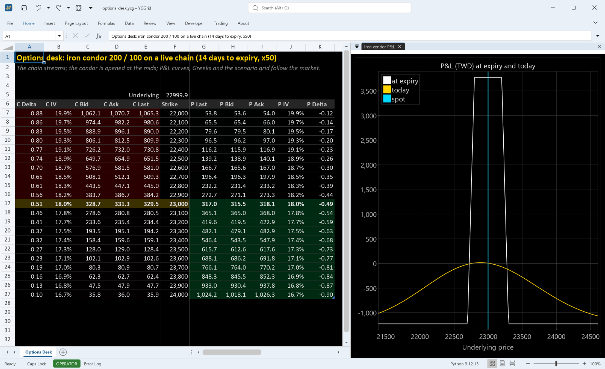 **Options desk**: a strategy priced off the live chain | 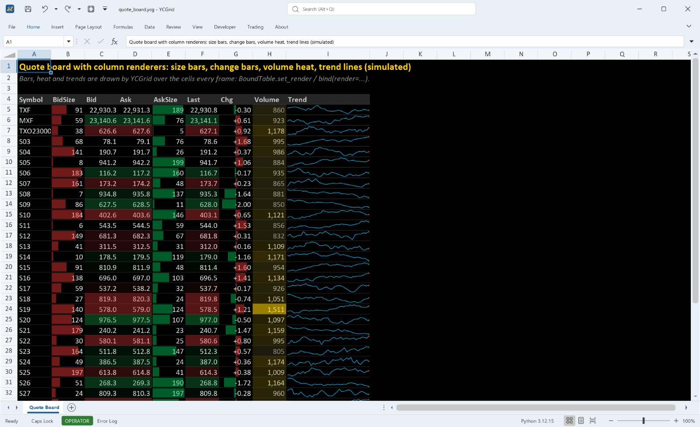 **Quote board**: size bars, change bars, volume heat and trend lines drawn every frame |
| 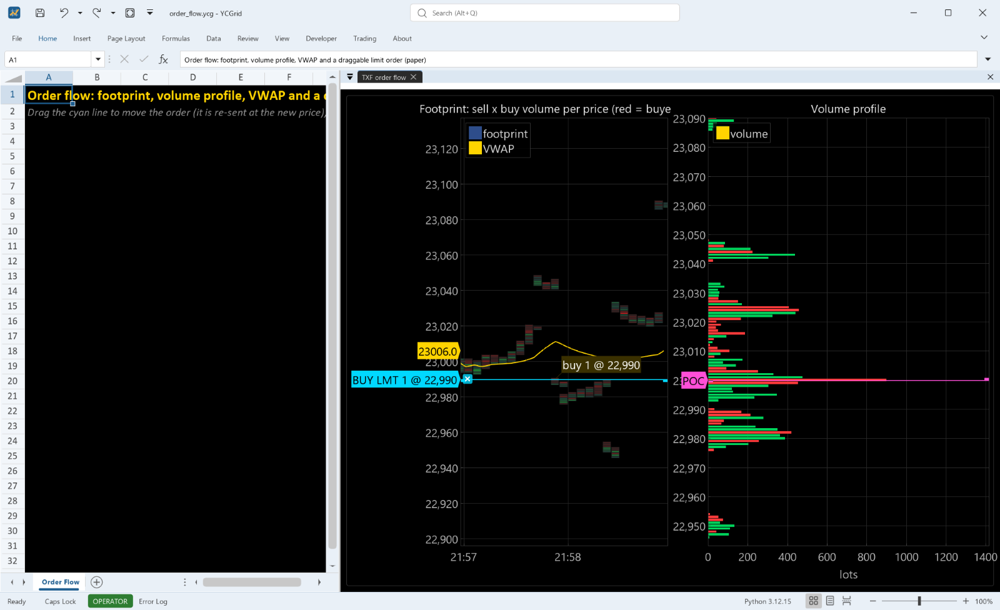 **Order flow**: footprint, VWAP and the volume profile | 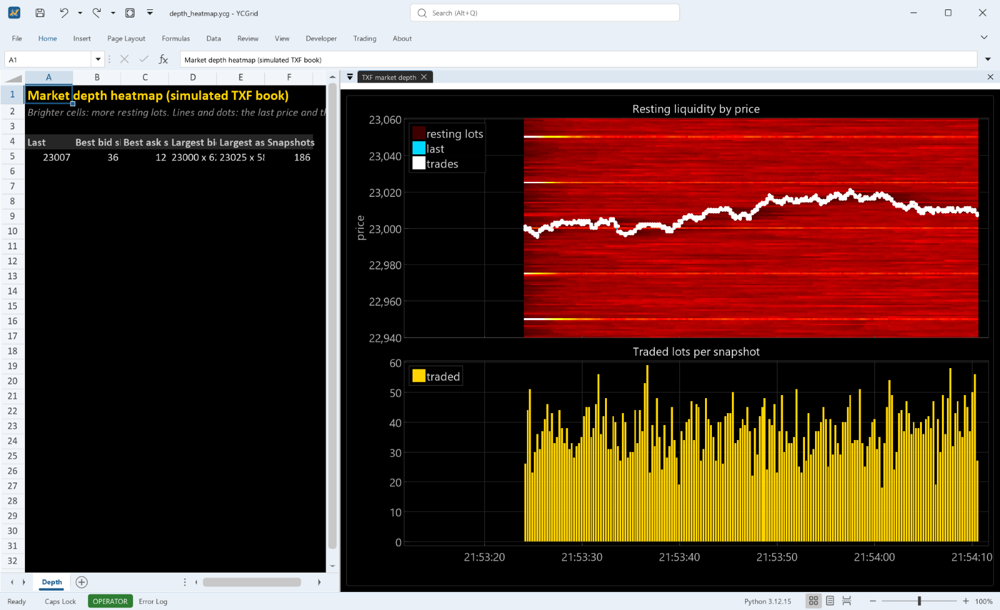 **Market depth**: resting liquidity by price over time |
| 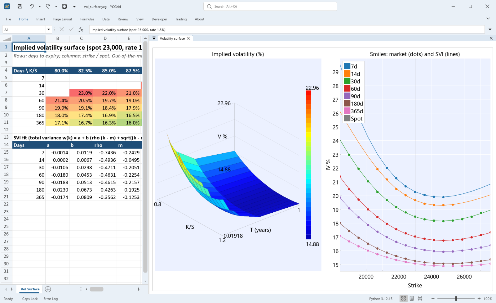 **Volatility surface**: implied volatilities, an SVI fit per expiry | 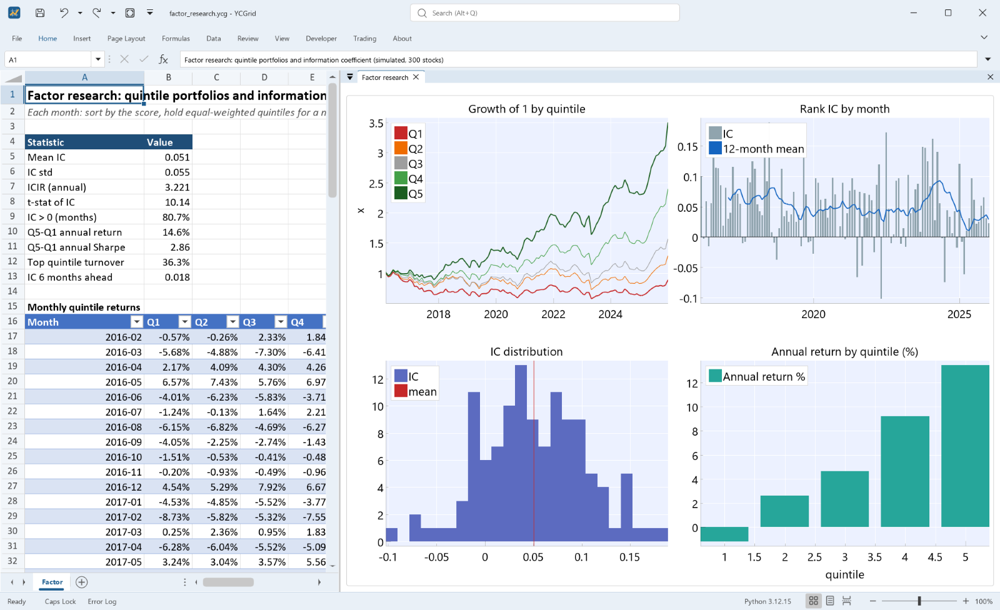 **Factor research**: quintile portfolios and information coefficients |
| 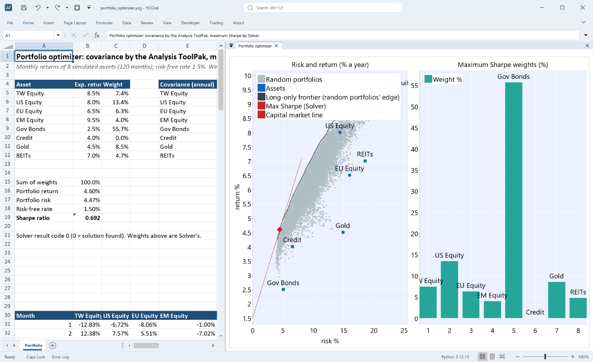 **Portfolio optimizer**: the frontier and the maximum Sharpe weights by Solver | 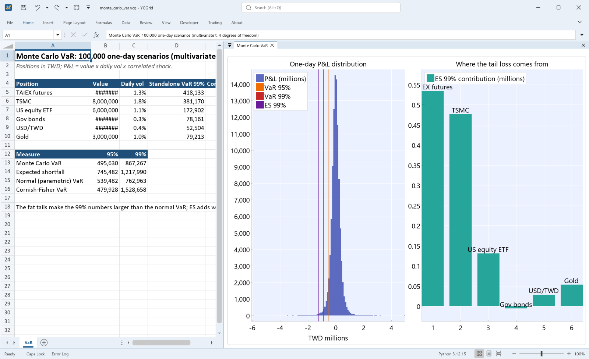 **Monte Carlo VaR**: 100,000 scenarios, VaR and where the tail loss comes from |
| 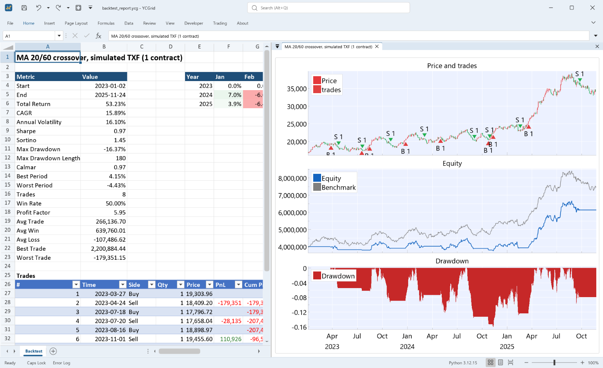 **Backtest report**: statistics, monthly returns, trades linked to the charts | 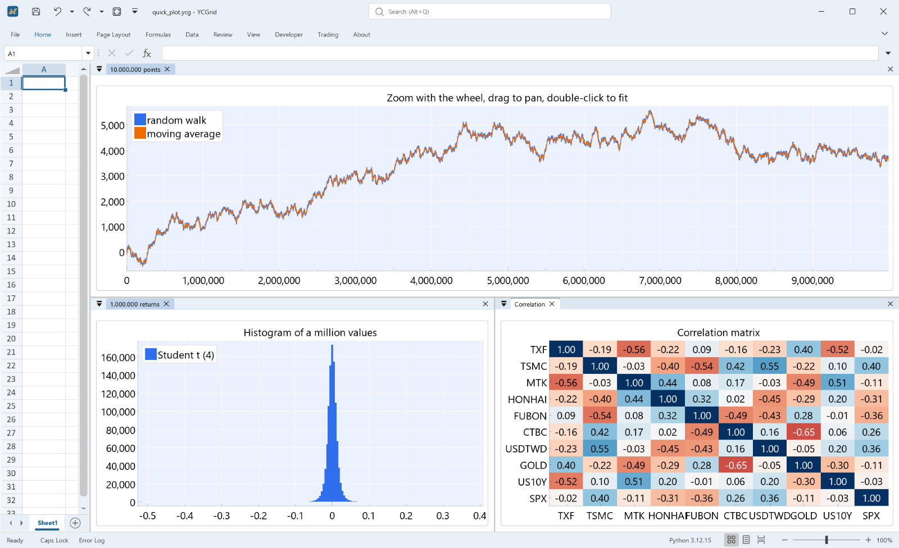 **Fast plots**: ten million points, a million-value histogram, a correlation heatmap |

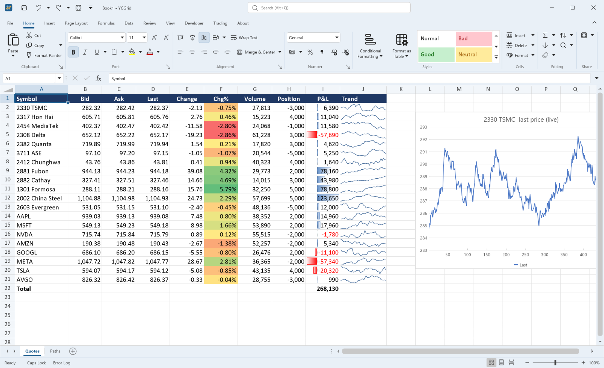

The blocks they are made of, each of which exists because it needs the C++ side (rendering, the data path, the
engine) or a guarantee Python on top can't give:

| Block | What it gives you |
|---|---|
| Bound tables (`ws.bind`) | live rows by key, per-column formats, flash, stale rows, column renderers (bars, heat, trend lines drawn over the cells every frame) |
| `yc.plot` | matplotlib-like calls drawn by ImPlot: lines, candles, buy / sell marks, scatter, histograms, heatmaps, 3-D surfaces; ten million points pan and zoom at full frame rate; live `append` with `follow`; draggable lines and points, click / hover / select events, linked crosshairs, a plot linked to a table's active row |
| Topics | named live values pushed from any process or thread; `=QUOTE()`, `BindTopics`, `Subscribe` |
| Per-cell `OnChange` and `Worksheet_LiveChange` | Python called only for the cells that changed, or once per publish cycle for live data |
| `yc.replay` | record every frame reaching the tables and topics; replay into the same screen at 0.25x–50x with pause, seek, pin and compare; live frames are ignored meanwhile, so a strategy runs on yesterday's session unchanged |
| `yc.trading` | an `OrderManager` with `RiskLimits` (size, position, price band, rate), `on_order` / `on_fill` callbacks, a `PaperGateway`, a `Gateway` interface for your broker |
| `yc.safety` | parameter cells (typed, range-checked, confirmed, logged), heartbeats that turn the window red when late, stale-data alarms, operator / read-only mode with a PIN, a kill switch (Ctrl+Alt+K), a change log saved in the workbook |
| `yc.interact`, `yc.alerts` | click actions and hotkeys on ranges (click-to-trade), threshold alerts that highlight, beep and call Python |
| `yc.data.view`, `Axes.plot_files` | tens of millions of rows or points without passing through cells |
| `=PY()` | Python in a cell, spilling a DataFrame |
| Panels, UserForms, floating sheets, docking, saved layouts | the window arrangement of a desk, rebuilt by code and saved with the workbook |

Brackets, OCO groups, P&L reports, journals, scanners and screens are a few lines of your own on top of these, and
YCGrid deliberately doesn't ship them ([ADR 0012](docs/adr/0012-pieces-not-ready-made-screens.md)): an agent writes
them in minutes, and your way of laying out a screen is yours.

## Why it is fast: low latency by design

The numbers below come from the design above: snapshots instead of locks, conflation instead of queues, and drawing
only what is on screen. Test machine: Intel Core Ultra 9 285HX (24 cores), NVIDIA RTX PRO 5000 Blackwell laptop GPU,
64 GB RAM, Windows 11, 120 Hz display, release build, 1600×977 window (704 visible cells).

**Live tables bound by key** (`ws.bind(df, key=...)`, shared memory, [`scripts/bench.py`](scripts/bench.py)): one
million cells (100,000 rows × 10 columns), publish interval 16 ms, numpy updates sent from another process.
Latency is measured from the moment Python sent the data to the frame that showed them.

| Load | Cells written / s | Python → screen p50 / p99 | FPS |
|---|---:|---:|---:|
| 1% of the rows, 500 updates / s | 5,500,000 | 12 / 32 ms | 96 |
| 10% of the rows, 100 updates / s | 11,000,000 | 21 / 40 ms | 94 |
| the whole table, 20 updates / s | 22,000,000 | 41 / 59 ms | 61 |
| the whole table, as fast as possible | 45,000,000 | 89 / 121 ms | 70 |

**Topics on a quote board** ([`scripts/stress_realtime.py`](scripts/stress_realtime.py)): each symbol has 5 live
`=QUOTE()` cells (bid, ask, last, volume, change) and 4 dependent formulas (spread, mid, P&L, change %), plus a total,
a color scale and data bars. Ticks pushed from another process as fast as it could, 8 seconds per case.

*200 symbols: 1,000 live cells per tick, 1,801 formulas*

| Case | Cell updates / s | New data on screen / s | FPS | CPU per frame (avg / p99) |
|---|---:|---:|---:|---:|
| `Topics.Push`, publish interval 100 ms (default) | 1,320,000 | 10 | 30 | 0.53 / 0.96 ms |
| `Topics.Push`, publish interval 16 ms | 1,230,000 | 58 | **120** | 0.41 / 0.60 ms |
| `Topics.Push`, publish interval 0 (every change) | 1,220,000 | **120** | **120** | 0.46 / 0.63 ms |
| `Range.Value` block writes | 1,950,000 | 61 | **120** | 0.41 / 0.56 ms |
| `Topics.Push`, 0 ms, vsync off | 1,240,000 | 585 | **616** | 0.38 / 0.55 ms |

*2,000 symbols: 10,000 live cells per tick, 18,001 formulas*

| Case | Cell updates / s | New data on screen / s | FPS | CPU per frame (avg / p99) |
|---|---:|---:|---:|---:|
| `Topics.Push`, publish interval 16 ms | 1,180,000 | 32 | 96 | 0.57 / 1.07 ms |
| `Topics.Push`, publish interval 0 (every change) | 1,120,000 | 76 | **120** | 0.71 / 1.36 ms |
| `Range.Value` block writes | 2,100,000 | 52 | **120** | 0.58 / 0.99 ms |
| `Topics.Push`, 0 ms, vsync off | 1,160,000 | 116 | **584** | 0.41 / 0.67 ms |

**Python calls** (another process, through the named pipe):

| Operation | Time | Rate |
|---|---:|---:|
| `Range("A1").Value = x` | 0.06 ms | ~17,000 calls / s |
| Write a 1,000 × 10 block | 3.6 ms | 2.8 million cells / s |
| Read a 1,000 × 10 block | 5.5 ms | 1.8 million cells / s |

How to read them:

- **FPS** is frames drawn per second. With vsync on it stops at the display's refresh rate (120 Hz here). With vsync
  off, YCGrid draws about 600 frames a second while taking 1.2 million cell updates a second.
- **New data on screen** counts engine snapshots that reached the screen. At 200 symbols with a 0 ms interval, every
  one of the 120 frames per second shows new prices. `Application.PublishInterval` is the knob: 0 for every change,
  16 for one per frame, 100 (the default) to save CPU.
- At 2,000 symbols each tick recalculates 18,000 cells in about 9 ms. The calculation, not the drawing, limits how
  often new data reaches the screen.
- Charts: [`scripts/bench_plot.py`](scripts/bench_plot.py) sends 10,000,000 points in 0.47 s and redraws them at about
  0.7 ms of CPU a frame while zooming; matplotlib needs 61 ms for each redraw of the same line.

Run it yourself (it replaces the open workbook with the test board, so save first, or add `--discard`):

```bat
dist_release\runtime\python\python.exe -E -s scripts\stress_realtime.py --symbols 200 --seconds 8
```

How to run every benchmark and compare YCGrid with other tools: [docs/benchmark.md](docs/benchmark.md).

## Built to be programmed by an AI agent: AI-generated trading and research UIs

The API is large (Excel's whole object model, live data, plots, panels, replay, more than 700 UI commands), more than
anyone should learn before building a screen. So YCGrid ships what an agent such as Claude Code, Codex or GitHub
Copilot needs to do it for you:

- **A skill that covers the whole API.** [`skill/ycgrid-python`](skill/ycgrid-python/SKILL.md) (SKILL.md and 12
  references) documents every object, member, event and pattern, and lists every UI command (ribbon buttons, menu
  items, shortcuts) with its Python entry point. The tests fail when a command is missing, so anything you can do in
  the UI, the agent knows how to do from Python.
- **Tools to see and drive the running app.** 43 MCP tools (`yc_*`) let the agent read and write cells, run Python
  and macros, look up the API, click and type in the UI and take screenshots. It checks its work in the live window
  instead of guessing.
- **Ready in one click.** **Developer → VS Code** (Alt+F11) saves the workbook and creates the project with
  `AGENTS.md` / `CLAUDE.md`, the skill for Claude Code, Codex and GitHub Copilot, and the MCP server already set up for Claude Code and
  GitHub Copilot.

The same tools serve your own tests: `yc.launch(hidden=True)` starts a YCGrid without a window, the `ui.input` request
(`yc.connect().request("ui.input", {"script": ...})`, or the MCP tool `yc_ui_input`) sends the keys, clicks and
drags a person would, `yc.ui.screenshot()` shows what they would see.

## Excel, the parts you expect

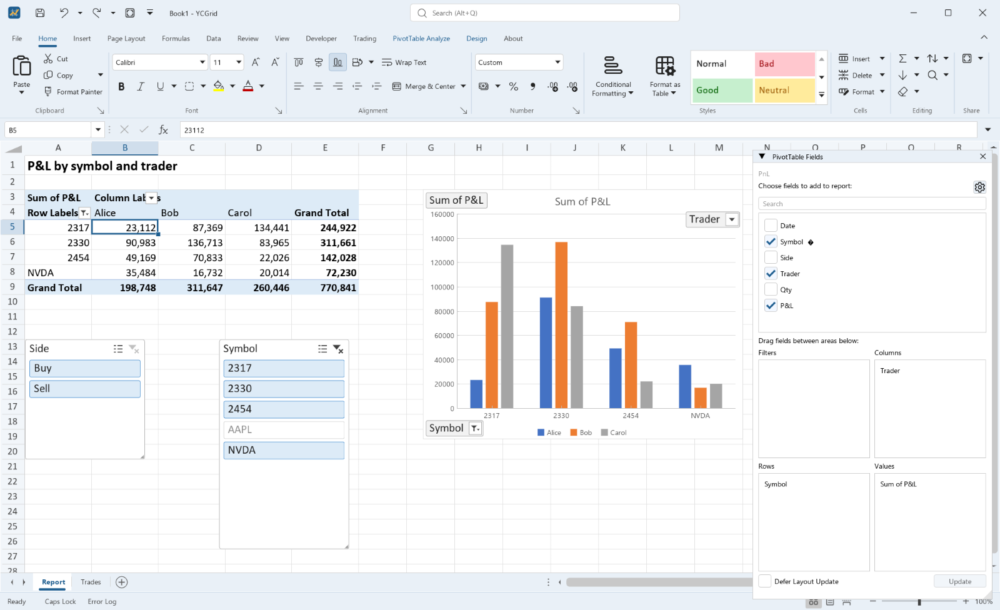

Every command, tab by tab, with its shortcut: [docs/features.md](docs/features.md).

| Area | What you get |
|---|---|
| Interface | The Excel ribbon (Home, Insert, Page Layout, Formulas, Data, Review, View, Developer and contextual tabs, and [YC] Trading), the formula bar, the Name Box, sheet tabs, context menus and Excel's keyboard shortcuts with KeyTips (Alt); Tell Me command search; IME composition inside the cell; English and Traditional Chinese |
| Formulas | 513 Excel functions: every one except `CALL` / `REGISTER.ID` (code in DLLs), `EUROCONVERT` (an add-in), `FIELDVALUE` (Microsoft's linked data types), `COPILOT` (Microsoft's cloud) and the `CUBE*` functions (no Data Model). Dynamic arrays (`FILTER`, `SORT`, `UNIQUE`, `SEQUENCE`...), `LET`, `LAMBDA` (`MAP`, `REDUCE`, `SCAN`...), `XLOOKUP`, `GROUPBY` / `PIVOTBY`, `REGEX*`, `WEBSERVICE`, `IMAGE`, financial, statistical, engineering and database functions, Chinese `NUMBERSTRING` / `DATESTRING`; `PY` runs in YCGrid's own Python. Structured references (`Table1[Qty]`), 3D references, R1C1, array formulas, iterative calculation |
| Exact numbers [YC] | exact decimals and nanosecond timestamps for market data |
| Formatting | number formats, fonts, fills, borders, merged cells, rotated text, several fonts and superscript / subscript inside a cell; document themes, built-in and custom cell styles; conditional formatting with data bars, color scales and icon sets |
| PivotTables | compact, outline and tabular layouts, filters, Show Values As, grouping of dates and numbers, calculated fields and items, Show Details, slicers, timelines, PivotCharts, `GETPIVOTDATA` |
| Charts | line, column, bar, scatter, area, pie, doughnut, stock, radar, waterfall, histogram, Pareto, box and whisker, treemap, sunburst and funnel charts; 3-D column, bar, line, area and pie charts, surface and contour charts, filled maps (countries, states, provinces, counties; offline); combo charts, trendlines, data labels and error bars (custom amounts too); chart sheets; click a chart element (title, legend, axis, series...) to format or delete it; sparklines; live streaming series |
| Objects | pictures, shapes, text boxes; form controls with macros (OnAction); UserForms written in Python; buttons, combo boxes, check boxes, option and toggle buttons, list boxes, spin buttons, scroll bars; design mode |
| Auditing | trace precedents and dependents, Evaluate Formula, Watch Window |
| Review | spelling (F7), workbook encryption, threaded comments with replies and a Comments pane, notes, sheet and workbook protection, allowed edit ranges |
| Printing | Page Break Preview (drag the page breaks) and Page Layout view, Page Layout tab, page setup, print titles and areas, page breaks, headers and footers, Print Preview, PDF export |
| Analysis | the Analysis ToolPak (regression, t-tests, ANOVA, descriptive statistics, histograms...), Solver and PivotTables, from the ribbon or from Python with Excel's calls |
| Customization | RibbonX: a `customUI.xml` in the project adds your own tabs, buttons and callbacks; Quick Access Toolbar and ribbon display options; context menus extended from Python (`CommandBars`) |
| Windows | several workbooks open at once (each in its own window), New Window and split panes on one sheet, Arrange All, Switch Windows; [YC] sheets pulled out into floating windows, docking containers, layouts saved with the workbook |
| Files | `.ycg` workbooks that every newer version can open (optionally encrypted), a key/value store inside the workbook, AutoRecover; opens Excel `.xlsx` / `.xlsm` and saves a copy as `.xlsx`; CSV and clipboard exchange |

Where YCGrid and Excel differ, the difference is measured in Excel first and either fixed or written down with its
reason ([docs/excel-parity-backlog.md](docs/excel-parity-backlog.md)). `python/tests/test_excel_basics.py` replays
1,699 basic operations measured in Excel and compares every cell's formula, value and format.

## Python, the Excel way

A workbook's Python project lives in its folder, laid out like an Excel macro project:

```
MyBook\
  MyBook.ycg
  main.py            # ThisWorkbook: Workbook_Open, startup code
  sheets\Sheet1.py   # one module per sheet: Worksheet_Change, button _Click...
  modules\*.py       # macros, @udf, @stream, shared code
  feeds\*.py         # data feed processes ([[python.feeds]] in ycgrid.toml)
  ycgrid.toml        # project settings
```

YCGrid starts the Python host when the workbook opens, loads `main.py`, the sheet modules and `modules\`, calls
`Workbook_Open`, and reloads in place whenever a `.py` file is saved. There is no registration step: a function with
Excel's event name in the right module is the handler.

```python
# main.py
from yc.excel import *

def Workbook_Open():
    Range("Quotes!C2:C100").OnChange = OnPrice      # per-cell OnChange [YC]: called only for cells that changed

def OnPrice(Target):
    for c in Target:
        if c.Value > c.Offset(0, 5).Value:          # price above the alert level
            c.Interior.Color = RGB(255, 200, 200)
```

```python
# modules/Module1.py
from yc.excel import *

@udf
def MidPrice(bid: float, ask: float) -> float:      # in a cell: =MidPrice(B2, C2)
    return (bid + ask) / 2

@udf(vectorize=True)                                 # called once per batch of cells with numpy arrays
def Spread(bid, ask):
    return ask - bid

def LoadQuotes():                                    # a macro: Developer → Macros, or a button's OnAction
    ids = Application.Topics.Register(["2330.last", "2317.last"])
    Application.Topics.Push(ids, [1050.0, 210.5])    # cells with =QUOTE("2330.last") update
```

Everything the Excel UI can do, Python can do with the same names: `Workbooks`, `Worksheets`, `Range`, `Cells`,
`ListObjects`, `PivotTables`, `ChartObjects`, `Shapes`, `OLEObjects`, `FormatConditions`, `Validation`, `Names`,
Excel's constants (`xlUp`, `xlSum`...), `WorksheetFunction`, `Application.OnTime`, `MsgBox`. Porting an Excel macro
is mostly adding `.Value` and parentheses ([excel-migration.md](skill/ycgrid-python/references/excel-migration.md)).

Each project runs on its own portable Python 3.12, separate from the system's; a missing package is found and
installed (asking first, or always or never, as `ycgrid.toml` says). Attach VS Code's debugger to the running host
while the window keeps drawing; **Developer → Immediate** is a Python prompt into the open workbook (`print()` and
`Debug.Print` from your code show up there too).

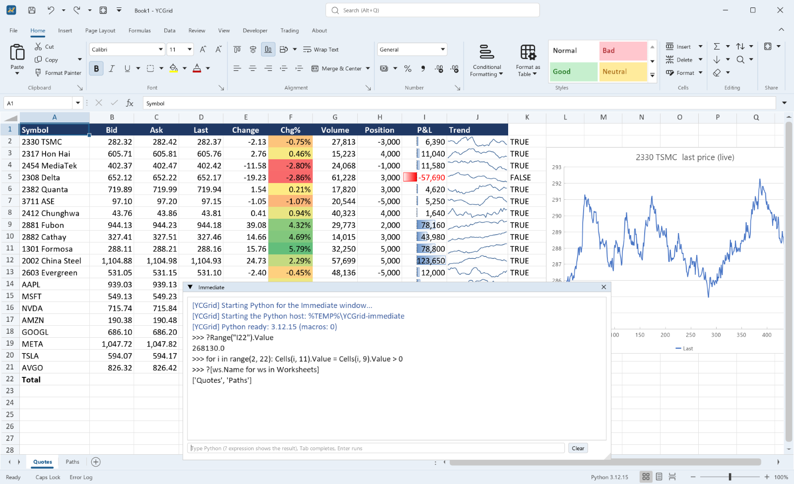

## Trading, with guard rails

A screen that drives real orders needs more than speed, and these come with every workbook
([safety.md](skill/ycgrid-python/references/safety.md)):

- **Parameter cells** (`safety.parameter("Params!B2", type=float, min=0, max=5)`): an orange corner, typed and
  range-checked, changed only by typing in operator mode, confirmed, logged. Pasting, filling and clearing don't
  touch them.
- **Heartbeats** (`safety.heartbeat("TXO feed", timeout=1.0)`) and `stale_after` on tables: when a source stops,
  rows gray out, the whole window is tinted red and a banner names the source and how long ago it stopped.
- **Operator / read-only mode** with a PIN and an idle timeout: read-only refuses every change from the screen while
  Python's writes go on.
- **Kill switch** (Ctrl+Alt+K, the status bar chip, or `safety.kill()`): asks once, runs the handler you registered.
- **Change log** saved in the workbook: parameters, modes, alarms, orders and whatever you `safety.log`.
- **The order manager** refuses what the risk limits forbid, refuses live orders during a replay or outside operator
  mode, and logs every order, cancel, fill and rejection.

## Compared with the alternatives

| | Excel + xlwings / RTD | Perspective, web grids | YCGrid |
|---|---|---|---|
| Spreadsheet (formulas, PivotTables, Solver, ToolPak) | yes | no | yes, Excel's names |
| Live data from Python | COM calls on Excel's UI thread; RTD throttled to 2 s by default | WebSocket streaming | shared memory by key, ~20 ms to the screen |
| Python | a separate process over COM | a server you build | a separate process; the object model has Excel's names |
| Charts of millions of points | no (Excel charts) | depends on the plugin | `yc.plot`, downsampled per pixel |
| Record and replay a session | build it yourself | build it yourself | built in |
| Trading safety (parameters, heartbeats, kill switch) | build it yourself | build it yourself | built in |
| Runs as | Microsoft 365 | a browser and a server | one portable Windows folder, or `pip install` |

## Requirements

| To | You need |
|---|---|
| Run YCGrid | Windows 10 (1903 or later) or Windows 11, 64-bit, with a Direct3D 11 graphics card (any PC from the last ten years). It runs from its folder; nothing else is installed. |
| Write Python for it | Nothing extra: YCGrid runs its own portable Python 3.12, separate from the system Python. Install the packages your code needs with pip. |
| Build screens with an AI agent | VS Code with Claude Code, Codex or GitHub Copilot. **Developer → VS Code** (Alt+F11) sets the project up for them. |
| Build YCGrid from source | Visual Studio 2026 with the C++ tools and the vcpkg package manager (CMake and Ninja come with it), Git, and an internet connection for the first build: vcpkg downloads FreeType, zstd, zlib, pugixml, nlohmann-json and Catch2, and ImGui and ImPlot come as git submodules. `setup.cmd` installs all of it (see below). |

## Getting started

### Use a release

1. Download `YCGrid-<version>.zip` from [Releases](https://github.com/ycgrid/ycgrid/releases), unzip it anywhere and
   run `ycgrid.exe`. Nothing is installed and the registry is not touched.
2. Optional: run `install.cmd` so double-clicking a `.ycg` file opens YCGrid, with YCGrid on the desktop and in the
   Start menu (current user only, no administrator needed; `install.cmd /nodesktop` leaves the desktop out).
   `uninstall.cmd` removes it.
3. Open a workbook in the `examples` folder (`examples\backtest_report\backtest_report.ycg`, ...) for a complete
   screen to explore; **Developer → VS Code** turns the workbook into a project for you or your agent.

YCGrid is not code-signed yet, so Windows SmartScreen may say "Windows protected your PC" the first time
`ycgrid.exe` runs: choose **More info**, then **Run anyway**. Each file on the release page has a `.sha256` file next
to it; compare it with what Windows computes for your download:

```bat
certutil -hashfile YCGrid-<version>.zip SHA256
```

### Install with pip

For people who use their own Python (a venv or conda environment with their libraries). The wheel is on each release
page next to the zip; it holds `ycgrid.exe` but no Python, and YCGrid's Python host runs on the Python that installed it.

```bat
pip install ycgrid-<version>-py3-none-win_amd64.whl     :: from Releases, or built by scripts\build_wheel.cmd
ycgrid                                                  :: start YCGrid; its Python host uses this Python
ycgrid examples\backtest_report\backtest_report.ycg  :: open an example (the examples folder of the zip)
python -m yc run my_research.py                        :: run a script connected to YCGrid
```

In tests and CI, `yc.launch(hidden=True)` starts a YCGrid without a window; check it with `yc.ui.state()` and
`yc.ui.screenshot()`.

### Build from source

**One step:** in the repository folder, run `setup.cmd`. It installs what is missing with winget, asking first: Git,
and the Visual Studio 2026 Build Tools with the C++ tools and vcpkg. Then it fetches ImGui and ImPlot at the pinned
commits, sets up YCGrid's Python, builds and tests YCGrid, and installs it for the current user (desktop and Start menu
shortcuts and the `.ycg` file association, no administrator rights). `setup.cmd /noinstall` stops after the build; `/yes` installs
without asking. No Git yet? Download the source as a zip from GitHub (**Code → Download ZIP**) and run `setup.cmd`
in it.

```bat
git clone https://github.com/ycgrid/ycgrid.git YCGrid
cd YCGrid
setup.cmd
```

**Step by step**, with Visual Studio and Git already installed:

```bat
git clone --recursive https://github.com/ycgrid/ycgrid.git YCGrid
cd YCGrid
scripts\setup_runtime.cmd          :: portable Python 3.12 for development (build\runtime)
scripts\build.cmd release          :: configure, build, run the unit tests, stage dist_release\
dist_release\ycgrid.exe
```

**Rebuild and install a new version:** double-click `build_release.cmd` in the repository folder. It builds
YCGrid, runs the unit tests, lays the result out in `dist_release\` and opens that folder; close YCGrid and
double-click `install.cmd` there to install the new version for the current user (an install over an older one
replaces it, keeping the packages you installed and your changes to the examples).

`scripts\package.cmd --with-python` builds a release zip that includes Python. All build and packaging scripts
are plain `.cmd` files.

Tests:

```bat
scripts\build.cmd release /silent    :: the C++ unit tests (Catch2) run as part of the build
scripts\check_all.cmd /quick         :: build, unit and Python tests, translations, command coverage, boundary
scripts\check_all.cmd                :: everything a commit needs: also the UI sweep, the feature checks, a timed trader session
cd python
..\dist_release\runtime\python\python.exe -E -s -m unittest tests.test_core    :: one Python test module
```

The Python tests drive hidden YCGrid instances and read their own screenshots; `check_all.cmd` runs its slow parts
side by side. [CONTRIBUTING.md](CONTRIBUTING.md) says which tests a change needs.

Before a release, `scripts\check_boundary.py --history` checks the tracked files and everything the published
branches ever committed for credentials, internal addresses and other things that must stay private.
[docs/releasing.md](docs/releasing.md) has every step of a release.

## Documentation

| Document | Contents |
|---|---|
| [docs/quant-guide.md](docs/quant-guide.md) | from research to trading on one screen: data, backtests, walk-forward, live paper trading, execution, risk, replay, agents |
| [docs/features.md](docs/features.md) | every feature, tab by tab: commands, panes, shortcuts, command line |
| [docs/YCGRID_PLAN.md](docs/YCGRID_PLAN.md) | the main specification: architecture, performance targets, hard rules, milestones |
| [docs/adr/](docs/adr/) | architecture decisions that changed the PLAN |
| [skill/ycgrid-python/SKILL.md](skill/ycgrid-python/SKILL.md) | writing Python for YCGrid (also the skill AI agents load) |
| [skill/ycgrid-python/references/object-model.md](skill/ycgrid-python/references/object-model.md) | the full Python object model |
| [skill/ycgrid-python/references/data-binding.md](skill/ycgrid-python/references/data-binding.md) | live tables from DataFrames, recording and replay |
| [skill/ycgrid-python/references/plot.md](skill/ycgrid-python/references/plot.md) | `yc.plot`: fast plots from Python |
| [skill/ycgrid-python/references/screens.md](skill/ycgrid-python/references/screens.md) | trading screens and research from the pieces, a recipe per screen, examples |
| [skill/ycgrid-python/references/safety.md](skill/ycgrid-python/references/safety.md) | safety for live trading |
| [skill/ycgrid-python/references/events-and-controls.md](skill/ycgrid-python/references/events-and-controls.md) | events, controls, panels, UserForms and the custom ribbon |
| [skill/ycgrid-python/references/excel-migration.md](skill/ycgrid-python/references/excel-migration.md) | porting Excel macros to Python |
| [skill/ycgrid-python/references/ui-coverage.md](skill/ycgrid-python/references/ui-coverage.md) | every UI command and the Python that does the same |
| [skill/ycgrid-python/references/mcp-tools.md](skill/ycgrid-python/references/mcp-tools.md) | the MCP tools for AI agents |
| [docs/ROADMAP.md](docs/ROADMAP.md) | the trading platform roadmap and its status |
| [docs/benchmark.md](docs/benchmark.md) | benchmarks and how to reproduce them |
| [docs/settings.md](docs/settings.md) | global settings (`settings.json`), project settings (`ycgrid.toml`), environment variables |
| [docs/ycg-format.md](docs/ycg-format.md) | the `.ycg` file format |
| [docs/releasing.md](docs/releasing.md) | how a version is built, checked and published (the zip, the wheel, their checksums) |
| [AGENTS.md](AGENTS.md) | rules for contributors and AI agents |

## Left out by design

YCGrid goes its own way where Excel depends on Microsoft's file formats or cloud services:

- Excel files: `.xlsx` / `.xlsm` open and a copy can be saved as `.xlsx` with values, formulas and formatting (charts,
  pictures, controls, PivotTables, conditional formatting, data validation and notes stay in the `.ycg`, see
  [ADR 0004](docs/adr/0004-xlsx-import-export.md)). The `.ycg` format is YCGrid's own and complete.
- Get & Transform, the Data Model and co-authoring: Python does the data work (pandas, any database driver), and
  YCGrid builds in what only it has ([ADR 0012](docs/adr/0012-pieces-not-ready-made-screens.md)).

## Compatibility

- **Workbooks:** every YCGrid opens every `.ycg` saved by an older version; tests open, save and reopen a sample of
  every file format version. An older YCGrid opening a newer file keeps the parts it doesn't know and writes them back
  on save, or opens it read-only when it can't ([docs/ycg-format.md](docs/ycg-format.md)).
- **Python:** the object model keeps Excel's names. While the version starts with 0, a minor version (0.x) may change
  a member, and the [changelog](CHANGELOG.md) says what to change in your code.
- **Windows:** Windows 10 (1903 or later) and Windows 11, 64-bit.

## Contributing

Bug reports, fixes and Excel behaviors YCGrid gets wrong are welcome. Read [CONTRIBUTING.md](CONTRIBUTING.md) for
building, testing and what a pull request needs, and "Kept on purpose" and "Not planned" in
[docs/excel-parity-backlog.md](docs/excel-parity-backlog.md) before proposing a feature. Report security problems
privately as described in [SECURITY.md](SECURITY.md). Everyone taking part follows the
[Code of Conduct](CODE_OF_CONDUCT.md).

## Support YCGrid

YCGrid is free and open source. If you find it useful, you can support its development with a donation to one of
these addresses:

| Coin | Address |
|---|---|
| **BTC** (Bitcoin) | `bc1q4gcj9n0hamvmv9ky6yyscv0wwctvc9zzh5rs2a` |
| **ETH** (Ethereum) | `0x183ca8C1B3a9ed5550b5911f4DA37Bf93b492fa4` |
| **SOL** (Solana) | `B6GCgHjbkQAVZh2QuPjkfPDybtkxXERZWyntqPjz6Anc` |

Send each coin only on its own network (BTC on Bitcoin, ETH on Ethereum, SOL on Solana); coins sent on another
network may be lost. Thank you!

## License

[Apache License 2.0](LICENSE). See [NOTICE](NOTICE) and [THIRD-PARTY-NOTICES.md](THIRD-PARTY-NOTICES.md) for the
third-party components and their licenses; a release carries them in its `licenses\` folder.

## Trademarks

Microsoft, Excel and Office are trademarks of the Microsoft group of companies. YCGrid is an independent project; it is
not affiliated with, endorsed by or sponsored by Microsoft. Excel's names are used only to describe compatibility, and
no Microsoft Office icons, images or other proprietary assets are used. Python is a trademark of the Python Software
Foundation; other names and marks are the property of their owners. Company names and stock codes in the examples are
sample data with simulated prices.
