# YCGrid

**YCGrid 是一套用起來跟 Excel 一樣、跟得上即時盤面（每秒超過一百萬次儲存格更新，畫面仍以螢幕的完整更新率流暢顯示）、
由 Python 驅動的試算表，所以 AI agent 能把你描述的任何交易或研究畫面做出來，又快又經過測試，你也還能像改一般工作表一樣
自己動手改。**

**你完全不需要會寫程式。** 跟 Claude Code、Codex 或 GitHub Copilot 說你想看到什麼，它就在 YCGrid 裡把畫面做出來，並在
執行中的視窗裡驗證：報價介面、搭配即時圖表的看盤介面、統計分析、回測與損益，或任何你說得出來的畫面。AI 用 YCGrid
的積木把畫面組起來（走共享記憶體的即時表格、一千萬點的圖表、錄製與重播、含風控限額與緊急停止的下單路徑），速度與穩定
由這些積木負責，所以它做出來的每個畫面都跑在同一套快速、經過測試的引擎上，而不是臨時寫出來的程式。

[English](README.md) · [變更紀錄](CHANGELOG.md) · [參與貢獻](CONTRIBUTING.md) · [贊助 YCGrid](#贊助-ycgrid)

[](https://github.com/ycgrid/ycgrid/actions/workflows/checks.yml)
[](https://github.com/ycgrid/ycgrid/releases/latest)
[](LICENSE)


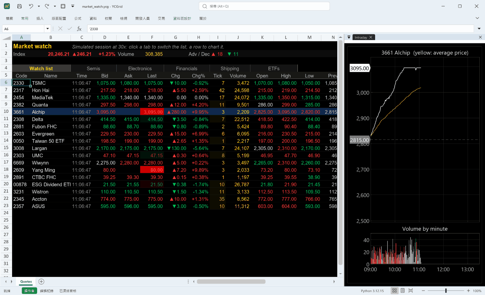

- **如果你每天用 Excel：** YCGrid 看起來、用起來都一樣。功能區、資料編輯列、快速鍵、513 個函數、樞紐分析表、圖表、
  條件式格式，而且直接開你的 `.xlsx`。
- **如果你寫 Python：** 用 Excel 的物件模型操控它（`Range("A1").Value`、`Worksheet_Change`、`Cells(i, 2)`），
  程式跑在獨立行程裡，可以當掉、停在中斷點、整個換掉，試算表都不受影響。一個 pandas DataFrame 一行就變成即時表格。
- **如果你在跑交易系統（高頻交易 HFT、造市、程式交易）：** YCGrid 就是它的交易畫面。走共享記憶體的即時表格，從
  Python 到螢幕的延遲中位數最低 12 ms，推送永遠不會卡住你的引擎；含風控限額的委託管理器、心跳與緊急停止把關畫面送出的
  每一筆單。你的微秒級路徑留在它自己的行程裡，YCGrid 負責顯示它的報價、委託與部位。
- **如果你做研究（量化研究 UI）：** 一千萬點的圖表、回測報告、參數掃描、整段盤勢的錄製與重播、分析工具箱與規劃求解、
  pandas 直接溢出到儲存格。全部都是讓你自己組合的積木；畫面與數學仍是你的。
- **如果你和 AI agent 一起工作（AI 產生的 UI）：** YCGrid 內建 Claude Code、Codex 或 GitHub Copilot 需要的 skill 與
  MCP 工具，一句話就讓它替你產生整個畫面，並在執行中的視窗裡驗證。一鍵（**開發人員 → VS Code**）就把專案設好。

## 用 YCGrid 做出來的畫面

下面每一張圖都是一張工作表：儲存格、格式、公式與表格，圖表停靠在旁邊。每一張都是可以打開、閱讀、修改的範例專案
（模擬資料、模擬交易所）；更多範例在[大家用它做什麼](#大家用它做什麼)。

**多檔行情報價**（`market_watch`）：依昨收紅綠上色、漲跌帶箭頭、漲跌停反白、分類分頁切換清單，旁邊是選取個股的分時
走勢與成交量。

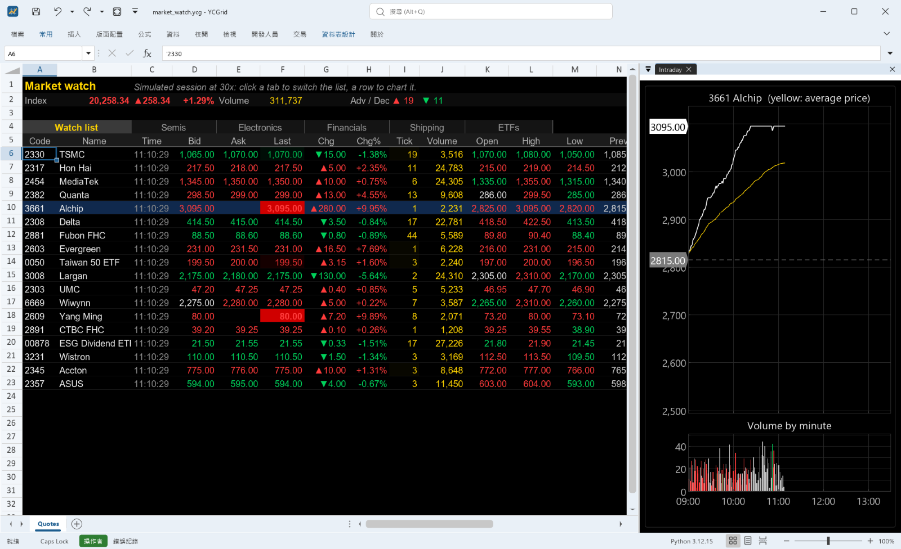

**選擇權 T 字報價**（`option_chain`）：買權｜履約價｜賣權，價內區塊上色、價平履約價高亮、到期月份分頁；各到期月份的
波動率微笑與各履約價的未平倉量。

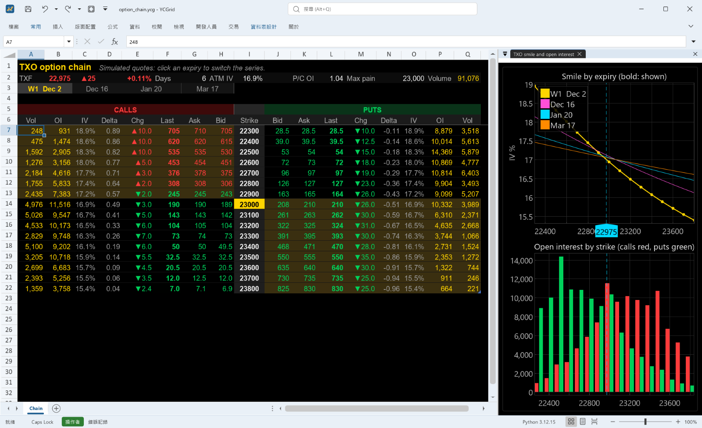

**技術分析圖**（`technical_chart`）：日 K 線加均線與布林通道、成交量、MACD、KD 四張連動的圖；在表格點一天，圖上就標出
那一天。

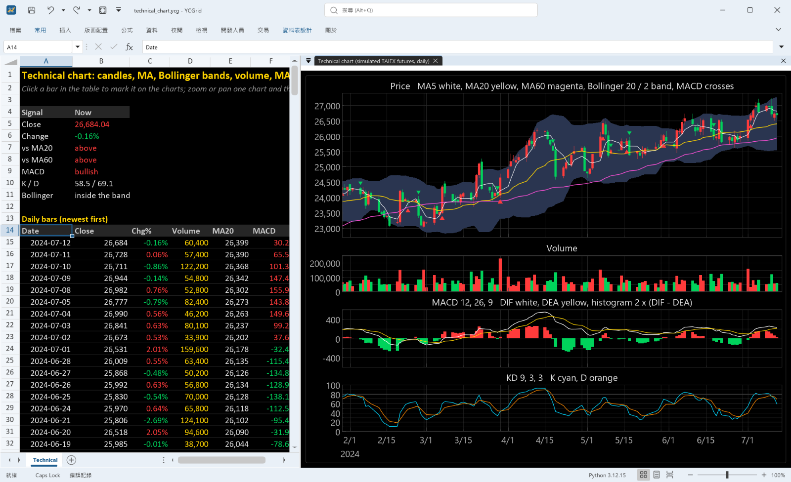

**自己做的下單介面**（`trading_desk`）：報價清單、下單按鈕、點價下單、部位與成交回報，旁邊的即時 K 線標出每一筆成交
與持倉均價。

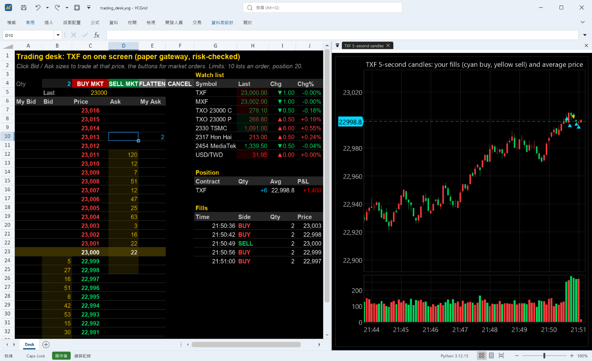

## 它解決什麼問題

交易員或研究員的畫面本質上就是一張試算表：一格一格的數字，有的手打、有的算出來、有的一秒跳好幾次。市面上沒有一樣工具
把這三件事同時做好。

- **Excel** 是大家都會的格子，但即時資料只能透過 COM 從它的 UI 執行緒進去，RTD 預設還節流兩秒。幾百格在跳，視窗就卡。
- **網頁儀表板**（Perspective、Grafana、React 表格）串流很行，但它們不是試算表：不能在格子裡打公式、沒有樞紐分析、
  沒有規劃求解，不會寫程式的人在座位上什麼都改不了。
- **Python 繪圖與 notebook** 做研究很好，但 notebook 不是你盯一整天的畫面，而且 matplotlib 重畫一條一千萬點的線要
  61 ms。

YCGrid 是一個原生的 Windows 試算表（C++20、Dear ImGui、ImPlot、Direct3D 11），核心從第一行程式就是為即時資料設計的：
**單一寫入者、不可變的快照、成本只跟「變了什麼」和「看得到什麼」成正比**。Python 從外面操控它，所以你的程式、你的套件、
你的 agent 都留在原地。

## 它怎麼運作

```
         your Python, in its own processes                         ycgrid.exe (C++20)
 ┌───────────────────────────────┐                  ┌──────────────────────────────────────────────┐
 │ main.py, sheets/, modules/    │ Excel object     │  Engine thread: the only writer              │
 │ (events, macros, UDFs)        │ model over a     │   · cells, formulas, the dependency graph    │
 │                               │ ──── pipe ─────▶ │   · recalculates only what changed, on all   │
 │ feeds/*.py (market data)      │ ◀── events ───── │     cores                                    │
 │                               │                  │   · publishes an immutable snapshot every    │
 │ scripts, notebooks, agents    │ shared memory    │     16–100 ms (you choose)                   │
 │ (yc.connect())                │ ── tables, ────▶ │                      │                       │
 │                               │ topics, plots    │                      ▼                       │
 └───────────────────────────────┘                  │  UI thread: ImGui + ImPlot on Direct3D 11    │
                                                    │   · reads the snapshot, never waits on a     │
                                                    │     lock, Python or a recalculation          │
                                                    │   · draws only the visible cells, ~0.4 ms    │
                                                    └──────────────────────────────────────────────┘
```

左邊是你的 Python，各自在自己的行程裡：`main.py`、`sheets/`、`modules/`（事件、巨集、UDF）、`feeds/*.py`（行情）、
以及任何用 `yc.connect()` 連上來的腳本、notebook 或 agent。它們透過具名管道走 Excel 物件模型、接收事件，表格、主題與
圖表資料則走共享記憶體。右邊是 `ycgrid.exe`：引擎執行緒是唯一的寫入者，管儲存格、公式與相依圖，只重算有變動的部分並用上
所有核心，每 16–100 ms（你決定）發布一份不可變的快照；UI 執行緒（ImGui + ImPlot，Direct3D 11）只讀快照、從不等待鎖、
Python 或重算，而且只畫看得到的儲存格，一個畫格約 0.4 ms。

四個原則解釋了大部分的設計：

1. **單一寫入者、不可變快照。** 只有引擎執行緒會改動活頁簿。每 16–100 ms 它發布一份快照；UI 和每個 Python 讀取端看到
   的都是同一個時間點（同一列的買價與賣價絕不會一新一舊），UI 也永遠不必等任何人。
2. **以最新值為準。** 行情資料是「合併」而不是「排隊」：每個主題只保留最後一個值，所以行情爆量時沒有積壓要追。
   推送端永遠不會被卡住。
3. **成本跟著變動走，不跟著工作表走。** 重算只走相依圖裡髒掉的部分，而且平行處理。繪圖只花看得到的儲存格的成本，
   底下的一百萬列不算錢。閒置就真的閒置：沒有東西在變時，YCGrid 每秒只畫約一個畫格。
4. **Python 是鄰居，不是房客。** 你的程式跑在自己的行程（要幾個都行），透過具名管道和共享記憶體對話。當掉、中斷點、
   重新載入，試算表照常運作；你在旁邊偵錯策略時，資料源行程仍持續推送。

## 60 秒看到它動起來

開啟 YCGrid，然後用任何裝有 `yc` 套件的 Python 執行（內建的那個，或 `pip install` wheel 之後你自己的）：

```python
# board.py
import time
import numpy as np, pandas as pd
import yc
from yc.excel import *
from yc import plot

yc.connect()                                            # 連上執行中的 YCGrid（yc.launch() 會啟動一個）
ws = Worksheets.Add(Name="Board")

# 1. 一個 DataFrame 變成一張由 Python 依鍵值更新的表格
syms = ["TXF", "MXF", "2330", "2317"]
px = np.array([23000.0, 23000.0, 1050.0, 210.5]); base = px.copy()
board = ws.bind(pd.DataFrame({"Symbol": syms, "Last": px, "Change": 0.0}),
                key="Symbol", name="Board", at="A1",
                formats={"Last": "#,##0.0", "Change": "+0.00%;-0.00%"},
                flash=["Last"], stale_after=3)          # 漲跌閃色；資料源停了列會變灰

# 2. 儲存格與公式，用 Excel 的名稱
ws.Range("E1").Value = "Average move"
ws.Range("E2").Formula = "=AVERAGE(Board[Change])"      # 表格一變就重算
ws.Range("E2").NumberFormat = "0.00%"

# 3. 一張獨立視窗的即時圖表
fig = plot.figure("TXF", theme="dark")
line = fig[0].line([], [], label="TXF", capacity=100_000)
fig[0].set(time=True, follow=60)                        # x 軸顯示最近 60 秒

# 4. 串流（這裡用模擬）：只有變動的列會走共享記憶體送出
rng = np.random.default_rng()
while True:
    px *= 1 + rng.normal(0, 0.0005, len(px))
    board.update({"Symbol": syms, "Last": px, "Change": px / base - 1})
    line.append([time.time()], [px[0]])
    time.sleep(0.1)
```

你會看到：一張工作表上有四列的表格，價格每秒閃紅閃綠十次；旁邊一個公式每次更新都重算；一個深色的圖表視窗跟著 TXF 走；
你把腳本停掉，列會變灰、整個視窗轉紅，並出現橫幅寫出是哪張表（表格設了 `stale_after=3`）。畫面上每樣東西都是普通的試算表物件：你可以排序這張表、
加一欄 `=[@Last]*2`、套條件式格式、在上面建樞紐分析表。把隨機漫步換成券商 API，它就是一個報價看板。

不想自己寫？開啟活頁簿，按 **開發人員 → VS Code**，然後告訴你的 agent：

> 「把選擇權報價串流進一張含 Greeks 的 T 字報價表，價內履約價上色，再加一個送出模擬單的按鈕。」·「用 `data\`
> 裡的 CSV 檔回測這個均線策略，掃描兩個參數並畫出權益曲線。」·「用 Sheet1 的選擇權報價建一個即時更新的波動率曲面。」

## 把即時資料送進儲存格：挑對工具

方法不只一種，因為畫面各有不同。先記住兩個概念：**主題（topic）**是一個有名字的即時值（`"2330.last"` 是台積電的成交價）；
**綁定表格**是一張 Python 用鍵值欄找到每一列的表格。

| 你手上有 | 寫法 | 發生什麼事 |
|---|---|---|
| 以代號、履約價或委託單號為鍵、經常變動的多列資料 | `t = ws.bind(df, key="Symbol", formats=..., flash=...)`，之後 `t.update(changed_rows)` | 一張真正的表格（ListObject），每欄有格式、閃色與過期變灰；只有變動的鍵與欄會走共享記憶體送出，每秒數千萬格。公式、圖表、樞紐分析表把它當一般表格用。綁定會隨活頁簿儲存。 |
| 幾個要讓公式跟著反應的即時值 | 儲存格寫 `=QUOTE("2330.last")`；資料源做 `ids = Application.Topics.Register(["2330.last"])` 和 `Application.Topics.Push(ids, [1085.0])` | 做對了的 Excel RTD：推送不阻塞、以最新值為準、所有相依公式都重算。 |
| 一大片單值的看板，不需要公式 | `Range("B2:D1001").BindTopics(ids)`，ids 的形狀和範圍一樣 | 每次推送直接寫進儲存格，零公式成本：每秒一百萬次以上的儲存格更新。綁定是執行期狀態，所以在 `Workbook_Open` 裡再綁一次。 |
| 一份報表、一個快照、一個想看的 DataFrame | `Range("A2:F1001").Value = rows` 或 `ws.write_frame(df)` | 普通儲存格。走管道每秒 280 萬格；走共享記憶體一百萬格約 0.1 秒。 |
| 每一筆 tick 都要給你的 Python 處理（組 K 棒、記錄） | 在 host 裡 `Application.Topics.Subscribe(names, on_tick)` | 每筆更新依序、成批、在訂閱自己的執行緒上交給你；`Conflate=True` 則每個主題只給最新值。 |

資料從哪裡來？從**資料源行程**：放在 `feeds\` 底下、在 `ycgrid.toml` 登記的腳本：

```toml
[[python.feeds]]
name = "market"
script = "feeds/market.py"
restart = "always"
```

YCGrid 隨活頁簿啟動它們、結束就重啟，並傳入 `YCGRID_PID` 讓 `yc.connect()` 找到正確的視窗。它們跑在 Python host 之外，
所以資料源永遠不會跟你的事件搶 GIL，host 重新載入或停在中斷點時仍持續推送。YCGrid 本身不附任何券商連線：`yc.feeds.Feed`
（合併、心跳、重連）和 `yc.trading.Gateway` 是你包在券商 SDK 外面要實作的介面，所有範例與範例專案都跑在內建的
模擬器（`yc.sim.Market`）上。

## 大家用它做什麼

下列每一個畫面都是 [`examples`](examples/README.md) 裡的一個專案（發行的 zip 裡也有）：開啟
`examples\<名稱>\<名稱>.ycg`，它的 `Workbook_Open` 就用這些積木建出畫面，資料為模擬。讀最接近你需求的那個範例的
原始碼；它們是拿來複製的程式，不是 API。

| 畫面 | 研究 | 資料 |
|---|---|---|
| `market_watch`：看盤軟體風格的多檔行情，分類分頁與選取個股的分時走勢 | `technical_chart`：K 線、均線、布林通道、成交量、MACD 與 KD，和表格裡的日 K 連動 | `million_cells`：一百萬個即時儲存格 |
| `option_chain`：T 字報價、到期月份分頁、各到期月份的波動率微笑與各履約價未平倉量 | `backtest_report`：統計數字、帶色階的月報酬、交易清單、含買賣標記的 K 線、與表格連動的權益與回撤 | `big_data`：數千萬列在 C++ 排序篩選的資料檢視 |
| `trading_desk`：報價清單、下單按鈕、價格階梯、部位與成交回報加即時 K 線，全在一張工作表 | `strategy_lab`：參數掃描熱圖、樣本外檢驗、walk-forward | `tick_replay`、`history_playback`：把歷史檔播進畫面，可暫停、拖曳 |
| `options_desk`：即時報價上的鐵兀鷹策略、到期與當下損益、Greeks、現貨 x 波動率情境表 | `factor_research`、`pairs_trading`、`portfolio_optimizer`、`monte_carlo_var` | `live_candles`：用 `yc.bars` 把 tick 組成 5 秒 K 棒 |
| `dom_ladder`：價格階梯，點擊下單，自己的委託顯示在上面 | `vol_surface`：由選擇權報價即時更新的 3D 曲面 | `time_machine`：錄下一切、重播、釘住一個時刻、比較 |
| `quote_board`：每個畫格自己畫量條、漲跌條、成交量熱度與走勢線的表格欄位 | `option_payoff`、`risk_dashboard` | `quick_plot`：一千萬點、一百萬筆的直方圖 |
| `order_flow`、`depth_heatmap`：footprint 儲存格與價格／時間座標的深度熱圖 | `py_cells`：`=PY("x.describe()", A1:C200)` 把 pandas 溢出到儲存格 | |
| `execution_algos`：TWAP 與冰山單，各是十行的類別，掛在委託管理器上 | | |
| `live_strategy`：回測用的那條規則，從即時 K 棒做模擬交易 | | |

| | |
|---|---|
| 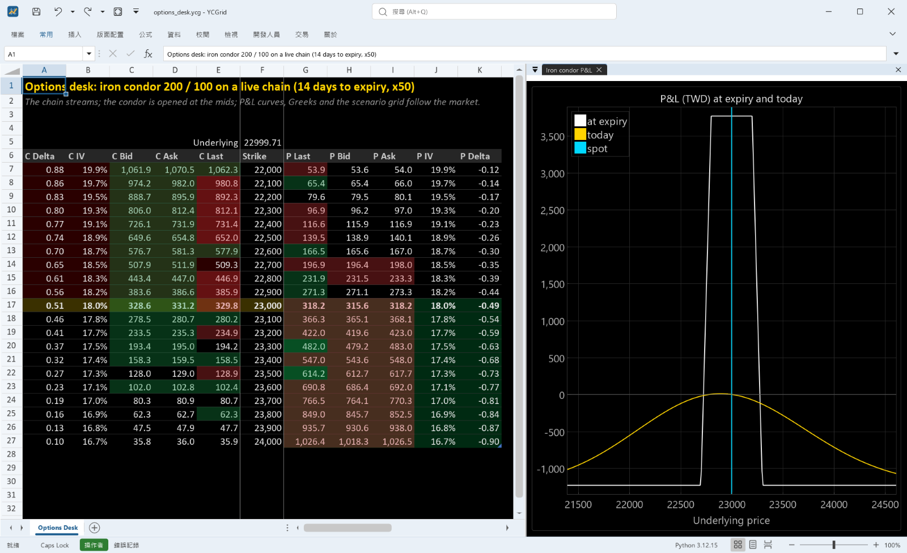 **選擇權策略台**：用即時報價計價的策略 | 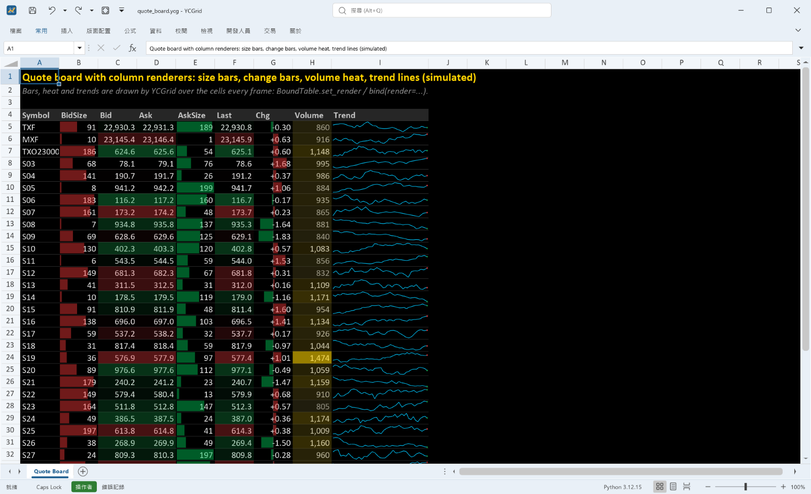 **報價看板**：每個畫格畫出量條、漲跌條、成交量熱度與走勢線 |
| 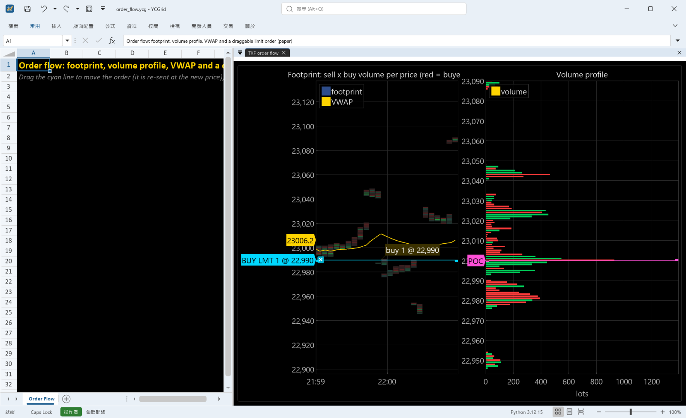 **訂單流**：footprint、VWAP 與成交量分布 | 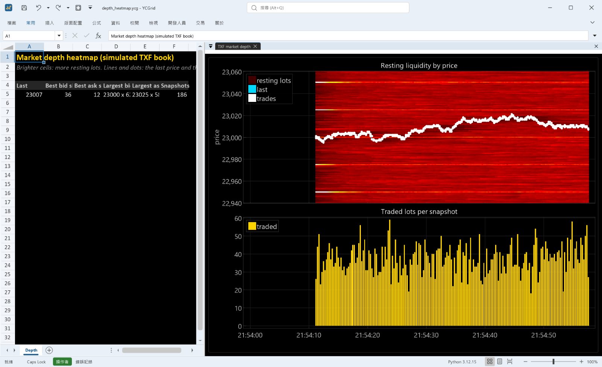 **市場深度**：各價位掛單量隨時間的變化 |
| 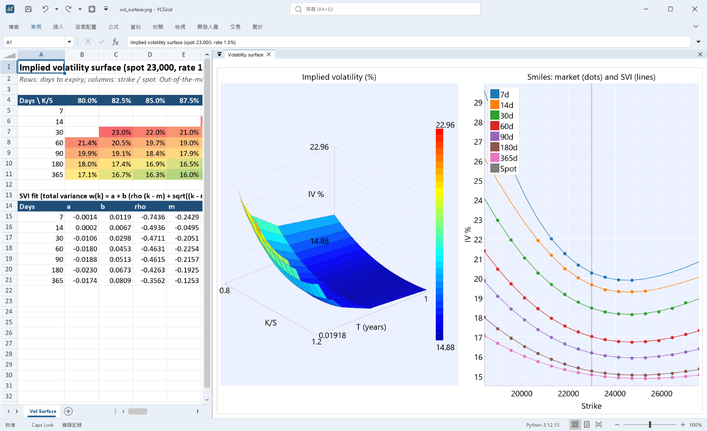 **波動率曲面**：隱含波動率，每個到期月份擬合 SVI | 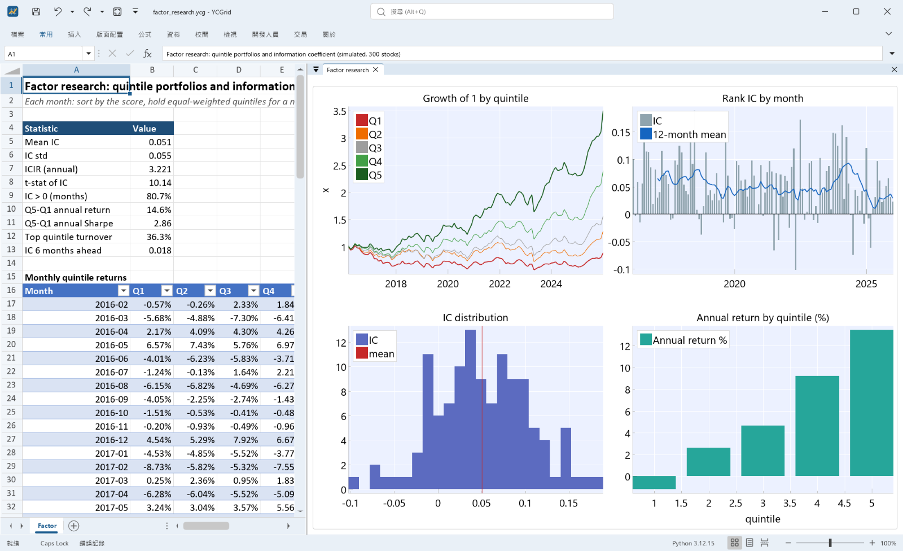 **因子研究**：五分位投組與資訊係數 |
| 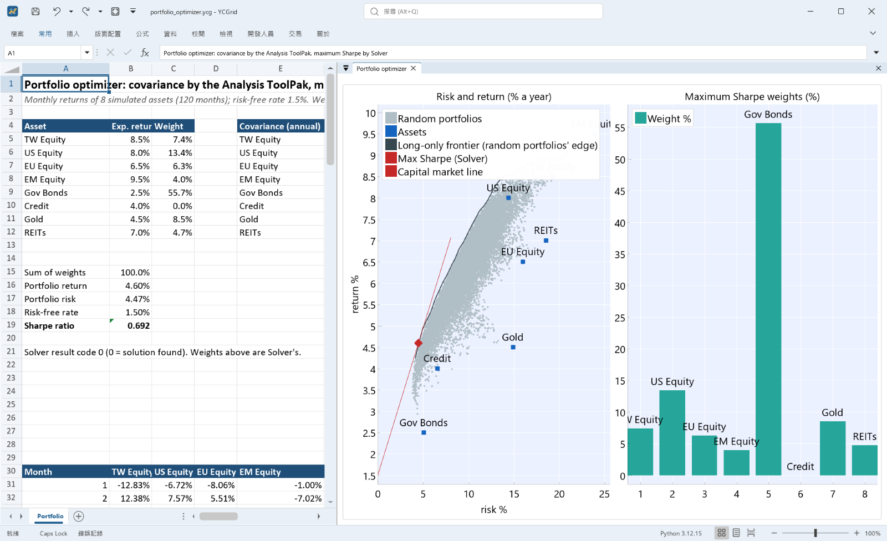 **投資組合最佳化**：效率前緣與規劃求解算出的最大夏普權重 | 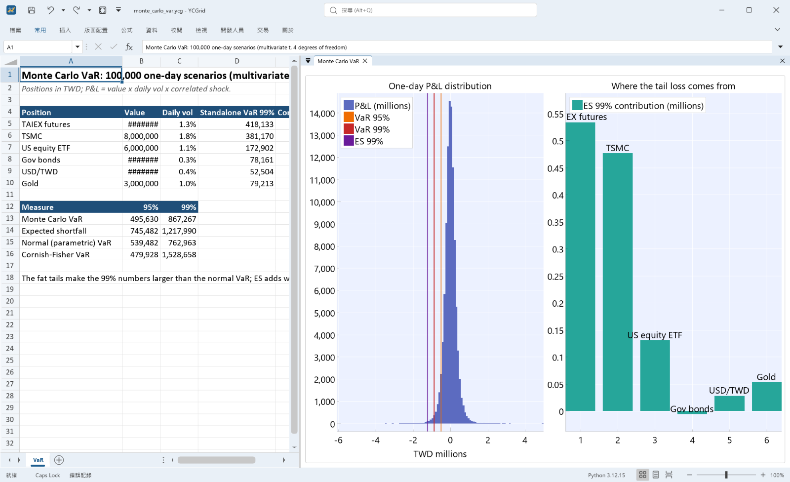 **蒙地卡羅 VaR**：十萬個情境、VaR 與尾端損失的來源 |
| 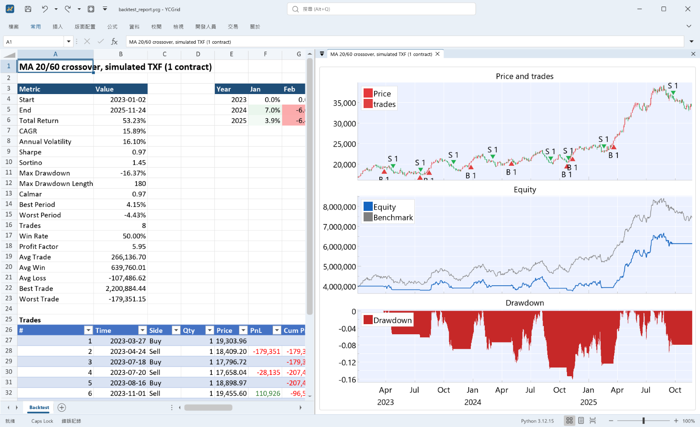 **回測報表**：統計、月報酬、與圖表連動的交易清單 | 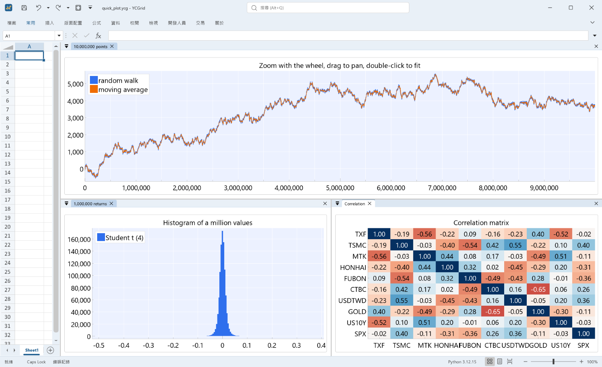 **快速繪圖**：一千萬點、一百萬筆的直方圖、相關係數熱圖 |

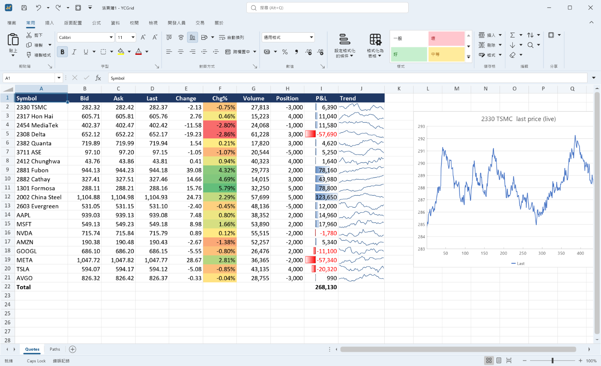

這些畫面用的積木如下。每一塊之所以存在，是因為它需要 C++ 那一側（繪製、資料通道、引擎），或是需要一種疊在上面的 Python
給不了的保證：

| 積木 | 給你什麼 |
|---|---|
| 綁定表格（`ws.bind`） | 依鍵值更新的即時列、每欄格式、閃色、過期列、欄位渲染器（每個畫格畫在儲存格上的量條、熱度、走勢線） |
| `yc.plot` | matplotlib 風格的呼叫，由 ImPlot 繪製：折線、K 線、買賣標記、散佈、直方圖、熱圖、3D 曲面；一千萬點以完整畫格率平移縮放；即時 `append` 加 `follow`；可拖曳的線與點、click / hover / select 事件、連動十字線、和表格目前列連動的圖 |
| 主題 | 從任何行程或執行緒推送的具名即時值；`=QUOTE()`、`BindTopics`、`Subscribe` |
| 單格 `OnChange` 與 `Worksheet_LiveChange` | 只為有變動的儲存格呼叫 Python，或每個發布週期為即時資料呼叫一次 |
| `yc.replay` | 錄下送進表格與主題的每一個畫格；以 0.25x–50x 重播進同一個畫面，可暫停、拖曳、釘住、比較；重播期間即時資料被忽略，所以策略一行不改就能跑在昨天的盤上 |
| `yc.trading` | 含 `RiskLimits`（數量、部位、價格帶、頻率）的 `OrderManager`、`on_order` / `on_fill` 回呼、`PaperGateway`、給你券商用的 `Gateway` 介面 |
| `yc.safety` | 參數儲存格（型別、範圍檢查、確認、記錄）、逾時就把視窗轉紅的心跳、資料過時警報、含 PIN 的操作／唯讀模式、緊急停止（Ctrl+Alt+K）、存在活頁簿裡的變更紀錄 |
| `yc.interact`、`yc.alerts` | 範圍上的點擊動作與熱鍵（點擊下單）、會上色、響鈴並呼叫 Python 的門檻警示 |
| `yc.data.view`、`Axes.plot_files` | 數千萬列或點，不經過儲存格 |
| `=PY()` | 在儲存格裡跑 Python，溢出一個 DataFrame |
| 面板、UserForm、浮動工作表、停駐、儲存的版面 | 一個交易桌的視窗配置，由程式重建並隨活頁簿儲存 |

括弧單、OCO 群組、損益報表、交易日誌、掃描器與整個畫面，都是你在這些積木上加幾行就有的東西，YCGrid 刻意不內建
（[ADR 0012](docs/adr/0012-pieces-not-ready-made-screens.md)）：agent 幾分鐘就寫得出來，而畫面要怎麼排是你的事。

## 為什麼這麼快：從設計上就是低延遲（Low Latency）

下面的數字都來自上面的設計：用快照而不是鎖、合併而不是排隊、只畫看得到的。測試環境：Intel Core Ultra 9 285HX
（24 核心）、NVIDIA RTX PRO 5000 Blackwell 筆電 GPU、64 GB 記憶體、Windows 11、120 Hz 螢幕、Release 建置、1600×977
視窗（可見 704 個儲存格）。

**依鍵值綁定的即時表格**（`ws.bind(df, key=...)`，走共享記憶體，以 [`scripts/bench.py`](scripts/bench.py) 實測）：
一百萬個儲存格（100,000 列 × 10 欄），發布間隔 16 ms，由另一個行程送出 numpy 更新。延遲是從 Python 送出資料，到畫面
顯示該資料的那個畫格為止。

| 負載 | 每秒寫入儲存格 | Python → 畫面 p50 / p99 | FPS |
|---|---:|---:|---:|
| 每次更新 1% 的列，每秒 500 次 | 5,500,000 | 12 / 32 ms | 96 |
| 每次更新 10% 的列，每秒 100 次 | 11,000,000 | 21 / 40 ms | 94 |
| 整張表，每秒 20 次 | 22,000,000 | 41 / 59 ms | 61 |
| 整張表，全速推送 | 45,000,000 | 89 / 121 ms | 70 |

**報價看板上的主題**（[`scripts/stress_realtime.py`](scripts/stress_realtime.py)）：每檔商品有 5 個即時的 `=QUOTE()`
儲存格（買價、賣價、成交價、成交量、漲跌）和 4 個相依公式（價差、中價、損益、漲跌幅），另有合計、色階與資料橫條。
行情由另一個行程以最快速度推送，每種情境測 8 秒。

*200 檔：每個 tick 1,000 個即時儲存格，共 1,801 個公式*

| 情境 | 儲存格更新／秒 | 畫面顯示新資料／秒 | FPS | 每畫格 CPU（平均／p99） |
|---|---:|---:|---:|---:|
| `Topics.Push`，發布間隔 100 ms（預設） | 1,320,000 | 10 | 30 | 0.53 / 0.96 ms |
| `Topics.Push`，發布間隔 16 ms | 1,230,000 | 58 | **120** | 0.41 / 0.60 ms |
| `Topics.Push`，發布間隔 0（每次變更） | 1,220,000 | **120** | **120** | 0.46 / 0.63 ms |
| `Range.Value` 整塊寫入 | 1,950,000 | 61 | **120** | 0.41 / 0.56 ms |
| `Topics.Push`，0 ms，關閉垂直同步 | 1,240,000 | 585 | **616** | 0.38 / 0.55 ms |

*2,000 檔：每個 tick 10,000 個即時儲存格，共 18,001 個公式*

| 情境 | 儲存格更新／秒 | 畫面顯示新資料／秒 | FPS | 每畫格 CPU（平均／p99） |
|---|---:|---:|---:|---:|
| `Topics.Push`，發布間隔 16 ms | 1,180,000 | 32 | 96 | 0.57 / 1.07 ms |
| `Topics.Push`，發布間隔 0（每次變更） | 1,120,000 | 76 | **120** | 0.71 / 1.36 ms |
| `Range.Value` 整塊寫入 | 2,100,000 | 52 | **120** | 0.58 / 0.99 ms |
| `Topics.Push`，0 ms，關閉垂直同步 | 1,160,000 | 116 | **584** | 0.41 / 0.67 ms |

**Python 呼叫**（從另一個行程，經由具名管道）：

| 操作 | 時間 | 速率 |
|---|---:|---:|
| `Range("A1").Value = x` | 0.06 ms | 每秒約 17,000 次 |
| 寫入 1,000 × 10 區塊 | 3.6 ms | 每秒 280 萬格 |
| 讀取 1,000 × 10 區塊 | 5.5 ms | 每秒 180 萬格 |

數字怎麼看：

- **FPS** 是每秒畫出的畫格數。開啟垂直同步時，上限就是螢幕更新率（這台是 120 Hz）。關閉垂直同步時，YCGrid 在每秒承受
  120 萬次儲存格更新的同時，每秒能畫約 600 個畫格。
- **畫面顯示新資料**是實際送上畫面的引擎快照數。200 檔、間隔 0 ms 時，每秒 120 個畫格每一格都是新價格。
  `Application.PublishInterval` 就是那顆旋鈕：0 每次變更都顯示，16 每個畫格一次，100（預設）省 CPU。
- 2,000 檔時，每個 tick 要重算 18,000 個儲存格，約 9 ms；限制新資料上畫面頻率的是計算，不是繪圖。
- 圖表：[`scripts/bench_plot.py`](scripts/bench_plot.py) 傳送 10,000,000 點需 0.47 秒，縮放時每個畫格約 0.7 ms CPU；
  同一條線 matplotlib 每次重繪要 61 ms。

自己跑一次（它會把開啟中的活頁簿換成測試看板，請先存檔，或加上 `--discard`）：

```bat
dist_release\runtime\python\python.exe -E -s scripts\stress_realtime.py --symbols 200 --seconds 8
```

每項基準測試怎麼跑，以及如何和其他工具比較：[docs/benchmark.md](docs/benchmark.md)。

## 生來就是給 AI agent 寫的：由 AI 產生交易與研究 UI

它的 API 很大（完整的 Excel 物件模型、即時資料、繪圖、面板、重播、超過 700 個 UI 指令），不該要求任何人先全部學會才能
做出一個畫面。所以 YCGrid 把 Claude Code、Codex、GitHub Copilot 這類 agent 替你動手所需的一切都附上了：

- **涵蓋全部 API 的 skill。** [`skill/ycgrid-python`](skill/ycgrid-python/SKILL.md)（SKILL.md 加 12 份參考文件）
  記載每個物件、成員、事件與寫法，並列出每一個 UI 指令（功能區按鈕、選單項目、快速鍵）對應的 Python 入口。
  少了任何一個指令，測試就會失敗，所以 UI 能做的每件事，agent 都知道怎麼用 Python 做。
- **看得到、也操作得了執行中程式的工具。** 43 個 MCP 工具（`yc_*`）讓 agent 讀寫儲存格、執行 Python 與巨集、
  查詢 API、在 UI 上點擊與打字，並擷取畫面。它在實際視窗裡驗證成果，而不是用猜的。
- **一鍵就緒。** **開發人員 → VS Code**（Alt+F11）會存檔並建立專案，`AGENTS.md` / `CLAUDE.md`、給 Claude Code、
  Codex 與 GitHub Copilot 的 skill 都已放好，MCP 伺服器也已替 Claude Code 與 GitHub Copilot 設定好。

同一套工具也給你自己的測試用：`yc.launch(hidden=True)` 啟動一個沒有視窗的 YCGrid，`ui.input` 請求
（`yc.connect().request("ui.input", {"script": ...})`，或 MCP 工具 `yc_ui_input`）送出一個人會按的鍵、點擊與拖曳，`yc.ui.screenshot()` 給你他會看到的畫面。

## Excel，你預期會有的那些

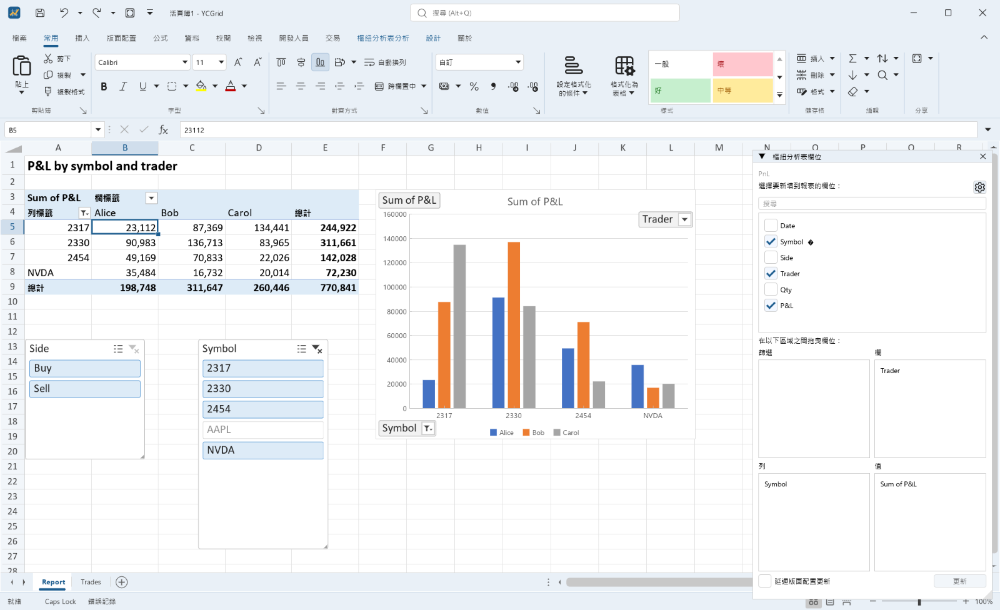

依索引標籤列出每個指令與快速鍵：[docs/features.md](docs/features.md)（英文）。

| 類別 | 內容 |
|---|---|
| 介面 | Excel 功能區（常用、插入、版面配置、公式、資料、校閱、檢視、開發人員與內容索引標籤，以及 [YC] 交易）、資料編輯列、名稱方塊、工作表索引標籤、右鍵選單與 Excel 快速鍵、按鍵提示（Alt）；「告訴我」命令搜尋；輸入法組字直接顯示在儲存格內；英文與繁體中文介面 |
| 公式 | 513 個 Excel 函數：除了 `CALL` / `REGISTER.ID`（呼叫 DLL）、`EUROCONVERT`（增益集）、`FIELDVALUE`（微軟的連結資料類型）、`COPILOT`（微軟雲端）與 `CUBE*` 函數（沒有資料模型）之外全部都有。動態陣列（`FILTER`、`SORT`、`UNIQUE`、`SEQUENCE`…）、`LET`、`LAMBDA`（`MAP`、`REDUCE`、`SCAN`…）、`XLOOKUP`、`GROUPBY` / `PIVOTBY`、`REGEX*`、`WEBSERVICE`、`IMAGE`、財務、統計、工程與資料庫函數、中文的 `NUMBERSTRING` / `DATESTRING`；`PY` 在 YCGrid 自己的 Python 執行。結構化參照（`Table1[Qty]`）、3D 參照、R1C1、陣列公式、反覆運算 |
| 精確數值 [YC] | 精確十進位與奈秒時間戳，適合行情資料 |
| 格式 | 數值格式、字型、填滿、框線、合併儲存格、文字方向旋轉、同一儲存格內多種字型與上標 / 下標；佈景主題、內建與自訂儲存格樣式；條件式格式（資料橫條、色階、圖示集） |
| 樞紐分析表 | 壓縮、大綱、列表式版面，篩選、值的顯示方式、日期與數值群組、計算欄位與計算項目、顯示詳細資料、交叉分析篩選器、時間表、樞紐分析圖、`GETPIVOTDATA` |
| 圖表 | 折線、直條、橫條、散佈、區域、圓形、環圈、股票、雷達、瀑布、長條圖（統計）、柏拉圖、盒鬚圖、矩形式樹狀結構圖、放射環狀圖、漏斗圖；立體直條、橫條、折線、區域與圓形圖，曲面圖與等高線圖，區域地圖（國家、州、省、縣市；離線運作）；組合圖、趨勢線、資料標籤與誤差線（含自訂誤差量）；圖表工作表；點選圖表項目（標題、圖例、座標軸、數列…）即可設定格式或刪除；走勢圖；即時串流數列 |
| 物件 | 圖片、圖形、文字方塊；可指定巨集的表單控制項；以 Python 撰寫的 UserForm；按鈕、下拉方塊、核取方塊、選項與切換按鈕、清單方塊、微調按鈕、捲軸；設計模式 |
| 公式稽核 | 追蹤前導與從屬參照、評估值公式、監看視窗 |
| 校閱 | 拼字檢查（F7）、活頁簿加密、可回覆的註解對話與註解窗格、附註、保護工作表與活頁簿、允許編輯範圍 |
| 列印 | 分頁預覽（可拖曳分頁線）與整頁模式檢視、版面配置索引標籤、版面設定、列印標題與範圍、分頁符號、頁首頁尾、預覽列印、匯出 PDF |
| 分析 | 分析工具箱（迴歸、t 檢定、變異數分析、敘述統計、直方圖⋯⋯）、規劃求解與樞紐分析表，可從功能區操作，也可用 Excel 的呼叫方式從 Python 執行 |
| 自訂 | RibbonX：專案中的 `customUI.xml` 可加入自己的索引標籤、按鈕與回呼；自訂快速存取工具列與功能區顯示選項；以 Python（`CommandBars`）擴充右鍵選單 |
| 視窗 | 同時開啟多個活頁簿（各自一個視窗）、同一工作表開新視窗與分割窗格、並排顯示、切換視窗；[YC] 工作表可拉出成浮動視窗、可停駐的容器，版面配置隨活頁簿儲存 |
| 檔案 | 新版永遠能開舊檔的 `.ycg` 活頁簿（可加密）、活頁簿內建鍵值儲存區、自動回復；可開啟 Excel `.xlsx` / `.xlsm`，並另存成 `.xlsx`；CSV 與剪貼簿交換資料 |

凡是 YCGrid 和 Excel 不一樣的地方，都先在 Excel 裡實測，然後不是修掉就是連同理由記下來
（[docs/excel-parity-backlog.md](docs/excel-parity-backlog.md)）。`python/tests/test_excel_basics.py` 重播 1,699 個在 Excel
裡量測過的基本操作，逐格比對公式、值與格式。

## 用 Excel 的方式寫 Python

活頁簿的 Python 專案放在它的資料夾裡，結構對應 Excel 的巨集專案：

```
MyBook\
  MyBook.ycg
  main.py            # ThisWorkbook：Workbook_Open、啟動程式
  sheets\Sheet1.py   # 每張工作表一個模組：Worksheet_Change、按鈕 _Click…
  modules\*.py       # 巨集、@udf、@stream、共用程式
  feeds\*.py         # 資料源行程（ycgrid.toml 的 [[python.feeds]]）
  ycgrid.toml        # 專案設定
```

活頁簿開啟時 YCGrid 啟動 Python host，載入 `main.py`、工作表模組與 `modules\`，呼叫 `Workbook_Open`，之後每存一個
`.py` 檔就原地重新載入。不需要任何註冊步驟：在正確的模組裡寫一個以 Excel 事件命名的函式，它就是處理函式。

```python
# main.py
from yc.excel import *

def Workbook_Open():
    Range("Quotes!C2:C100").OnChange = OnPrice      # 單格 OnChange [YC]：只為有變動的儲存格呼叫

def OnPrice(Target):
    for c in Target:
        if c.Value > c.Offset(0, 5).Value:          # 價格超過警示價
            c.Interior.Color = RGB(255, 200, 200)
```

```python
# modules/Module1.py
from yc.excel import *

@udf
def MidPrice(bid: float, ask: float) -> float:      # 在儲存格中：=MidPrice(B2, C2)
    return (bid + ask) / 2

@udf(vectorize=True)                                 # 一批儲存格只呼叫一次，參數是 numpy 陣列
def Spread(bid, ask):
    return ask - bid

def LoadQuotes():                                    # 巨集：開發人員 → 巨集，或按鈕的 OnAction
    ids = Application.Topics.Register(["2330.last", "2317.last"])
    Application.Topics.Push(ids, [1050.0, 210.5])    # 寫著 =QUOTE("2330.last") 的儲存格隨即更新
```

Excel UI 能做的每件事，Python 都能用同樣的名稱做：`Workbooks`、`Worksheets`、`Range`、`Cells`、`ListObjects`、
`PivotTables`、`ChartObjects`、`Shapes`、`OLEObjects`、`FormatConditions`、`Validation`、`Names`、Excel 的常數
（`xlUp`、`xlSum`…）、`WorksheetFunction`、`Application.OnTime`、`MsgBox`。移植一支 Excel 巨集大多只是補上 `.Value`
和括號（[excel-migration.md](skill/ycgrid-python/references/excel-migration.md)）。

每個專案跑在自己的可攜式 Python 3.12 上，與系統的分開；缺少的套件會自動找出並安裝（依 `ycgrid.toml` 設定先詢問、
一律安裝或不安裝）。可以把 VS Code 的偵錯器附加到執行中的 host，視窗照常更新；**開發人員 → 即時運算**是一個通往
開啟中活頁簿的 Python 提示列（你程式裡的 `print()` 和 `Debug.Print` 也會顯示在這裡）。

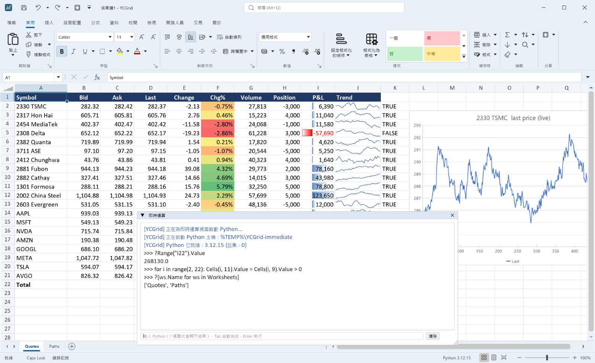

## 交易，有護欄

會下真單的畫面需要的不只是速度，而這些每本活頁簿都有（[safety.md](skill/ycgrid-python/references/safety.md)）：

- **參數儲存格**（`safety.parameter("Params!B2", type=float, min=0, max=5)`）：橘色角標，有型別與範圍檢查，只能在
  操作模式下用打字改，會確認、會記錄。貼上、填滿、清除都動不了它。
- **心跳**（`safety.heartbeat("TXO feed", timeout=1.0)`）與表格的 `stale_after`：來源一停，列變灰、整個視窗轉紅，
  橫幅寫出是哪個來源、停了多久。
- **操作／唯讀模式**，含 PIN 與閒置逾時：唯讀模式拒絕畫面上的每一個變更，Python 的寫入照常進行。
- **緊急停止**（Ctrl+Alt+K、狀態列的按鈕，或 `safety.kill()`）：問一次，執行你登記的處理函式。
- **變更紀錄**存在活頁簿裡：參數、模式、警報、委託，以及你用 `safety.log` 記的任何東西。
- **委託管理器**拒絕風控限額不允許的單、在重播期間或非操作模式下拒絕真實下單，並記錄每一筆委託、取消、成交與拒絕。

## 和其他選擇相比

| | Excel + xlwings / RTD | Perspective、網頁表格 | YCGrid |
|---|---|---|---|
| 試算表（公式、樞紐分析、規劃求解、分析工具箱） | 有 | 沒有 | 有，名稱與 Excel 相同 |
| 從 Python 推送即時資料 | 透過 COM 在 Excel 的 UI 執行緒上寫入；RTD 預設節流 2 秒 | WebSocket 串流 | 共享記憶體依鍵值更新，約 20 ms 到畫面 |
| Python | 透過 COM 的另一個行程 | 需要自己建伺服器 | 獨立行程；物件模型與 Excel 同名 |
| 數百萬點的圖表 | 不行（Excel 圖表） | 看外掛 | `yc.plot`，依像素降採樣 |
| 錄製與重播交易時段 | 自己做 | 自己做 | 內建 |
| 交易安全機制（參數、心跳、緊急停止） | 自己做 | 自己做 | 內建 |
| 執行方式 | Microsoft 365 | 瀏覽器加伺服器 | 一個可攜式 Windows 資料夾，或 `pip install` |

## 環境需求

| 用途 | 需要 |
|---|---|
| 執行 YCGrid | Windows 10（1903 以上）或 Windows 11 64 位元，顯示卡支援 Direct3D 11（近十年的電腦都有）。直接在資料夾裡執行，不會另外安裝任何東西。 |
| 為它寫 Python | 不用另外準備：YCGrid 使用自己的可攜式 Python 3.12，與系統的 Python 分開。程式需要的套件用 pip 安裝。 |
| 用 AI agent 打造畫面 | VS Code 加上 Claude Code、Codex 或 GitHub Copilot。**開發人員 → VS Code**（Alt+F11）會替它們把專案設定好。 |
| 從原始碼建置 | 含 C++ 工具與 vcpkg 套件管理員的 Visual Studio 2026（CMake 和 Ninja 隨附）、Git，第一次建置時需要網路：vcpkg 會下載 FreeType、zstd、zlib、pugixml、nlohmann-json 和 Catch2，ImGui 與 ImPlot 則是 git 子模組。`setup.cmd` 會把這些全部裝好（見下方）。 |

## 開始使用

### 使用發行版

1. 從 [Releases](https://github.com/ycgrid/ycgrid/releases) 下載 `YCGrid-<版本>.zip`，解壓縮到任何位置，執行
   `ycgrid.exe`。不需要安裝，也不會寫入登錄檔。
2. 選用：執行 `install.cmd`，之後按兩下 `.ycg` 檔就會用 YCGrid 開啟，桌面和開始功能表也會有 YCGrid 捷徑（只對目前
   使用者，不需要系統管理員權限；`install.cmd /nodesktop` 不建桌面捷徑）；`uninstall.cmd` 可完整移除。
3. 開啟 `examples` 資料夾裡的活頁簿（`examples\backtest_report\backtest_report.ycg` 等）就有完整的畫面可以探索；
   **開發人員 → VS Code**把活頁簿變成給你或你的 agent 用的專案。

YCGrid 目前還沒有程式碼簽章，第一次執行 `ycgrid.exe` 時 Windows SmartScreen 可能顯示「Windows 已保護您的電腦」：
按 **其他資訊**，再按 **仍要執行**。發行頁上每個檔案旁邊都有一個 `.sha256` 檔，可以和 Windows 對你下載的檔案算出的值比對：

```bat
certutil -hashfile YCGrid-<版本>.zip SHA256
```

### 用 pip 安裝

給使用自己 Python 的人（裝好自己函式庫的 venv 或 conda 環境）。wheel 放在每個發行頁、zip 的旁邊；它內含
`ycgrid.exe` 但不含 Python，YCGrid 的 Python host 會跑在安裝它的那個 Python 上。

```bat
pip install ycgrid-<version>-py3-none-win_amd64.whl     :: 從 Releases 下載，或由 scripts\build_wheel.cmd 建置
ycgrid                                                  :: 啟動 YCGrid；它會用這個 Python 執行你的程式
ycgrid examples\backtest_report\backtest_report.ycg  :: 開啟範例（zip 裡的 examples 資料夾）
python -m yc run my_research.py                        :: 執行連到 YCGrid 的腳本
```

在測試與 CI 中，`yc.launch(hidden=True)` 會啟動沒有視窗的 YCGrid，用 `yc.ui.state()` 和 `yc.ui.screenshot()` 檢查結果。

### 從原始碼建置

**一鍵安裝：** 在 repo 資料夾執行 `setup.cmd`。缺少的工具會先詢問再用 winget 安裝：Git，以及含 C++ 工具與 vcpkg
的 Visual Studio 2026 Build Tools。接著它會取得指定版本的 ImGui 與 ImPlot、準備 YCGrid 的 Python、建置並測試
YCGrid，最後替目前使用者安裝（桌面與開始功能表捷徑、`.ycg` 檔案關聯，不需要系統管理員權限）。`setup.cmd /noinstall`
只建置不安裝；`/yes` 不詢問直接安裝。還沒有 Git？從 GitHub 下載原始碼 zip（**Code → Download ZIP**），在裡面執行
`setup.cmd` 即可。

```bat
git clone https://github.com/ycgrid/ycgrid.git YCGrid
cd YCGrid
setup.cmd
```

**逐步建置**（已裝好 Visual Studio 與 Git）：

```bat
git clone --recursive https://github.com/ycgrid/ycgrid.git YCGrid
cd YCGrid
scripts\setup_runtime.cmd          :: 開發用的可攜式 Python 3.12（build\runtime）
scripts\build.cmd release          :: 設定、建置、執行單元測試，並產生 dist_release\
dist_release\ycgrid.exe
```

**重新建置並安裝新版：** 在 repo 資料夾按兩下 `build_release.cmd`。它會建置 YCGrid、執行單元測試、把結果放到
`dist_release\` 並打開那個資料夾；關閉 YCGrid 後按兩下裡面的 `install.cmd`，就會替目前使用者裝好新版（覆蓋舊版時，
你裝過的套件與你改過的範例都會保留）。

`scripts\package.cmd --with-python` 會產生內含 Python 的發行 zip。所有建置與打包腳本都是單純的 `.cmd` 檔。

測試：

```bat
scripts\build.cmd release /silent    :: C++ 單元測試（Catch2）在建置時一併執行
scripts\check_all.cmd /quick         :: 建置、單元與 Python 測試、翻譯、指令涵蓋率、邊界檢查
scripts\check_all.cmd                :: 提交前的全部檢查：再加上 UI 巡檢、功能檢查、計時的交易員一日流程
cd python
..\dist_release\runtime\python\python.exe -E -s -m unittest tests.test_core    :: 只跑一個 Python 測試模組
```

Python 測試會啟動隱藏的 YCGrid 並讀取它自己的截圖；`check_all.cmd` 會把慢的部分平行執行。一項修改需要哪些測試，
見 [CONTRIBUTING.md](CONTRIBUTING.md)。

發布前，`scripts\check_boundary.py --history` 會檢查納入版本控制的檔案，以及公開分支歷史上提交過的所有內容，
是否有帳密、內部位址等不該公開的東西。發行的完整步驟在 [docs/releasing.md](docs/releasing.md)。

## 文件

| 文件 | 內容 |
|---|---|
| [docs/quant-guide.md](docs/quant-guide.md) | 從研究到交易在同一個畫面：資料、回測、walk-forward、模擬實盤、執行演算法、風控、重播、agent |
| [docs/features.md](docs/features.md) | 依索引標籤列出所有功能：指令、窗格、快速鍵、命令列 |
| [docs/YCGRID_PLAN.md](docs/YCGRID_PLAN.md) | 主規格：架構、效能目標、鐵則、里程碑 |
| [docs/adr/](docs/adr/) | 改變 PLAN 的架構決策紀錄 |
| [skill/ycgrid-python/SKILL.md](skill/ycgrid-python/SKILL.md) | 為 YCGrid 撰寫 Python（也是 AI agent 載入的 skill） |
| [skill/ycgrid-python/references/object-model.md](skill/ycgrid-python/references/object-model.md) | 完整的 Python 物件模型 |
| [skill/ycgrid-python/references/data-binding.md](skill/ycgrid-python/references/data-binding.md) | DataFrame 即時表格、錄製與重播 |
| [skill/ycgrid-python/references/plot.md](skill/ycgrid-python/references/plot.md) | `yc.plot`：從 Python 高速繪圖 |
| [skill/ycgrid-python/references/screens.md](skill/ycgrid-python/references/screens.md) | 用積木組交易畫面與研究、每種畫面的做法、範例 |
| [skill/ycgrid-python/references/safety.md](skill/ycgrid-python/references/safety.md) | 實盤交易的安全機制 |
| [skill/ycgrid-python/references/events-and-controls.md](skill/ycgrid-python/references/events-and-controls.md) | 事件、控制項、面板、UserForm 與自訂功能區 |
| [skill/ycgrid-python/references/excel-migration.md](skill/ycgrid-python/references/excel-migration.md) | 把 Excel 巨集移植到 Python |
| [skill/ycgrid-python/references/ui-coverage.md](skill/ycgrid-python/references/ui-coverage.md) | 每個 UI 指令與做同一件事的 Python |
| [skill/ycgrid-python/references/mcp-tools.md](skill/ycgrid-python/references/mcp-tools.md) | 給 AI agent 的 MCP 工具 |
| [docs/ROADMAP.md](docs/ROADMAP.md) | 交易平台路線圖與進度 |
| [docs/benchmark.md](docs/benchmark.md) | 效能測試與重現方式 |
| [docs/settings.md](docs/settings.md) | 全域設定（`settings.json`）、專案設定（`ycgrid.toml`）、環境變數 |
| [docs/ycg-format.md](docs/ycg-format.md) | `.ycg` 檔案格式 |
| [docs/releasing.md](docs/releasing.md) | 一個版本怎麼建置、檢查與發行（zip、wheel 與檢查碼） |
| [AGENTS.md](AGENTS.md) | 給貢獻者與 AI agent 的開發規則 |

（以上文件皆為英文。）

## 刻意不做的部分

凡是 Excel 依賴微軟檔案格式或雲端服務的地方，YCGrid 走自己的路：

- Excel 檔案：可開啟 `.xlsx` / `.xlsm`，也能把值、公式與格式另存成 `.xlsx`（圖表、圖片、控制項、樞紐分析表、
  條件式格式、資料驗證與附註只保留在 `.ycg`，見 [ADR 0004](docs/adr/0004-xlsx-import-export.md)）。`.ycg` 是 YCGrid
  自己的完整格式。
- 取得及轉換資料、資料模型與共同編輯：資料處理交給 Python（pandas、任何資料庫驅動程式），YCGrid 只內建別人沒有的能力
  （見 [ADR 0012](docs/adr/0012-pieces-not-ready-made-screens.md)）。

## 相容性

- **活頁簿：** 每一版 YCGrid 都能開啟舊版存的 `.ycg`；測試會開啟、儲存再重新開啟每個檔案格式版本的範例檔。舊版
  YCGrid 開啟新版檔案時，會保留不認得的部分並在存檔時寫回，無法保留時則以唯讀開啟（見
  [docs/ycg-format.md](docs/ycg-format.md)）。
- **Python：** 物件模型沿用 Excel 的名稱。版本號仍是 0 開頭時，次版本（0.x）可能更動成員，
  [變更紀錄](CHANGELOG.md)會說明程式要怎麼改。
- **Windows：** Windows 10（1903 以後）與 Windows 11，64 位元。

## 參與貢獻

歡迎回報錯誤、提交修正，以及指出 YCGrid 和 Excel 行為不一致的地方。建置、測試與 pull request 的要求見
[CONTRIBUTING.md](CONTRIBUTING.md)（英文）；提議新功能前，請先讀 [docs/excel-parity-backlog.md](docs/excel-parity-backlog.md)
的「Kept on purpose」與「Not planned」。資安問題請依 [SECURITY.md](SECURITY.md) 私下回報。所有參與者都遵守
[行為準則](CODE_OF_CONDUCT.md)。

## 贊助 YCGrid

YCGrid 是免費的開源專案。如果你覺得它有用，歡迎贊助以下任一地址，支持後續開發：

| 幣別 | 地址 |
|---|---|
| **BTC**（Bitcoin） | `bc1q4gcj9n0hamvmv9ky6yyscv0wwctvc9zzh5rs2a` |
| **ETH**（Ethereum） | `0x183ca8C1B3a9ed5550b5911f4DA37Bf93b492fa4` |
| **SOL**（Solana） | `B6GCgHjbkQAVZh2QuPjkfPDybtkxXERZWyntqPjz6Anc` |

每種幣請只用它自己的網路轉帳（BTC 走 Bitcoin、ETH 走 Ethereum、SOL 走 Solana），用錯網路轉出的款項可能無法
取回。謝謝你的支持！

## 授權

[Apache License 2.0](LICENSE)。第三方元件與其授權列在 [NOTICE](NOTICE) 和
[THIRD-PARTY-NOTICES.md](THIRD-PARTY-NOTICES.md)；發行版放在 `licenses\` 資料夾。

## 商標

Microsoft、Excel 與 Office 是 Microsoft 集團的商標。YCGrid 是獨立專案，與 Microsoft 沒有任何關聯，也未獲其背書或贊助。
使用 Excel 的名稱只是為了說明相容性，本專案沒有使用任何 Microsoft Office 的圖示、圖片或其他專有素材。
Python 是 Python Software Foundation 的商標；其他名稱與標誌屬於各自的所有人。範例中的公司名稱與股票代號只是示範資料，
價格為模擬值。
