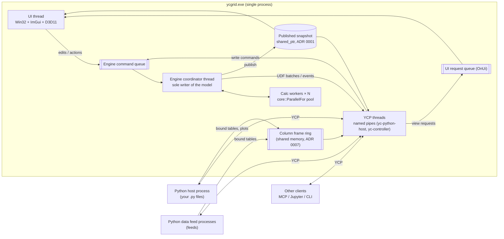
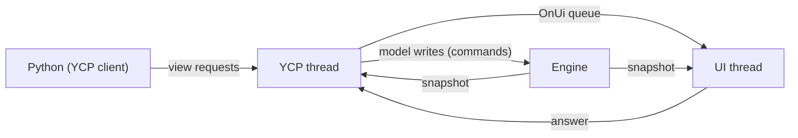
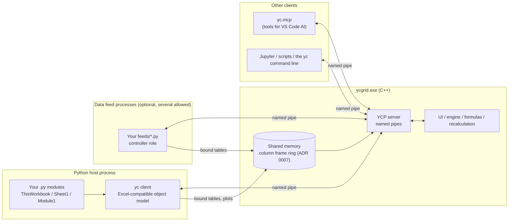

# YCGrid: a high-performance Excel-like spreadsheet front end — implementation plan

> Version: 3.0 (2026-10-30) | Audience: implementing agents (Claude Code etc.) and the development team | Previous versions: 2.0 (2026-10-23) and 1.1 (2026-10-11)
> Project name: **YCGrid**; executable `ycgrid.exe`; C++ namespace and Python import package: `yc` (Python distribution name `ycgrid`); workbook files `.ycg`; control protocol YCP (YCGrid Control Protocol)
> Core technology: C++20, Dear ImGui **v1.93.0-docking** + ImPlot (master `851cdbd`), both pinned as git submodules (§3.2); Win32 + Direct3D 11; Python 3.12 in a separate process (YCP protocol)
> Terminology: this document uses Excel's terms — **row**, **column**, cell, worksheet, workbook, formula bar, name box, fill handle, ribbon.
> Scope: C++ front-end UI + Python back end, Windows only. Excel files: `.xlsx` / `.xlsm` open and a copy can be saved as `.xlsx` (values, formulas, formatting; ADR 0004); other languages are out of scope for this version (§1.2).
> This document is the main specification (§0–§22). Detailed interface definitions live in separate files in the repo (see "Appendix files"); the files in the repo are authoritative.

## Main changes in 3.0

| Item | Change | Section |
|---|---|---|
| Naming | the product is YCGrid: `yc` code prefix, `.ycg` workbooks, the YCP control protocol, the [YC] doc marker, `YCGRID_*` environment variables (ADR 0014) | whole document |

## Main changes in 2.0

| Item | Change | Section |
|---|---|---|
| ImGui + ImPlot integration | ImGui v1.93.0-docking + ImPlot master, pinned submodules, three version checks | §3 |
| Charts | changed from "not doing" to Excel-style charts drawn with ImPlot | §9 |
| Python controls all UI | UI object model, custom panels, floating worksheet windows, containers, saving and loading layouts | §10 |
| Ribbon | the full Excel ribbon (adaptive scaling, command system, RibbonX) | §11 |
| Design mode | buttons + combo boxes that can float anywhere | §12.9 |
| Python | fixed at 3.12, upgradable; `main.py` entry point; one-key development with Alt+F11; automatic package installation; per-cell OnChange; "anything the UI can do, Python can do" | §13 |
| One-click packaging / installation | `.cmd` scripts (no PowerShell); double-click a `.ycg` to open it | §13.16 |
| File format | backward-compatible, upgradable `.ycg`; built-in workbook key/value store | §15 |
| Sheet size | 1,048,576 rows by default, grown dynamically on demand | §5.1 |
| Exact decimals | nanosecond timestamps with 10 integer digits + 9 decimal places | §5.2a |
| Low latency | end-to-end latency budget, vsync publish mode | §2 |

## Contents

0. Guidance for implementing agents
1. Goals and scope
2. Performance targets (SLO)
3. Technology choices and dependency version management
4. System architecture
5. Data model
6. Formula engine
7. Dependency graph and recalculation
8. Rendering layer (Dear ImGui)
9. Charts (ImPlot)
10. UI object model, custom panels, floating windows and containers
11. Ribbon and window frame
12. Interaction and editing (matching Excel's behavior; 12.9 design mode and controls)
13. Python integration (separate process, Excel compatibility, project rules, automatic installation, one-click packaging)
14. Excel UI parity checklist
15. Files: a backward-compatible, upgradable `.ycg`
16. Directory layout
17. Testing and verification
18. Coding conventions
19. Milestones and acceptance gates
20. Risks and mitigations
21. Open questions
22. References

Appendix files: separate files in the repo (see "Appendix files" at the end)

---

## 0. Guidance for implementing agents

### 0.1 How to use this document

- Implement in the milestone order of §19; each milestone ends with a **Gate (acceptance criteria)**, and the next stage must not start until it passes.
- **P0/P1/P2/P3** = feature priority (P0 required, P1 high, P2 medium, P3 deferred); **M0–M15** = milestones.
- Reading order: read §0, §1, §2 and §19 first; then read the sections for the milestone you are working on.
- Detailed interface definitions live in separate files in the repo ("Appendix files" at the end), and the files in the repo are authoritative: the Python object model is defined by `skill/ycgrid-python/references/object-model.md` (written by hand; the planned `schema/om.yaml` was not built), the UI commands by `schema/commands.yaml`, the MCP tools by `mcp/tools.json`, the file format by `docs/ycg-format.md`.
- Versions and upgrade rules for third-party libraries (ImGui, ImPlot) are in §3.2, §3.3 and `third_party/README.md`.
- Values marked "**to be calibrated**" (colors, pixels, default fonts, dash styles, etc.) must be calibrated against real Excel screenshots or files supplied by the user, never decided from memory.
- Record every difference from Excel's behavior: a deliberate one in this PLAN or an ADR (with the reason), one still to fix in `docs/excel-parity-backlog.md`.
- Architecture decisions that deviate from this document get an ADR in `docs/adr/NNNN-title.md`.
- At the end of each milestone, write the performance numbers to `docs/benchmark.md` (measured with `scripts\bench.py` and `scripts\bench_plot.py`; the planned `bench/results/` folder was not built).

### 0.2 Hard rules (a violation is a defect)

1. The **UI thread** never waits on IPC, never waits on a lock or the engine, and never does O(sheet size) work; per-frame cost may only be proportional to "the number of visible cells".
2. **Single writer**: the workbook model is modified only by the "engine coordinator thread" (workers dispatched during recalculation write only the cells they own). Every other thread sends a Command or writes into the Topic conflation table.
3. **Readers only read published snapshots** (UI, Python reads, saving, find), held by `shared_ptr` ([ADR 0001](adr/0001-snapshot-shared-ptr.md)); they never read the working version.
4. **Hot/cold split**: values (hot) are stored separately from formats / formulas / structure (cold); live market data only triggers copy-on-write of the hot layer.
5. The grid area must **not** use the ImGui Tables API or ImGui's built-in scrolling; it is always drawn with `ImDrawList` and has its own scrolling (§8.2).
6. **Every queue is bounded**; market data is always conflated ("last value wins") and must never build up a backlog.
7. **Incremental recalculation must equal a full recalculation**; checked at random by `scripts\calc_fuzz.py --mode recalc` (each step against `CalculateFull`) and `yc_doc_fuzz` (§7.7; the planned `--verify-recalc` switch was not built).
8. Core modules (`core/ model/ formula/ engine/`) **must not depend on ImGui**, and use Win32 only behind a few narrow calls (collation with `CompareStringEx`, file mappings for bound tables, thread names, environment variables). The product is Windows only; this rule keeps module boundaries clean and modules testable on their own (the Catch2 unit tests link them without the UI).
9. Per-cell work inside the render loop **must not allocate heap memory** (use a frame arena).
10. **No Microsoft Office icons, trademarks or other proprietary assets**; "faithful clone" means layout and behavior, and icons come from an open-source icon set (§3).
11. **ycgrid.exe does not embed Python**: all Python code runs in separate processes and talks over YCP (§13.3). Every wait ycgrid.exe does on Python is bounded; when the Python host crashes, restarts or is paused in a debugger, the UI keeps working and separate data feed processes (§13.13) keep pushing market data.
12. **The Python API uses Excel's names and values**: class, member and parameter names and constant values follow Excel (constants written by hand from the Excel type library, `python/yc/constants.py`); no invented synonyms; YCGrid-specific extensions are always marked [YC] (§13.5).
13. **Single source for external interfaces**: the MCP tools have `mcp/tools.json` (`mcp/gen_tools_doc.py` writes `mcp-tools.md`) and the UI commands `schema/commands.yaml` (`scripts/check_commands.py --write` writes `ui-coverage.md`); the object model's single source is `object-model.md` and the YCP methods' is the code (`schema/om.yaml` and `schema/ycp.yaml` were planned, not built). Interface changes must update them together.
14. **Render only the visible area**: invisible cells are still calculated (formulas, UDFs, events, saving), but are not formatted, laid out, evaluated for conditional formats, or drawn (§8.0).
15. **Portable folders**: project folders only use relative paths; copying the whole folder to another path or another computer is enough to run it (§13.15). ycgrid.exe **does not write the registry** in normal use; only when the user runs `install.cmd` (`ycgrid.exe --install`) does it write the `.ycg` file association under HKCU, and `uninstall.cmd` removes it completely (§13.16). The Python runtime is self-contained and doesn't affect any Python already on the system.
16. **All C++ code lives under `namespace yc`**, with sub-namespaces matching modules (`yc::core`, `yc::model`, ..., §18); the Python import package is `yc`.
17. **Third-party UI libraries come in only as submodules**: imgui and implot live in `third_party/`, and **submodule contents must not be modified**; customization always goes through `src/ui/yc_imconfig.h` and wrapper layers (§3.2).
18. **Three version locks**: `third_party/deps.lock` + a CMake configure-time check + a compile-time `static_assert`; upgrades must go through an ADR and the §3.3 process, and ImGui must not be upgraded to a version ImPlot doesn't support.
19. **ImPlot is only called on the UI thread**; chart data is always prepared by the engine into a SeriesCache in the snapshot (§9.2), and the UI never scans cells per frame.
20. **Python never makes ImGui calls directly**: Python only changes properties of "declarative UI objects" and view state (through requests the UI thread runs at the start of a frame, `PythonBridge::OnUi`, §4.6), and the UI thread draws them; the UI thread never waits for Python.
21. **Backward-compatible files**: new versions must open every older `.ycg` (counted from `.ycg` 1.0); format changes must come with an upgrade function and compatibility corpus files (§15, §17.12). Saved content must not depend on ImGui's internal formats (such as `imgui.ini`).

---

## 1. Goals and scope

### 1.1 Goals

1. UI and feel very close to Excel (baseline: Microsoft 365 Excel), including the full **ribbon** (§11), scroll bar behavior (§8.2), merged cells, shortcuts and context menus.
2. A built-in Excel-compatible formula engine: syntax, operators, references, error values, type conversion, common functions; plus [YC] exact decimals and nanosecond timestamps (§5.2a).
3. Incremental recalculation over a dependency graph + multi-core parallel calculation + circular reference detection.
4. Complete cell operations: merging, borders, fonts, fills, alignment, number formats, conditional formats, data validation, freeze panes, filtering, sorting, etc.
5. **Excel-style charts**: drawn with ImPlot (§9); million-point series and live streams without stutter.
6. Python controls the front end from a separate process (§13): an Excel-compatible object model, workbook and worksheet events, [YC] per-cell OnChange, macros, UDFs, streaming (`=STREAM` / `=QUOTE`, like Excel's RTD). **Anything you can do in the Excel UI, Python can do** (§13.5a, coverage checked by CI). When Python crashes or is paused in a debugger, the UI keeps working.
7. **Python controls all UI objects** (§10): view state (selection, scrolling, zoom, windows), custom panels, charts, controls, floating worksheet windows, containers and layouts.
8. Performance: handle **1 million cells of live market data** at once without stutter; the data refresh interval is configurable (default 100 ms, 0–5000 ms; 0 shows every change).
9. Design mode (§12.9): drag **buttons and combo boxes** from the Developer tab onto the sheet, floating anywhere; clicks and changes call Python functions.
10. Floating sheets and containers (§10.5): worksheets can be pulled out into separate windows; empty containers can be created and windows docked into them; the layout is saved with the workbook and fully restored on reopen.
11. AI development tool chain (§13.12): Alt+F11 generates a project template and opens VS Code in one step; AI operates and verifies the UI through MCP tools; SKILL.md and CLAUDE.md are included.
12. Saving and loading (§15): one workbook is saved as one `.ycg` file; **every new version can open every older file**; the workbook has a built-in key/value store.
13. Portable folder distribution (§13.15): ycgrid.exe, the Python code and a dedicated portable Python 3.12 live in one folder; copy it to someone else and it just works, without touching the Python already on their computer; missing packages are detected and installed automatically.
14. One-click packaging and installation (§13.16): `.cmd` scripts; after installation, double-clicking a `.ycg` opens it in YCGrid.

### 1.2 Not doing / deferred

- **Not doing**: an Excel macro language, its editor, macro recording; the binary `.xls` format (`.xlsx` / `.xlsm` open and a copy saves as `.xlsx` since ADR 0004; the clipboard and CSV also work, §15.3); platforms other than Windows; languages other than Python (the protocol stays language-neutral so others can be added later).
- **Deferred (P2 / P3, room left in the architecture)**:
  - Done since: selecting and formatting individual chart elements, chart sheets, KeyTips, two windows on the same sheet (New Window, split panes), several workbooks, context menu customization (`CommandBars`), ribbon display options.
  - P3: in-process C++ plug-ins (§6.9), external C++ programs writing shared memory directly, remote Python (§13.13), the simplified ribbon. (Co-authoring was built, then removed by ADR 0012.)

  - Done after the first release: sparklines, pictures / shapes / text boxes, printing, Print Preview, the Page Layout tab and PDF export (through Microsoft Print to PDF), the Review tab (protection), tables, dynamic arrays, ActiveX-style check boxes, option and toggle buttons, text boxes, labels, list boxes, spin buttons, scroll bars and images, RibbonX (customUI.xml), PivotTables (compact / outline / tabular reports, filters, Show Values As, GETPIVOTDATA, grouping, calculated fields and items, Show Details, PivotCharts, slicers, timelines), form controls, UserForms, Page Break Preview and Page Layout view, radar / waterfall / statistical / hierarchy charts, threaded comments, workbook encryption, Flash Fill, spelling, `.xlsx` import / export (ADR 0004). Get & Transform queries (ADR 0005) were built and later removed (ADR 0012).

### 1.3 Default assumptions (can change before delivery, see §21)

| Item | Default |
|---|---|
| Platform | Windows 10 (1903 or later: the manifest's UTF-8 `activeCodePage`) / 11 x64 only; Direct3D 11 rendering |
| Process model | ycgrid.exe is the only entry point; one ycgrid.exe = one workbook main window (floating worksheet windows and containers belong to the same process). ycgrid.exe starts the Python host automatically, and the `.py` files in the folder bind to that instance (§13.1) |
| Python | portable CPython **3.12** (currently pinned to 3.12.15) in the project folder's `runtime\python\`; one-click upgrade (§13.15) |
| Project | one workbook + its Python code = one folder; the entry point is `main.py` (§13.1) |
| AI development environment | VS Code + Claude Code or GitHub Copilot, operating the UI through MCP tools (§13.12) |
| Sheet size | 1,048,576 rows × 16,384 columns by default (same as Excel); rows grow dynamically on demand (§5.1) |
| Files | a single `.ycg` file, backward compatible (§15); CSV (P1); xlsx open / save a copy (ADR 0004) |
| Calculation | automatic calculation by default; data publish interval 100 ms |
| UI libraries | Dear ImGui v1.93.0-docking + ImPlot master `851cdbd` (pinned submodules, §3.2) |

---

## 2. Performance targets (SLO)

### 2.1 Two kinds of "rate"

| Name | Meaning | Default | Range |
|---|---|---|---|
| Data publish interval `publish_interval_ms` | the shortest time between snapshots the engine publishes for changes from Python and data feeds (the first change after a quiet period is published at once; the user's own edits are never held back) | 100 ms | 0–5000 ms (0: every change) |
| Interactive frame rate | redraw rate while scrolling, dragging and typing | follows the monitor's vsync | — |
| Idle redraw | with no input, draw one frame only when a new snapshot is published | equals the publish interval | — |

The requirement "screen updates every 200–500 ms" refers to the **data publish interval**. If interactive redraws also dropped to 2–5 fps, scrolling and typing would lag noticeably and not feel like Excel, so redraws are **event-driven**: CPU/GPU are near zero when idle, data refreshes at the configured interval, and interaction redraws immediately.

Also, **user edits (pressing Enter) take a fast path**: the affected subgraph is recalculated and published immediately, without waiting for the next interval.

`publish_interval_ms` is kept in `settings.json` (`live_data.publish_interval_ms`, `docs/settings.md`), set in the Options dialog or from Python (`Application.PublishInterval`), and takes effect immediately while running.

### 2.2 Reference machine

The targets were set for an 8-core / 16-thread desktop CPU (recent Core i7 / Ryzen 7 class), 32 GB RAM, Windows 11, 1440p display, discrete or recent integrated GPU. The machine actually measured and its numbers are in `docs/benchmark.md` (currently an Intel Core Ultra 9 285HX with 64 GB); compare numbers only from the same machine.

### 2.3 Test scenarios

- **A quote wall**: 100,000 rows × 10 columns = 1 million live numeric cells, each updated twice per second on average (2 million updates/s in total); plus 200,000 formulas (mid price, spread, percent change, etc.) referencing those cells; publish interval 200 ms. Market data is fed by a Python data feed process (§13.13) or a bound table (`scripts\bench.py`, `scripts\stress_realtime.py`; the planned native `tools/feed_sim` was not built).
- **B heavy calculation**: 1 million formulas (10 columns × 100,000 rows, filled down as shared formulas), 30% dirtied each interval; plus 1,000 XLOOKUPs over 100,000 rows and 10 whole-column SUMs.
- **C Python UDF**: 50,000 cells calling a vectorized Python UDF (e.g. a Black-Scholes price), all recalculated every interval; Python runs in a separate host process.
- **E chart wall**, **F large sheet**: see §2.9.
- **D large file operations**: open and save 1 million cells (with formats), copy and paste 100,000 cells, sort 1 million rows, find across the whole sheet.

### 2.4 SLOs (the basis for Gates)

| Metric | Target | Scenario |
|---|---|---|
| UI frame time (continuous scrolling / drag-selecting while A runs) | p99 ≤ 8 ms, p99.9 ≤ 16 ms | A, B, C |
| Key press to screen response | ≤ 1 frame | A |
| Result shown after editing a cell (affecting ≤ 10,000 cells) | ≤ 30 ms | B |
| Native Topic table write throughput (not built: the native table and `tools/feed_sim`, ADR 0007) | ≥ 20 million/s (contiguous blocks); ≥ 8 million/s (randomly scattered) | — |
| Market data write throughput: Python batches through shared memory (bound tables, ADR 0007; the planned fast lane extension was not built) | ≥ 10 million/s | — |
| Market data write throughput: Python batches over YCP | ≥ 2 million/s | — |
| Engine work per interval (market data sampling + recalculation + publish) | A ≤ 20 ms; B ≤ 60 ms (8 cores) | A, B |
| Framework overhead of a 50,000-row vectorized UDF (excluding the function body, including cross-process transfer) | ≤ 15 ms | C |
| YCP round trip (named pipe ping) | p99 ≤ 200 µs | — |
| User edit → `Worksheet_Change` starts; button click → `_Click` starts | ≤ 5 ms (host idle) | — |
| `.py` saved → the new `Workbook_Open` starts (`yc init` template project, §13.11) | ≤ 2 s | — |
| UI frame time while the Python host is crashed, restarting or paused in a debugger | same as the first row | A |
| Publish jitter (not overloaded) | actual interval error ≤ ±5 ms | A |
| Market data to screen latency | ≤ publish interval + recalculation time + 1 frame | A |
| Engine memory (excluding Python) | ≤ 400 MB | A |
| Open a 1-million-cell `.ycg` | ≤ 1.5 s | D |
| Save a 1-million-cell `.ycg` (in the background, UI not frozen) | ≤ 1.5 s | D |
| Sort 1 million rows / find across the whole sheet | ≤ 1 s, UI not frozen meanwhile | D |

### 2.5 Degradation under overload

- Recalculation plus publishing takes longer than one interval: **skip the missed slots** (no catch-up publishes) and publish the latest state in the next slot; the status bar shows the actual interval and latency.
- Market data sources never block: a bound table's frame that repeats the waiting frame's keys and columns replaces it, so only the latest values are kept (ADR 0007; the planned Topic conflation table of §4.4 was not built). Python's requests and the UI's commands share the engine's one command queue (`Engine::Loop`), which publishes when the interval is due even while commands keep coming.
- Python UDFs over budget: that batch of cells keeps its previous values and is marked "calculating"; the results are merged in the next interval after they arrive (§13.8).
- Python host unresponsive (crashed or paused in a debugger): UDFs take the timeout path immediately, events are not sent, and the status bar shows a notice (§13.2).
- Every degradation event is counted and shown in the built-in "Performance" panel.

### 2.6 Key performance design at a glance

| Goal | Key design | Section |
|---|---|---|
| No stutter while scrolling and typing | event-driven redraw; no IPC or lock waits on the UI thread; render only the visible area; custom virtual scrolling (int64 positions) | §2.1, §8.0, §8.2 |
| 1 million cells of live market data | bound tables fed through shared memory, latest values win (ADR 0007); separate Python data feed processes don't compete for the host's GIL; `Range.BindTopics` avoids formula cost | §13.13, ADR 0007 |
| Publishing and reading never block each other | single writer + tile-level copy-on-write snapshots held by `shared_ptr` (ADR 0001); readers never wait on locks | §4.2, ADR 0001 |
| Fast recalculation | parallel recalculation in waves (ADR 0002) + early cutoff; shared formulas store one definition; lookup caches; volatile control | §6.3, §7.8, ADR 0002 |
| Python never slows the UI | Python runs in a separate process; every UI wait on Python is bounded; UDFs are called vectorized in whole batches | §13.2, §13.8 |
| Fast Python reads and writes | numpy arrays and bound tables read and written in one go (the client-side tile cache of §13.6 was not built) | §13.6 |
| Saving and loading large files without freezing | background saves from a snapshot; parallel tile decoding; zstd compression | §15.1 |
| No compromise on correctness | incremental recalculation must equal full recalculation (`scripts\calc_fuzz.py`, `yc_doc_fuzz`); every queue is bounded | §0.2, §7.7 |

### 2.7 End-to-end latency budget

"Ultra-low latency" is defined by the table below; every row has a matching measurement (§17.6), and missing a target is a defect.

| Path | Target (p99) | Key design |
|---|---|---|
| Key / mouse → screen | ≤ 1 frame | event-driven redraw, the UI thread waits on no lock or IPC, flip model + frame latency waitable (at most 1 frame of latency), `SetMaximumFrameLatency(1)` |
| User edit → formula results shown (affecting ≤ 10,000 cells) | ≤ 30 ms | urgent fast path (§4.3) |
| User edit → per-cell OnChange / `Worksheet_Change` starts | ≤ 5 ms (host idle) | §13.7a |
| Python changes view state (selection, scrolling, zoom, panel text) → screen | ≤ 1 frame + 0.2 ms | the request goes straight to the UI thread (`PythonBridge::OnUi`), bypassing the engine (§4.6) |
| Python `Range.Value = ...` → screen | ≤ 20 ms (144 Hz) | YCP 0.2 ms + the next publish (the first change after a quiet period at once, then at most every `publish_interval_ms`, §2.1) + 1 frame |
| Market data → screen | ≤ publish interval + recalculation time + 1 frame | bound tables (ADR 0007), the publish interval (§2.1) |
| Panel `LinkedCell` display → screen | same as cells (same snapshot) | no Python round trip (§10.3) |

Optional: on VRR (variable refresh rate) displays, present with `DXGI_PRESENT_ALLOW_TEARING` to reduce vsync waits.

### 2.8 Publish modes

> Not built: there is no `publish_mode` setting; the engine publishes once the commands it has are done, at most every `publish_interval_ms` for changes from Python and data feeds, and at once for the user's own edits (`Engine::Loop`, §2.1). The design below is kept for reference.

`[engine].publish_mode`:

- `interval` (default): publish every `publish_interval_ms` (§2.1). Maximizes COW coalescing per interval and uses the least CPU.
- `vsync`: the UI sends a "need a new snapshot" signal at the start of every frame, and the engine publishes right after the next ingest; market data → screen latency drops to about 2 frames. The cost is more COW (estimated as tile count × 64 KB, §4.5), so it's only recommended for trading screens with a small amount of high-frequency data.

### 2.9 SLOs for charts and large sheets

| Metric | Target | Scenario |
|---|---|---|
| UI frame time (20 charts, 50 series, 10 million points in total, 10 of them live streams) | p99 ≤ 8 ms | E |
| CPU per visible chart per frame | ≤ 0.3 ms | E |
| Zooming a chart to any range | downsampling cost proportional only to the chart's width in pixels | E |
| Ribbon CPU per frame | ≤ 0.3 ms (0.05 ms measured in the prototype) | all |
| Scrolling, jumping and Ctrl+End with RowLimit = 100 million rows (sparse data) | frame time within 5% of 1,048,576 rows | F |
| 3 floating worksheet windows + 2 containers open at once | no regression in scenario A's UI SLO | A |

Scenario **E chart wall**: 20 line / candlestick charts, with series sourced one third each from cell ranges, Python arrays and Topic streams. Scenario **F large sheet**: one worksheet whose RowLimit is grown to 100 million rows, with sparsely distributed data.

---

## 3. Technology choices and dependency version management

### 3.1 Technology choices

| Area | Choice | Reason | Alternatives / notes |
|---|---|---|---|
| Language | C++20 | concepts, span, jthread, atomic_ref | a C++23 subset (e.g. `std::expected`) where the compiler supports it |
| Compiler | Visual Studio 2026 (MSVC 14.5x, toolset v145) primarily, clang-cl secondarily | Windows-only releases | a `clang-cl-release` preset exists; the planned TSan runs of the core tests on WSL2 were not set up (§17.1) |
| Build | CMake ≥ 3.28 + CMakePresets + Ninja; vcpkg manifest; one-click build `scripts\build.cmd` (§13.16) | VS 2026 ships CMake, Ninja and vcpkg, nothing else to install | static CRT (`/MT`, vcpkg triplet `x64-windows-static`), so distributions don't need the VC++ runtime |
| GUI | **Dear ImGui v1.93.0-docking** (submodule) + imgui_freetype | dynamic fonts since 1.92 (any size, glyphs loaded on demand) → per-cell font sizes and CJK without pre-baking huge glyph sets; docking + multi-viewport support floating windows and containers | version pinning and upgrade process in §3.2, §3.3 |
| Charts | **ImPlot master `851cdbd`** (submodule) | same draw pipeline as ImGui, GPU batching, million-point scale; `ImPlotSpec` style API since 1.0 | the ImPlot v1.0 release is not compatible with ImGui 1.92.8+ (§3.2); 3-D charts are drawn from a projected scene instead of ImPlot3D |
| Platform back end | Win32 + Direct3D 11 (official imgui backends) | IME, clipboard, cursors and DPI straight from Win32 | Windows only |
| Icons | the Fluent UI System Icons font (MIT), embedded in ycgrid.exe | close to the Office style and legal to use; dynamic fonts render at any size per DPI | proprietary Office icons are banned (hard rule 10) |
| Parallelism | a small persistent worker pool in standard C++ (`core::ParallelFor`, `src/core/parallel.h`; one thread per logical core minus two) | no dependency; parallel recalculation in waves (ADR 0002) | oneTBB was planned and not adopted |
| Snapshots | copy-on-write with `std::shared_ptr` (`core::Cow`, `model::TileDir`; ADR 0001) | simple and safe to share across threads | the planned seqlocks and epoch reclamation were not built |
| Hash tables | the standard library's containers | | ankerl::unordered_dense was planned and not adopted |
| Allocators | the default allocator; a pooled allocator for tiles (`TileAllocator`, `src/model/tile_dir.h`) | | mimalloc was planned and not adopted |
| 128-bit integers | custom `yc::core::Int128` (`_mul128`, `_umul128`, `_udiv128` intrinsics) | exact decimals (§5.2a); MSVC has no `__int128` | |
| JSON | nlohmann-json (layouts, settings, reports) | | not used on hot paths |
| Python | **CPython 3.12** (python-build-standalone, portable), packages installed and managed by **uv** | 3.12 has the most complete package ecosystem; uv is fast, locks versions and downloads portable Pythons | upgradable (§13.15); free-threaded to be evaluated after moving to 3.14 |
| Python client | pure Python, with its own msgpack encoder (`yc/_msgpack.py`); live tables and plots send column frames through a shared-memory ring with `mmap` (ADR 0007) | no native extension, so any Python from 3.12 up works without a rebuild | the planned nanobind fast lane was not built (ADR 0007) |
| IPC | Windows named pipes + msgpack framing (YCP, §13.3; C++ side `src/io/msgpack.cpp`) | low latency on the local machine | TCP (remote Python) is P3 |
| MCP server | YCGrid's own stdio JSON-RPC server (`python/yc/mcp/server.py`, standard library only) | VS Code (Copilot) and Claude Code both support MCP | — |
| Macro extraction | custom (pure-Python parsing of OLE compound files) | only reads macro code and control lists from .xlsm / .xls so AI can port them | a development tool, not a YCGrid feature |
| Interface sources | `schema/commands.yaml` (checked by `scripts/check_commands.py`), `mcp/tools.json` (`mcp/gen_tools_doc.py`), `docs/ycg-format.md` and `object-model.md` kept by hand | each interface has one source (hard rule 13) | the planned YAML schemas with Jinja2 generators were not built |
| Number to string | `std::to_chars` + a custom Excel number format engine (including [YC] `[epoch]` and nanoseconds) | | |
| Saving | a custom chunk format (§15) + msgpack (metadata) + zstd | backward compatible, upgradable | |
| Tests | Catch2 v3 (`tests/unit/`), Python `unittest` (`python/tests/`) | | |
| Excel reference data | probe scripts that drive a hidden Excel of their own over COM (`scripts/measure_excel_basics.py`, `scripts/measure_test_formulas.py`, `scripts/excel_diff.py`; no pywin32 needed) | expected answers are measured in real Excel and committed (`tests/unit/excel_measured_*.inc`, `tests/data/`) | only runs on development machines with Excel installed (§17.2) |
| Performance | Catch2 benchmarks (`yc_unit_tests "[bench]"`), `scripts\bench.py`, `scripts\bench_plot.py`, `perf.stats` over YCP | | Google Benchmark and Tracy were planned and not adopted |
| Logging | the Error Log window and its log file (`errors` in `docs/settings.md`) | | spdlog was planned and not adopted |
| Fuzzing | `yc_doc_fuzz` (`tests/fuzz/doc_fuzz.cpp`, the Document in-process), `scripts\calc_fuzz.py`, `scripts\formula_fuzz.py`, `scripts\chaos.py` | | libFuzzer was planned and not adopted |

### 3.2 Dependency sources and version pinning

**Where each dependency comes from**

| Source | Packages | Reason |
|---|---|---|
| git submodules (`third_party/`) | imgui (docking), implot | source-level integration that needs exact control over versions and build settings (`yc_imconfig.h`); ImGui and ImPlot versions must move together |
| committed directly (`third_party/fluent-icons/`) | the Fluent icon font, codepoint map, LICENSE | just data files; the source commit is recorded |
| vcpkg manifest (`vcpkg.json`, pinned `builtin-baseline`) | freetype, nlohmann-json, zstd, zlib (the `.xlsx` ZIP container, ADR 0004), Catch2, pugixml (RibbonX customUI.xml, `.xlsx`) | ordinary C/C++ libraries, all versions pinned at once by the baseline |
| downloaded at packaging time (`scripts\package.cmd`) | uv, CPython 3.12.15 | only goes into the release folder, never into the repo |

**Version matrix** (single source: `third_party/deps.lock`)

| Package | Version | Pinned commit |
|---|---|---|
| Dear ImGui | v1.93.0-docking (`IMGUI_VERSION_NUM 19300`, 2026-10-14) | `b916186e66aa3c02b72c6ca17455516512ed8049` |
| ImPlot | master "1.1 WIP" (`IMPLOT_VERSION_NUM 10100`, 2026-10-10) | `851cdbdd60d1dfb64c23e987969694de0f547a6b` |
| Fluent UI System Icons | main | `463d58b8186f874ab2f51cf0a08b4ff5097c912f` |
| vcpkg registry | 2026.10.16 | `9eec002df1cd109f8f104cd966a763daf9751489` |
| uv | 0.12.24 | — |
| CPython | 3.12.15 | — |

**Why ImPlot is pinned to master instead of v1.0**: ImPlot v1.0 (2026-04-05) is only compatible up to about ImGui 1.92.7. ImGui 1.92.8 swapped the `thickness` and `flags` parameters of `ImDrawList::AddRect()` (the old signature is `= delete`), and 1.93 changed `AddLine()`'s half-pixel offset, switched closed shapes to inner strokes, merged `ImDrawListFlags` into `ImDrawFlags`, renamed `ImDrawFlags_RoundCorners*`, and removed a parameter from `ImGuiTextFilter::Draw()`. ImPlot's fixes for these changes (9751e23, 47c994a, 7eeb916, 09e2ba7) are only on master. Verified in M0: forcing a build with implot switched back to v1.0 produces errors such as undeclared `ImDrawListFlags_AntiAliasedLines` and `ImDrawFlags_RoundCornersAll` and a wrong argument count for `ImGuiTextFilter::Draw` (recorded in `third_party/README.md`).

**Three locks**

1. `third_party/deps.lock`: the URL, ref, commit and version of each submodule; the vcpkg baseline; the uv and Python versions.
2. CMake configure time (`cmake/YcDeps.cmake`): an uninitialized submodule, a commit mismatch, an `IMGUI_VERSION_NUM` / `IMPLOT_VERSION_NUM` mismatch, a non-docking branch, or a `vcpkg.json` baseline that disagrees with `deps.lock` — any of these is a `FATAL_ERROR`. `-DYC_ALLOW_DEP_DRIFT=ON` downgrades them to warnings, for upgrade testing only.
3. Compile time (`src/ui/yc_imgui_check.cpp`): `static_assert` on the version numbers, `IMGUI_HAS_DOCK`, `sizeof(ImDrawIdx) == 4`, `sizeof(ImWchar) == 4`.

**Build settings** (`src/ui/yc_imconfig.h`, injected into every TU through a PUBLIC `IMGUI_USER_CONFIG` to avoid ODR mismatches; the submodules must not be modified):

- `IMGUI_DEFINE_MATH_OPERATORS`, `ImDrawIdx unsigned int` (the grid area and large charts exceed 65,535 vertices), `IMGUI_USE_WCHAR32` (CJK extension blocks).
- `IMGUI_DISABLE_OBSOLETE_FUNCTIONS`, `IMPLOT_DISABLE_OBSOLETE_FUNCTIONS`: catch API drift early. M0 confirmed that ImPlot `851cdbd` builds with zero errors under these settings.
- `IMGUI_ENABLE_FREETYPE` (CMake option `YC_USE_FREETYPE`, ON by default).
- `IMGUI_DISABLE_DEFAULT_FONT`: ImGui's embedded fonts are left out; text uses the fonts in Windows' Fonts folder.
- `IMGUI_ENABLE_TEST_ENGINE`: only the test engine hooks, which the UI item recorder uses (`yc_ui_items.cpp`, `ui.items`) while a test turns them on.
- `IMPLOT_CUSTOM_NUMERIC_TYPES (float)(double)`: without the demos, only the needed types are instantiated, shortening build times (the ImPlot demo needs every integer type, so there is no restriction with `YC_IMGUI_DEMOS`).
- `IM_ASSERT` is routed to `yc_imgui_assert_failed()` (counted for tests as `ui.state()["imgui_asserts"]`; a debug build stops).
- Every TU, third-party ones included, builds with `/utf-8 /Zc:__cplusplus /permissive- /MP`; third-party sources add `/W0`, our own code `/W4 /bigobj` and `/WX` (CMake option `YC_WARNINGS_AS_ERRORS`, ON by default).

**Impact of ImGui 1.92.8 / 1.93 on this project's code**

- `AddRect()` always uses the new signature `(p_min, p_max, col, rounding, thickness, flags)`.
- Grid lines and borders are drawn with integer-pixel `AddRectFilled()` anyway (§8.3), so the 1.93 stroke semantics change doesn't affect them; only diagonal borders drawn with `AddLine()` need coordinates adjusted to the new semantics (no half-pixel offset).
- Font API: `AddRemapChar()` was renamed `AddRemapCodepoint()`; font data must stay alive until `RemoveFont()` (since 1.92).
- The second parameter of `PushFont(font, size)` is the unscaled base size; `GetFontSize()` is the scaled size and must not be passed back to `PushFont()`.

### 3.3 Upgrade process

1. Create a branch and write an ADR (`docs/adr/NNNN-upgrade-imgui-x.y.md`).
2. First make sure ImPlot supports the new ImGui: **when ImPlot lags behind, ImGui is not upgraded**; if necessary, temporarily fork ImPlot to our own GitHub account and note it in `deps.lock`.
3. Move the submodules (`git -C third_party\imgui checkout v1.xx.x-docking` etc.) and update `deps.lock`.
4. `scripts\build.cmd`: builds with zero warnings under `IMGUI_DISABLE_OBSOLETE_FUNCTIONS`.
5. Smoke test: `ycgrid.exe --warp --frames 300 --report r.json --screenshot s.png` (wide, medium and narrow widths, §17.7), and open the ImGui / ImPlot demos for a visual check.
6. Screenshot comparison, performance benchmarks, layout save/load and the `.ycg` compatibility corpus all pass (§17).
7. Commit `third_party/imgui`, `third_party/implot` and `third_party/deps.lock` together.

---

## 4. System architecture

### 4.1 Threads and data flow



| Thread (name in a debugger) | Responsibilities |
|---|---|
| UI (main thread) | Win32 message loop, ImGui + ImPlot, D3D11 (every swap chain of the main and floating windows), input state machine, IME, clipboard, running Python's view requests (`PythonBridge::OnUi`) at the start of a frame |
| Engine (`yc-engine`) | runs the command queue in order (`Engine::Loop`), schedules recalculation, publishes snapshots |
| Calc workers × N | parallel evaluation in waves (ADR 0002); N = logical cores − 2 (`core::ParallelFor`) |
| YCP (`yc-python-host`, `yc-controller` and one thread per controller connection) | reads the host's pipe; listens on the controller pipe; decodes requests, answers reads from the snapshot, turns writes into engine commands, sends events and UDF batches to the host |
| Data feeds (`yc-feed`, one per feed) | starts a data feed process, logs its output and restarts it (§13.13) |
| Releasers (`yc-engine-release`, `yc-snapshot-release`) | free dropped undo entries and the snapshots the UI stopped using, off the engine and UI threads |
| Watchdog (`yc-watchdog`, `yc-dump-writer`) | notices a UI thread that stopped pumping messages and writes crash and hang dumps |
| (external) Python host and other clients | separate processes, see §13 |

No thread priorities or affinities are set (all threads run at normal priority).

### 4.2 Core principles

1. **Single writer + immutable snapshots** (MVCC): writes are centralized in the engine, and readers always see a consistent point in time (e.g. the bid and ask in the same row are never one new and one old).
2. **Hot/cold split + tile-level copy-on-write**: each interval only copies the tiles that were written.
3. **Conflation over queueing**: market data only keeps the last value, so there is no such thing as a backlog.
4. **Cost proportional only to the "visible range" and the "dirty range"**: rendering is O(visible cells), recalculation is O(dirty subgraph).

### 4.3 Engine main loop

> Not built as designed: the loop is `Engine::Loop` (`src/engine/engine.cpp`). It waits on one command queue (a mutex and a condition variable), runs the commands in order, recalculates (or calculates only what was entered, in manual mode) and publishes at once after a user's edit, or when `publish_interval_ms` has passed for changes from Python and data feeds. There is no `CalcPolicy`, `continuous_tick_ms`, `min_urgent_interval_ms` or epoch reclamation (ADR 0001); conditional formats are evaluated by the UI for the visible cells (§8.8). The design below is kept for reference.

```cpp
void Engine::run() {
  Deadline next_pub = now() + interval_;
  while (!stop_) {
    // Wait for: UI commands, urgent events, or the publish time.
    // The timer uses CreateWaitableTimerExW(CREATE_WAITABLE_TIMER_HIGH_RESOLUTION) to reach ±1 ms.
    wait_until(policy_ == CalcPolicy::Continuous ? min(next_pub, now() + continuous_tick_)
                                                 : next_pub);
    const bool urgent = drain_commands();          // user edits, YCP sync → urgent
    const bool due    = now() >= next_pub;
    if (urgent || due || policy_ == CalcPolicy::Continuous) {
      ingest_topics();               // scan the dirty bitmap → write bound cells (§4.4)
      drain_bulk_ring();             // bulk writes from YCP clients
      apply_late_udf_results();      // Python results that timed out earlier
      recalc();                      // §7.3
      if (urgent || due) {
        eval_conditional_formats();  // §8.8
        compute_view_results();      // selection statistics, filter lists, etc. (§12.2)
        publish();                   // §4.5
        if (due) next_pub = next_slot(next_pub, now());   // don't catch up on missed slots
      }
      reclaim();                     // epoch reclamation (§4.5)
    }
  }
}
```

- `calc_policy = on_publish` (default): "sample → recalculate → publish" at every publish time, for maximum coalescing.
- `calc_policy = continuous`: sample and recalculate every `continuous_tick_ms` (default 10 ms), but still only publish at publish times; for Python strategies that need to read formula results more promptly.
- Urgent publishes have a minimum spacing `min_urgent_interval_ms` (default 16 ms) to prevent COW storms from high-frequency client `sync`s; urgent requests inside the spacing are merged into the next publish.

### 4.4 Three input channels

> Not built: the UI and every YCP connection post commands to the engine's one queue, and topic updates arrive over the pipe as `stream.push` (`Application.Topics.Push`). The shared-memory Topic conflation table with seqlocks and a dirty bitmap was never built; live data goes through bound tables and column frames in shared memory instead ([ADR 0007](adr/0007-data-binding-over-shared-memory.md)). The design below is kept for reference.

| Channel | Purpose | Structure | When full |
|---|---|---|---|
| UI command queue | user edits, formatting, structural operations | MPSC, high priority, low volume | never fills in practice; grows if necessary (the UI must not block) |
| Batch write ring | values, formulas, formats and structural operations from YCP clients | bounded MPSC + large payload buffers | YCP applies backpressure to that connection (stops reading); the UI is unaffected |
| Topic conflation table | live market data | fixed-capacity slot array + seqlock + dirty bitmap | never fills: each topic only keeps its last value |

**Topic conflation table** (the main path for market data):

- Each market data field (e.g. `TXO202610W2C23000.bid`) is registered as a topic id (`uint32`). Names are unique within a workbook: registering the same name again returns the same id.
- A slot is 32 bytes (half a cache line): `seq` (seqlock), `timestamp_ns`, `Value` (16 bytes, §5.2). With multiple producer threads, topic ids are allocated in per-producer ranges to avoid false sharing between adjacent slots.
- Topic values are limited to numbers, booleans, errors and inline strings of ≤ 14 bytes; longer strings go through the batch write ring (a seqlock reader can't safely follow heap pointers).
- Producers (any thread): seqlock-write the slot, then `fetch_or` the matching bit of the dirty bitmap.
- Engine, every interval: `exchange(0)` word by word to collect dirty topics → seqlock-read the values (retry on failure) → write the cells and mark changes through `TopicBinding` (a CSR structure: topic → list of cells); grouped by target tile and written in parallel (one task per tile).
- Each topic has a "single writer" by default; use the CAS version `push_mp()` when multiple writers are needed.
- Shared memory version: the same slot array and bitmap live in a named file mapping, and the Python client's fast lane writes them directly with zero copies (§13.4).
- C++ memory model: the seqlock's data fields must be read and written with relaxed atomics (e.g. moving 16 bytes as two `std::atomic_ref<uint64_t>`), to avoid the undefined behavior of a data race (see the Boehm paper in §22).
- Two ways to bind, sharing one table:
  1. Python `Range.BindTopics(ids)`: one-to-one per cell, zero formula cost, fastest;
  2. The cell formula `=QUOTE("TXO202610W2C23000","bid")`: a streaming function (§13.9) that feels like Excel RTD.
- When the user types into a bound cell by hand, that cell is unbound (just like overwriting an RTD formula in Excel).

### 4.5 Snapshot publishing and memory reclamation (MVCC)

> Superseded by [ADR 0001](adr/0001-snapshot-shared-ptr.md): every shared structure is copy-on-write through `std::shared_ptr` (`core::Cow`, `model::TileDir`), publishing copies the `Workbook`'s pointers into an `std::atomic<std::shared_ptr<const Snapshot>>`, and a snapshot is freed when its last reader drops it (the UI hands old snapshots to the `yc-snapshot-release` thread). There are no epochs, reader slots, `SheetSnapshot`, `BookSnapshot` or `CfTile`. The design below is kept for reference.

```cpp
struct SheetSnapshot {
  uint32_t sheet_id;
  const TileDir<ValueTile>* values;   // hot layer: COW every interval
  const TileDir<MetaTile>*  meta;     // cold layer: styles / formulas / flags; COW only on structure or format changes
  const TileDir<CfTile>*    cf;       // conditional format result overlay (§8.8)
  const DimIndex* rows;               // row heights (§5.7)
  const DimIndex* cols;               // column widths
  const MergeIndex* merges;           // merged cells (§5.6)
  const SheetProps* props;            // name, freeze panes, gridlines, zoom, tab color, filter state...
};
struct BookSnapshot {
  uint64_t epoch;
  std::span<const SheetSnapshot* const> sheets;
  const StyleTables* styles;
  const NameTable* names;
  const ViewResults* view;            // computed by the engine: selection statistics (status bar), filter value lists...
  CalcStatus calc;                    // calculating, circular reference location, actual interval, overload counters
};
```

Rules:

1. The engine owns the "working version" W. Before writing a tile it checks `tile->born_epoch == W.epoch`; if not, it copies first (COW) and then writes, handing the old tile to the reclaimer (retire). The two-level directory `TileDir` itself is COW too.
2. Before parallel recalculation, the engine makes every tile that rank will write writable (`prepare_writable()`, run serially); workers only write the cells they own and never touch the directory.
3. Publish: `published.store(new_snap, release)` → `global_epoch++` → replaced objects are retired tagged with the old epoch.
4. Readers (the UI once per frame, Python reads, saving): `reader_slot = global_epoch` (seq_cst) → read `published` → use it → `reader_slot = IDLE` when done. The engine's publish (the store to `published`) and its scan of the reader slots must also be seq_cst (or use an equivalent fence), otherwise reclamation can interleave with pinning and cause a use-after-free.
5. **Reclamation happens only on the engine thread**: free objects with `retire_epoch < min(active reader slots)`. Releasing a snapshot on the UI side is a single atomic store and never frees.
6. Ownership of heap strings: owned by "the cell referencing it in the latest version"; retired when overwritten or cleared in the working version; not freed when an old tile is reclaimed. Strings created and overwritten in the same interval (never published) can be freed immediately. Strings overwritten by undoable operations are held by that undo record instead (§12.8).
7. Debug builds: reclaimed memory is filled with a poison value (`0xDD`); `--epoch-stress` provides a stress test (many readers pinning / releasing randomly).

Cost estimate: COW cost per interval = number of written tiles × 64 KB. With all 1 million cells changing that's about 16–25 MB per interval (depending on tile fill; scenario A only uses 10 columns, a fill of 10/16), about 80–125 MB/s of memcpy at a 200 ms interval, far below memory bandwidth.

### 4.6 View state: requests the UI thread runs

Workbook state falls into two classes, each with a single owner:

| Class | Contents | Owner | Saved |
|---|---|---|---|
| Model state | cells, formulas, formats, merges, row heights and column widths, RowLimit, chart definitions, control definitions and values, panel definitions, KV | the engine coordinator thread (hard rule 2) | yes |
| View state | selection, active cell, scrolling, zoom, freeze panes, window positions and the dock tree, ribbon state, dialogs, status bar text | the UI thread | layout and view state go into the `LAYT` chunk (§15.5) |

View state such as selection and scrolling belongs to the UI thread and isn't in the engine snapshot. Python reaches it through requests the UI thread runs:

- **UI requests** (`PythonBridge::OnUi`): a YCP request that reads or changes view state (`Range.Select`, `ActiveWindow.ScrollRow`, `Zoom`, panel control properties, `Application.Layout`, `Selection`, `ActiveCell`, `VisibleRange`...) is queued for the UI thread, which runs the queue at the start of its next frame; the YCP thread waits for the answer. Before queuing, the engine publishes what this connection changed (`Engine::Sync`), so the UI sees it.
- `Application.Sync(Wait="ui")` [YC]: returns once the UI thread has handled what this connection sent before (e.g. scroll first, then take a screenshot); `Wait="engine"` once the engine has applied the writes.
- The UI never waits for Python; the YCP thread's wait for the UI is bounded by the request's timeout.

The planned UI command ring (bounded SPSC, last value wins) and the `UiSnapshot` read by other threads were not built.



---

## 5. Data model

### 5.1 Coordinates and limits: sheets grow dynamically

- 1,048,576 rows × 16,384 columns by default (same as Excel). **Rows grow dynamically on demand**, with a hard limit `max_rows` defaulting to 2,147,483,647 (kept within int32 so R1C1 offsets and Excel's Long stay safe).
- Internally 0-based: `row` is `uint32`, `col` is `uint32` (effective limit 16,384; dynamic column growth is P2, up to 65,536 columns), `sheet` < 65,536.
- `CellKey` (`uint64`): `sheet << 48 | row << 16 | col`, for hashing and sorting.
- `Rect { uint32 r0, r1, c0, c1; }` (closed intervals). Whole-column and whole-row references are "open rectangles": `r1` / `c1` is a sentinel meaning "up to the current limit" (§5.3).
- Each worksheet has a `RowLimit` (the current row count, stored in SHEET_META). It grows when:
  1. Python writes past the end: `Cells(2_000_000, 1).Value`, block writes, data feed processes appending data.
  2. Pasting, filling or CSV import goes past the end.
  3. Inserting rows would push data past the boundary (Excel refuses with "can't shift cells off the sheet"; YCGrid grows instead).
  4. It is set explicitly: [YC] `Worksheet.RowLimit = N`, or in the Options dialog.
- Growth amount: rounded up to a multiple of 1,048,576. Simply moving to the last row with the arrow keys does **not** grow the sheet (same feel as Excel); this can be turned on in Options.
- Growing is a structural change: it is written by the engine, appears in the snapshot and can be undone; the whole-column reference `A:A` automatically covers the new rows.
- The difficulty with column growth (P2): past XFD, strings such as `ABCD1` are valid names in Excel and would clash with cell references; growing columns needs separate naming rules and a notice to the user.
- Compatibility note: `Rows.Count` returns the current `RowLimit`, so the common Excel idiom `Cells(Rows.Count, 1).End(xlUp)` works as usual. When copying more than 1,048,576 rows to Excel, warn that Excel will truncate them.
- The usable row count is limited by memory: 16 bytes per non-empty cell (hot layer) + styles and formulas (cold layer); an estimation table (`docs/capacity.md`) is still to be written.
- Other Excel limits: 32,767 characters of cell text, 8,192 characters per formula, 64 levels of function nesting, 255 arguments, zoom 10–400%, 100 undo steps (configurable).

### 5.2 Value (16 bytes)

```cpp
enum class VType : uint8_t { Empty, Number, Bool, Error, StrInline, StrHeap, Decimal, Pending };  // Decimal: §5.2a
enum class Err   : uint8_t { None, Null, Div0, Value, Ref, Name, Num, NA,
                             GettingData, Spill, Calc, Python, Connect, Blocked };
// byte 0 = type; byte 1 = extra info (inline string length / error code / bool / stale flag)
// bytes 2..15 = inline string (UTF-8, up to 14 bytes: 4 CJK characters or 14 ASCII characters)
// bytes 8..15 = double / StrObj* / ArrayObj*
struct alignas(16) Value {
  uint8_t type, sub;
  uint8_t inl_head[6];
  union { double num; const StrObj* str; const ArrayObj* arr; uint64_t bits; };
};
static_assert(sizeof(Value) == 16);
```

- Numbers are always IEEE-754 doubles. **NaN / ±Inf must never enter a cell**; they always become `#NUM!` (Python UDFs can set `nan_as`).
- `Pending`: shows `#GETTING_DATA` while waiting for an async result the first time; later waits keep the old value and set the stale flag (a small mark in the cell corner) so quote screens don't flicker.
- Error value strings: `#NULL! #DIV/0! #VALUE! #REF! #NAME? #NUM! #N/A #GETTING_DATA #SPILL! #CALC! #PYTHON! #CONNECT! #BLOCKED!` (`#PYTHON!` and `#CONNECT!` are for Python exceptions and stream disconnects, `#BLOCKED!` for `=PY` while the Trust Center keeps the workbook's code disabled, §13.15 (e)).
- Arrays are not a cell value type: a formula result with several cells spills its values into the cells (ADR 0003).

### 5.2a Exact decimals and nanosecond timestamps [YC]

**The problem**: a double has only about 15.9 significant digits. `1729658400.123456789` (10 integer digits + 9 decimal places = 19 digits) stored as a double becomes `...400.1234567`, a precision of about 0.24 µs, and the nanoseconds are lost. Exchange timestamps in trading data are often epoch nanoseconds and must be stored, displayed and subtracted exactly.

**Value type `VType::Decimal`** (a Value is still 16 bytes):

```cpp
// byte 0 = VType::Decimal; byte 1 = scale (0–28)
// bytes 2..15 = 112-bit signed integer mantissa (little-endian, two's complement)
// value = mantissa ÷ 10^scale
```

- Can represent about ±2.6×10^33; with scale = 9 the integer part can reach about 2.6×10^24, far more than "10 integer digits + 9 decimal places" needs, exact throughout with no floating point involved.
- 128-bit arithmetic: MSVC has no `__int128`, so there is a custom `yc::core::Int128` (`_mul128`, `_umul128`, `_udiv128` intrinsics); property tests use Python's `decimal` module as the reference.

**Input**

- Numbers typed or pasted with more than 15 significant digits are stored as Decimal (scale from the number of decimal places), instead of padding the tail with zeros the way Excel does. This is a deliberate difference (documented here and in `docs/settings.md`); the option `excel_15_digit_input = true` restores Excel's behavior.
- During CSV import, number columns with more than 15 digits use Decimal automatically.
- Functions [YC]: `DECIMAL("1729658400.123456789")` (with one argument; two arguments are Excel's `DECIMAL(text, radix)`), `DECIMAL.SCALE(value, places)` (files saved before the formula dialect key, WKBK 6, read two-argument `DECIMAL` as this), `NOW_NS()` (volatile; Windows' `GetSystemTimePreciseAsFileTime` has an actual resolution of 100 ns, so nanosecond digits usually come from the data source), `EPOCH_TO_DATE(ts)` (converts to an Excel date serial for the date functions), `DATE_TO_EPOCH(d)`, `TS_PART(ts, "ns"|"us"|"ms"|"s")`.

**Arithmetic semantics**

| Operation | Result |
|---|---|
| Decimal ± Decimal | exact (scales aligned first); subtracting two timestamps (`=B2-A2`) gives the exact nanosecond difference |
| Decimal × Decimal | exact when the mantissa fits, otherwise rounded to scale 28 |
| Decimal ÷ Decimal | scale = max(both scales, 9), rounded |
| Decimal mixed with double | converted to double (may lose precision) |
| Comparison | exact when both sides are Decimal |
| SUM, MIN, MAX, AVERAGE, COUNT | exact for Decimal |
| Other functions | Decimal converted to double |
| Overflow | `#NUM!` |

**Display (number format extensions, §5.5)**

- Exact decimals use ordinary format codes: `0.000000000` prints all 19 digits using integer arithmetic.
- The `[epoch]` modifier treats the value as Unix epoch seconds. Time zones `[utc]`, `[local]`, `[tz=+08:00]` (P1), or `[tz=Asia/Taipei]` (P2, using the ICU built into Windows).
- Fractional seconds extended to `.000000000` (Excel's maximum is `.000`). Example: `[epoch][tz=+08:00]yyyy-mm-dd hh:mm:ss.000000000` → `2026-10-23 14:00:00.123456789`.
- The ribbon's Number Format drop-down and the Format Cells dialog gain a "Timestamp (nanoseconds)" category (the prototype already has the option).

**Python**

- `Range.Value` returns `decimal.Decimal` when it reads a Decimal; writing a `decimal.Decimal` stores it exactly. [YC] `Range.ValueNs` reads and writes int nanoseconds.
- `ToNumpy()` converts scale = 9 columns to `datetime64[ns]` or `int64`; writing a `datetime64[ns]` array stores Decimal(scale 9) automatically and applies a nanosecond time format to cells in the General format.
- Topics: `Topics.Register(name, Type=ycDecimal9)` (the planned fast lane that pushes int64 nanosecond arrays into shared-memory slots was not built, ADR 0007).

**Other**

- Charts (§9.2): ImPlot coordinates are doubles. The SeriesCache records a `base` (Int128 nanoseconds) for time-axis series and stores x as "seconds relative to base", giving nanosecond local precision; the axis tick formatter adds base back for display.
- Saving: the `CELL` chunk's values include Decimal (`docs/ycg-format.md`).
- Clipboard: copying to Excel writes text with every digit, and warns that Excel only keeps 15.

### 5.3 Tiles and the tile directory

The directory and the tiles are copy-on-write through `std::shared_ptr` ([ADR 0001](adr/0001-snapshot-shared-ptr.md)); `src/model/tile_dir.h` and `src/model/sheet.h`:

```cpp
constexpr uint32_t kTileRows = 256, kTileCols = 16;
constexpr uint32_t kTileCells = kTileRows * kTileCols;            // 4096
// column-major within a tile: idx = (col % kTileCols) * kTileRows + (row % kTileRows)

struct ValueTile {                    // hot layer: 64 KB + header
  Value    v[kTileCells];
  uint64_t occ[kTileCells / 64];      // non-empty bitmap (for Ctrl+arrow jumps)
  uint32_t count;                     // non-empty cells
  uint32_t heap_strings;              // values holding a shared string (a copy only counts them again when > 0)
};
struct MetaTile {                     // cold layer
  uint32_t style[kTileCells];         // 0 = not set (inherits from row / column styles, §5.4)
  uint32_t formula[kTileCells];       // formula id; 0 = not a formula
  uint32_t formula_count, style_count;
};
template <class T> class TileDir {    // three levels, allocated on demand, COW
  // vector<shared_ptr<Chunk>>: a Chunk holds 256 shared_ptr<Page> (one row-tile band each, 65,536 rows a Chunk);
  // a Page holds 1,024 shared_ptr<T> (column tiles, 16,384 columns / 16)
};
```

- The top level of `TileDir` is a **growable vector** of Chunks; when RowLimit grows it is copied (pointers only) and old snapshots are unaffected. Writing a cell copies only the three nodes on its path. Spill ranges, notes, hyperlinks and other per-cell objects are per-sheet maps, not tile flags (ADR 0003).
- Why 256×16: range functions mostly run down columns (`SUM(B2:B100001)`) → column segments are contiguous; updates to one instrument spread over the columns of one row land in the same tile; a window (about 50 rows × 20 columns) touches only 2–4 tiles. The constants live in `src/model/tile_dir.h` (`kTileRows`, `kTileCols`); M2 compares against 128×32 with benchmarks before deciding.
- Engine-private (not in snapshots): the dependency index, the pending set and the per-round change bitmaps (`ChangedCells`, ADR 0002); there are no ranks.

### 5.4 Styles

Following Excel's `cellXfs` approach: `Font / Borders / Fill / NumFmt / Align / Protection` are each interned into ids, combined into a `Style`, which is interned again into a style id (`uint32`). Everything is append-only and immutable; unused entries are compacted away on save / load.

```cpp
struct Font    { uint32_t family; float size_pt; uint32_t color;
                 uint8_t bold:1, italic:1, strike:1, underline:3, script:2; };
                 // underline: none/single/double/single_accounting/double_accounting
                 // script: none/superscript/subscript
struct Border  { uint8_t style; uint32_t color; };   // 13 line styles + none
struct Borders { Border l, r, t, b, diag_up, diag_down; };
struct Fill    { uint8_t pattern; uint32_t fg, bg; }; // P0: solid; P3: patterns / gradients
struct Align   { uint8_t h, v, indent; int16_t rotation; bool wrap, shrink; };
struct Style   { uint32_t font, borders, fill, numfmt; Align align;
                 bool locked = true, hidden = false; };
```

- Line styles (same as Excel): thin, medium, thick, double, hair, dotted, dashed, dashDot, dashDotDot, mediumDashed, mediumDashDot, mediumDashDotDot, slantDashDot, plus none.
- Horizontal alignment: General, Left (Indent), Center, Right (Indent), Fill, Justify, Center Across Selection, Distributed (Indent). Vertical alignment: Top, Center, Bottom, Justify, Distributed.
- **Effective style resolution** (Excel's behavior): the cell's own style > the row style (when the row has a custom format) > the column style > the default. Formatting a whole column / row writes the column / row style and updates the styles of existing cells in that column / row; **it never materializes a million empty cells**.
- Colors: both RGB and theme colors (theme index + tint), for the Office-style color palette; theme color values are to be calibrated.

### 5.5 Number formats

Format codes are compiled into small programs and cached by id. Required support:

- Up to four sections `positive;negative;zero;text`, condition sections `[>=100]`, colors `[Red]` / `[Color10]` (localized Excel UIs may show localized color names; verify on a real machine), locale and currency `[$NT$-404]`, `[$-404]`.
- Digit placeholders `0 # ?`, thousands separators and scaling (trailing comma = ÷1000), `%`, scientific `E+ E- e+ e-`, fractions `# ?/?`.
- Text `@`, literals `"..."`, escapes `\x`, alignment spaces `_x`, repeat fill `*x`.
- Dates and times: `y yy yyyy m mm mmm mmmm mmmmm d dd ddd dddd h hh m mm s ss AM/PM A/P [h] [m] [s] .0 .00 .000` plus the localized AM/PM markers, including the rule that "`m` right after `h` or right before `s` means minutes".
- **ROC (Minguo) years**: `e` (year), `g/gg/ggg` (era name), e.g. `[$-404]ggge/m/d` (verify the output on a real machine).
- Localized Excel UIs show "General" in the custom format list under its localized name (e.g. `G/<General>` in the Traditional Chinese UI).
- Built-in format ids 0–49, plus the zh-TW locale-specific built-in formats (ids 27–36, 50–58, etc.), implemented from the built-in format table in the ECMA-376 spec (used only as a reference for Excel's behavior; includes `[$-404]e/m/d` and localized AM/PM time formats).
- **General format**: adjusts the displayed digits to the column width and switches to scientific notation when too large (about 11 significant digits, to be confirmed by measurement). Numbers in non-General formats that don't fit show `####`; **numbers never overflow into neighboring cells**.
- Display at most 15 significant digits; when parsing input, digits beyond 15 significant digits become 0 (Excel's behavior).

### 5.6 Merged cells

- One `MergeIndex` per worksheet: `std::vector<Rect>` + per-tile overlap lists + a top-left → merge id hash.
- Queries: the merge area a cell belongs to (O(1)), and every merge area intersecting the window (including those whose anchor is off screen).
- Invariants: merge areas never overlap; merging keeps only the top-left value (with Excel's warning); selections expand to fully include intersecting merge areas (§12.2).

### 5.7 Row heights and column widths: a sparse index

- v1.1's Fenwick tree allocated an array sized by the row count: 100 million rows would need 400 MB, which conflicts with dynamic growth (§5.1). 2.0 uses **`DimIndex` = a default size + only the custom sizes** (`src/model/dim_index.h`: a sorted array with prefix deltas, rebuilt lazily once per batch of writes; entries set back to the default stay as stale ones and are compacted in bulk):
  - `Offset(i) = i × default + Σ(deltas of custom entries with index < i)`, O(log k).
  - `IndexAt(px)`: reverse lookup of which row a pixel falls in, O(log k).
  - k = the number of rows with custom heights; memory is proportional only to k, independent of RowLimit.
  - Hidden = custom size 0 (the original size is kept for unhiding); `NextVisible(i, dir)` skips hidden rows.
  - Units are pixels at 100% zoom, type int64: even 2.1 billion rows × 20 px won't overflow.
- The B+tree planned for M1 was not needed: the sorted array, verified by property tests "compared against a naive array" and by whole-sheet tests with a time limit (`test_basics_dims.cpp`), stays.
- Default row height and column width derive from the default font and are **to be calibrated**: in English Excel, Calibri 11 gives 15 pt (20 px) and 8.43 characters (64 px); other UI languages use other default fonts (historically PMingLiU 12 in Traditional Chinese; newer Microsoft 365 builds may differ) and different row heights, so follow the user's real machine. Externally (UI hints, clipboard, Python) Excel units are used: row height in pt, column width in "characters". The tooltip while dragging matches Excel: "Width: 8.43 (64 pixels)".
- **Automatic row height**: rows without a custom height must adjust when the font grows or wrap text is set. A lazy strategy is used: mark `needs_autofit`; the UI measures when the row enters the visible range (including one screen of prefetch above and below) and sends back `SetRowHeight`. Invisible rows aren't measured (§8.0) but adjusted when scrolled to, so the scroll bar position may shift slightly.

### 5.8 Strings

- Always UTF-8 internally; ≤ 14 bytes are inlined in the Value, otherwise an immutable, atomically reference-counted `StrObj { atomic<uint32> rc; uint32 len; char data[]; }` (`src/core/value.h`).
- Convert to UTF-16 only at Win32 boundaries (clipboard, IME, file paths).
- Lengths and positions in text functions are counted in **UTF-16 code units** (consistent with Excel); `LENB` and the other *B functions count with CP950 double-byte rules in the Traditional Chinese locale.

### 5.9 Other worksheet objects (sparse storage)

| Object | Storage | Notes |
|---|---|---|
| Defined names | tables at workbook / worksheet scope | can point to ranges, constants, formulas |
| Conditional format rules | per-sheet rule list: applies-to range (multiple rectangles), priority, "Stop If True" | §8.8 |
| Data validation | rules + applies-to ranges | §14 |
| Notes, hyperlinks, rich text, spill ranges | per-sheet maps keyed by `row << 16 \| col` (`Sheet::notes`, `links`, `rich`, `spills`) | ADR 0003 |
| Filters | one AutoFilter range per sheet + per-column criteria | §14 |
| Tables (ListObject) | per-sheet list (`model/table.h`), done | structured references |
| Overlay objects: charts, controls | one list per sheet + a spatial index keyed by row tile | §8.13, §9, §12.9 |
| Custom panels, containers, layouts | workbook level | §10 |
| Workbook KV, CustomDocumentProperties | maps at workbook / worksheet level | §15.7 |

---

## 6. Formula engine

### 6.1 Lexer

- Constants: numbers (`1`, `.5`, `1E+10`, `1e-3`), strings (`"..."`, with `""` as the escape), booleans, error values, array constants `{1,2;3,4}`.
- References: `A1`, `$A$1`, `A:A`, `$1:$3`, `A1:B2`, `Sheet1!A1`, `'My Sheet'!A1:B2`; 3D references `Sheet1:Sheet3!A1` (done: aggregate functions walk the sheets in tab order; such formulas are treated as dynamic references); R1C1 reference style (done: File -> Options or `Application.ReferenceStyle`; numbered column headings, formulas shown, typed and pointed in R1C1); spill references `A1#` (done); structured references `Table1[Column]` (done). When sheet names need quotes is checked against a real machine.
- Names and function names: may contain dots (`NORM.S.DIST`); Python UDF names (§13.8). When parsing formulas from Excel's clipboard, the `_xlfn.` / `_xlws.` prefixes are accepted and stripped (§12.6).
- Operators: `+ - * / ^ & = <> < > <= >= %`, range `:`, union `,` (only an operator inside parentheses), intersection (space), implicit intersection `@` (done, §6.7).
- Whitespace and newline tokens are kept, so the user's layout (including Alt+Enter) survives reconstruction.

### 6.2 Operator precedence and Excel quirks

| Precedence (high → low) | Operators |
|---|---|
| 1 | `:` (range), space (intersection), `,` (union) |
| 2 | unary `-` `+` |
| 3 | `%` |
| 4 | `^` |
| 5 | `*` `/` |
| 6 | `+` `-` |
| 7 | `&` |
| 8 | `=` `<>` `<` `>` `<=` `>=` |

Must be reproduced (all in the golden tests):

- `=-2^2` is **4** (unary minus binds tighter than exponentiation).
- `^` is left-associative: `=2^3^2` is **64**.
- String comparison is case-insensitive: `="a"="A"` is TRUE.
- Numeric text converts automatically in arithmetic: `="3"+1` is 4; `="2026/10/11"+0` becomes a date serial according to the locale.
- Blank cells are 0 in arithmetic and `""` in concatenation; for a blank cell both `=A1=0` and `=A1=""` are TRUE.

### 6.3 Compilation pipeline

`text → Lexer → Parser (hand-written Pratt / precedence climbing) → AST → semantic resolution (names, references, function ids) → constant folding → Bytecode`

- References are always converted to **R1C1 form** (relative parts store offsets, absolute parts store coordinates).
- **Shared formulas**: deduplicated into a `FormulaDef` by hashing the "R1C1 token sequence". `=C2-B2` in E2:E100001 is `=RC[-2]-RC[-3]` everywhere, so only one bytecode is stored; each formula cell takes only 4 bytes of `MetaTile.formula`. Relative references are resolved from the cell coordinates at evaluation time.
- `FormulaDef`: bytecode, reference list (with relative / absolute flags, for the dependency index), flags (volatile, dynamic references, contains Python UDFs, contains streams, array result), reference count.
- Editing part of a shared group needs no "splitting": each cell points to its own def and only reference counts are updated.

### 6.4 VM and evaluation semantics

- A stack VM. Stack elements `EvalValue` = scalar `Value` | reference `RefValue{sheet, rects}` (multi-area supported) | array `ArrayValue` (allocated in the calc arena).
- Example instructions: `PUSH_NUM/STR/BOOL/ERR/ARRAY`, `PUSH_REF/RANGE/NAME`, `NEG`, `PCT`, `BIN(op)`, `CALL(fn, argc)`, `JMP_IF_FALSE/JMP`. **IF, IFS, IFERROR, IFNA, CHOOSE and SWITCH evaluate only the chosen branch** (AND/OR don't short-circuit, same as Excel).
- Function ABI: `Value fn(EvalCtx&, ArgSpan)`; range arguments iterate tile by tile through `RangeView`, with a fast path for "all-numeric tiles".
- Error propagation: binary operations prefer the left operand's error; aggregate functions that hit errors in a range return according to each function's spec.
- Comparison and sort order: numbers < text < FALSE < TRUE; when sorting, errors and blanks go last. Chinese text is compared with `CompareStringEx("zh-TW")`; the default collation (stroke or Zhuyin order) is to be confirmed on a real machine.
- Dates: the 1900 date system (serial 1 = 1900/1/1, keeping the nonexistent 1900/2/29 = serial 60); the 1904 system is optional.
- Floating point: Excel has a special correction for "additions and subtractions whose result is close to 0" that depends on parentheses; whether to emulate it is decided by golden tests and recorded in `docs/excel-parity-backlog.md` when it isn't.
- Numeric limit ±9.99999999999999E+307; overflow is `#NUM!`.
- Legacy semantics: a range used in a scalar context (e.g. `=A1:A10` in row 5) uses implicit intersection; once dynamic arrays (§6.7) are enabled it spills instead.

### 6.5 Function library tiers

| Category | P0 (M3–M4) | P1 (before M12) | P2 |
|---|---|---|---|
| Math | SUM SUMIF SUMIFS SUMPRODUCT PRODUCT ABS SIGN INT TRUNC ROUND ROUNDUP ROUNDDOWN MOD SQRT POWER EXP LN LOG LOG10 PI RAND RANDBETWEEN CEILING.MATH FLOOR.MATH SUBTOTAL | QUOTIENT MROUND CEILING FLOOR EVEN ODD GCD LCM FACT COMBIN SUMSQ AGGREGATE trigonometric functions DEGREES RADIANS | SEQUENCE RANDARRAY |
| Statistical | AVERAGE AVERAGEIF AVERAGEIFS COUNT COUNTA COUNTBLANK COUNTIF COUNTIFS MAX MIN MAXIFS MINIFS MEDIAN LARGE SMALL RANK.EQ STDEV.S STDEV.P VAR.S VAR.P NORM.DIST NORM.S.DIST NORM.INV NORM.S.INV | AVERAGEA MAXA MINA MODE.SNGL RANK.AVG PERCENTILE.INC/EXC QUARTILE.INC CORREL COVARIANCE.S SLOPE INTERCEPT FORECAST.LINEAR LOGNORM.DIST STANDARDIZE and the legacy compatibility names (STDEV, VAR, RANK...) | |
| Logical | IF IFS IFERROR IFNA AND OR NOT XOR SWITCH TRUE FALSE | | LET LAMBDA MAP REDUCE SCAN BYROW BYCOL MAKEARRAY |
| Lookup and reference | VLOOKUP HLOOKUP XLOOKUP INDEX MATCH XMATCH CHOOSE OFFSET INDIRECT ROW ROWS COLUMN COLUMNS ADDRESS | LOOKUP TRANSPOSE HYPERLINK | FILTER SORT SORTBY UNIQUE VSTACK HSTACK TAKE DROP CHOOSEROWS CHOOSECOLS TOCOL TOROW |
| Text | LEN LEFT RIGHT MID FIND SEARCH SUBSTITUTE REPLACE UPPER LOWER PROPER TRIM TEXT VALUE CONCAT CONCATENATE TEXTJOIN REPT EXACT | LENB LEFTB RIGHTB MIDB FINDB SEARCHB REPLACEB ASC DBCS CHAR CODE UNICHAR UNICODE CLEAN FIXED NUMBERVALUE T N | TEXTBEFORE TEXTAFTER TEXTSPLIT |
| Date and time | NOW TODAY DATE TIME YEAR MONTH DAY HOUR MINUTE SECOND WEEKDAY EDATE EOMONTH DATEVALUE TIMEVALUE | DATEDIF DAYS WEEKNUM ISOWEEKNUM NETWORKDAYS(.INTL) WORKDAY(.INTL) YEARFRAC | |
| Information | ISNUMBER ISTEXT ISBLANK ISERROR ISERR ISNA ISLOGICAL NA TYPE ERROR.TYPE | ISNONTEXT ISREF ISFORMULA ISEVEN ISODD CELL (subset) INFO (subset) FORMULATEXT SHEET SHEETS | |
| Financial | | PV FV PMT NPER RATE NPV XNPV IRR XIRR IPMT PPMT | |

- SUBTOTAL / AGGREGATE must correctly skip rows hidden by filtering (AutoFilter depends on this behavior).
- One file (or group) per function, with unit tests and golden tests; the function registry holds: name, argument signature (for autocomplete and argument hints), volatile, whether references are accepted, whether it can run in parallel.

### 6.6 Reference adjustment

| Operation | Rule |
|---|---|
| Insert rows / columns | references after the insertion point shift; inserting inside a range expands it; inserting just outside a range's edge doesn't (e.g. `SUM(A1:A10)` is unchanged by an insert at row 11 and becomes `A1:A11` with an insert at row 5) |
| Delete rows / columns | references shift; deleted single-cell references become `#REF!`; partially deleted ranges shrink, fully deleted ranges become `#REF!` |
| Cut and paste (move) | references to the moved cells move along; the moved formulas' own references don't change |
| Copy and paste | relative references adjust by the offset; going past the edge gives `#REF!` |
| Renaming a sheet | references are stored by sheet id, and the text is updated automatically by the reconstructor |
| Deleting a sheet | related references become `#REF!` |
| Sorting | rows move as in Excel; formulas move with their rows and adjust according to the rules |

After a structural operation: update the dependency index, update affected ranks, and mark every affected formula dirty. Structural operations longer than 100 ms show progress in the status bar (the UI doesn't freeze).

### 6.7 Arrays and dynamic arrays

- M3–M11: the `Array` value type, array constants, and array operations such as TRANSPOSE and SUMPRODUCT work.
- M14 (done, ADR 0003): dynamic arrays and spilling, LET / LAMBDA (variables and closures in the evaluator; named LAMBDAs through defined names), MAP REDUCE SCAN BYROW BYCOL MAKEARRAY ISOMITTED — spill ranges per sheet (`Sheet::spills`; members hold plain values), `#SPILL!` when blocked, `A1#` references, `@` implicit intersection, a blue border around the active cell's range, the anchor's formula grayed in the formula bar for members. Functions that expect one value are lifted over arrays (`FuncInfo::lift`). A change of spill range marks the dependents of its cells pending.
- CSE array formulas (Ctrl+Shift+Enter, done): one formula over a fixed range (`Document::SetArrayFormula`, a `cse` spill range), the result fitted to the range (one row / column repeats, the rest is `#N/A`), shown as `{=...}`, edited only as a whole; Python `Range.FormulaArray`, `HasArray`, `CurrentArray`.

### 6.8 Formula text reconstruction

- Text is rebuilt from tokens / the AST (function names and references in upper case, whitespace tokens kept); the displayed text after inserting / deleting rows and columns always comes from the reconstructor.
- `FORMULATEXT`, the formula bar and copying to the clipboard share the same reconstructor.

### 6.9 Native C++ extensions (P3, not in this version; room left in the architecture)

- Load `plugins/*.dll` at startup; a stable C ABI (`sdk/yc_plugin.h`): `yc_plugin_init(const YcHostApi*)` calls `register_function` / `register_stream`.
- Two function interfaces: scalar `fn(const YcValue* args, int argc, YcValue* out)`; columnar batch `fn(const YcColumn* in, int argc, size_t n, YcColumn* out)`. Functions declared `thread_safe` **run in parallel directly on calc workers, without Python and without the GIL**.
- Plug-ins can create their own market data threads and call `api->topic_push()` directly.
- The sample plug-in `yc_options`: `YC.BS()`, `YC.BSIV()`, `YC.GREEK()` (columnar batches, parallel), which also serve as ABI acceptance samples. In this version heavy calculation is done with vectorized Python UDFs (numpy) or formulas.

---

---

## 7. Dependency graph and recalculation

### 7.1 Index structures

The index is `engine::DepIndex` (`src/engine/dep_index.h`): for every referenced rectangle (a single cell is a one-cell rectangle), the formula cells that read it; removal is lazy (a generation number per formula cell, compacted when stale entries pile up). The planned `PointIndex` / `RangeKey` split was not built. The spatial index has four classes:
  1. **Small rectangles** (covering ≤ 16 tiles): registered in the bucket of every covered tile;
  2. **Tall rectangles** (e.g. `A:A`, `B2:B100001`): registered in their "column tile band";
  3. **Wide rectangles** (e.g. `1:1`): registered in their "row tile band";
  4. **Both tall and wide** (close to the whole sheet): a global list.
- Queries are always **batched per changed tile** (`ChangedCells`, ADR 0002): every bucket is scanned once per propagation round (avoiding the combinatorial explosion of 10,000 `SUM(A:A)` × 1 million changes).
- Dynamic references (OFFSET / INDIRECT, names) are recalculated as volatile, and what they read is recorded as the formula's dependencies once it is calculated (`SetDynamicDeps`), so a spill or a cycle through them is found (§7.4).
- Phase 2 (§7.8): shared formula groups are registered as a "relative mapping" instead of per-cell `PointIndex` entries.

### 7.2 Maintaining ranks (topological levels)

> Superseded by [ADR 0002](adr/0002-parallel-recalc-waves.md): no ranks are kept. Pending formulas are evaluated in parallel waves (a formula that reads a still-pending cell is blocked and goes to the next wave), and a serial pass with circular-reference detection finishes long chains and cycles. The design below is kept for reference.

- Definition: constants / blanks have rank 0; a formula's rank = 1 + max(rank of its formula predecessors). Range predecessors use each tile's `max_formula_rank` summary as an upper bound (an upper bound doesn't affect correctness, it can only add a few levels).
- Adding / editing a formula: compute the new rank; if it went up, push dependents up with a BFS (only those that still need it). If the push returns to the starting cell or takes more steps than there are formulas → it's a cycle, and Tarjan's SCC runs on the affected subgraph to mark the cycle's members.
- Deleting a formula: ranks are not lowered (they stay upper bounds); rebuilt when idle or with Ctrl+Alt+Shift+F9 to reduce the number of levels.
- Bulk operations (opening a file, pasting ≥ 10,000 formulas): a full Kahn rebuild directly (can run in parallel).

### 7.3 Recalculation algorithm: rank buckets + early cutoff + parallelism

> Superseded by [ADR 0002](adr/0002-parallel-recalc-waves.md): recalculation runs in waves on the `core::ParallelFor` pool when at least `Document::kParallelMin` (512) formulas are pending, then a serial pass; there are no rank buckets and no mimalloc. The design below is kept for reference.

```text
recalc(changed: per-tile change bitmaps, volatiles):
  cycle_id += 1
  seeds = notify_dependents(changed)              # batched per tile + deduplicated
  seeds ∪= volatiles ∪ formulas edited this interval
  for s in seeds: if dirty.test_and_set(s) is newly set: bucket[rank(s)].push(s)

  for r in non-empty buckets (increasing rank):
      cells = bucket[r], sorted by tile for locality
      prepare_writable(tiles of cells)            # COW, run serially
      py_batches = cells grouped by Python function → sent to the Python host via YCP udf.call_batch (§13.8)
      parallel_for(remaining cells, grain=256):
          v = vm.eval(cell)
          if v ≠ old value: write it; record in the thread-local change bitmap
      wait for py_batches (bounded by udf_sync_budget_ms) → write results, record changes
      newly = notify_dependents(changes of this rank)    # new dirty cells always have rank > r
      for d in newly: if dirty.test_and_set(d) is newly set: bucket[rank(d)].push(d)
  clear dirty bits; output statistics (dirty cell count, levels, elapsed time)
```

- **Early cutoff**: when the new value equals the old one (numbers compared bitwise, strings by content), dependents are not notified. Very effective for MAX / MIN / IF threshold formulas and small market data ticks.
- **Parallelism**: cells of the same rank don't depend on each other; workers record changes in thread-local bitmaps, which are merged and notified in batches at the end of the rank, so no concurrent containers are needed.
- New strings created by workers are allocated with a thread-safe allocator (mimalloc); overwritten old strings go to thread-local retire lists, merged into the reclaimer at the end of the rank.
- Python UDFs are grouped and sent at the start of each rank, while workers compute native formulas, so the two overlap.
- Very deep graphs (> 1,000 levels) log a warning; Phase 2 may evaluate a task graph driven by atomic counters to remove the barriers between levels.

### 7.4 Volatile functions and dynamic references

- Volatile: NOW, TODAY, RAND, RANDBETWEEN, RANDARRAY, OFFSET, INDIRECT, CELL (partly), INFO, and Python UDFs marked `volatile=True`. Recalculated every calculation interval. (Remind users: `NOW()` makes all its dependents recalculate every interval, the same semantics as Excel.)
- A dynamic reference only knows its target at run time: if it reads "a dirty cell not yet calculated this interval" → abort this cell, raise its rank to "target rank + 1" and put it into that bucket (the rank is remembered). Exceeding the deferral limit counts as a cycle.
- Debug builds: a static reference that reads an uncalculated dirty cell asserts (it means the rank invariant is broken).

### 7.5 Circular references and iteration

- Default: once detected, the status bar shows "Circular References: Sheet1!B3", cells in the cycle keep their previous values (0 when new), and a warning pops up once, as in Excel.
- Iterative calculation (option): maximum iterations default 100, maximum change default 0.001; each SCC is evaluated repeatedly in a fixed order until it converges or reaches the limit.

### 7.6 Calculation modes

| Operation | Behavior |
|---|---|
| Automatic (default) | calculate on every change; market data is calculated per publish interval |
| Manual | market data and input update values as usual, but nothing is recalculated; the status bar shows "Calculate" |
| F9 | calculate all dirty formulas |
| Shift+F9 | calculate the active sheet only |
| Ctrl+Alt+F9 | force recalculation of all formulas |
| Ctrl+Alt+Shift+F9 | rebuild the dependency graph + recalculate everything |
| Options | automatic / manual, data tables, iterative calculation (maximum iterations and change); the calculation thread count is automatic (logical cores − 2) and not an option |

### 7.7 Correctness verification

- `scripts\calc_fuzz.py --mode recalc` (against a hidden YCGrid): random writes, formulas and structural changes; after each step the values calculated step by step must equal `CalculateFull`'s. `yc_doc_fuzz` (`tests/fuzz/doc_fuzz.cpp`) does the same on the Document in-process, with save / open checks and a full recalculation of what was saved. The planned `--verify-recalc=N` switch was not built.
- Randomized property tests: random DAG sheets + random edit sequences (including inserting / deleting rows and columns, pasting, renaming, merging), comparing incremental and full results.

### 7.8 Performance optimizations

| Item | Stage | Description |
|---|---|---|
| Lookup cache | **required in M4** | exact matches in MATCH / XMATCH / XLOOKUP / VLOOKUP / HLOOKUP: build a hash index over the lookup vector, invalidated by the `col_version` of each column segment in the range. The symbol column of a quote sheet rarely changes, so the index stays valid for a long time; approximate matches use binary search directly |
| SUMIFS / COUNTIFS aggregation cache | P2 | for many calls with the same (criteria range, sum range), build a "criteria key → aggregate" hash once per interval |
| Per-column-segment summaries | P2 | sum / count / min / max per column segment per tile, invalidated on change, speeding up whole-column aggregates |
| Vectorized shared formula groups | P2 | consecutive cells with the same FormulaDef and rank are computed in one go by a columnar VM (SIMD) |
| Compressed group dependencies | P2 | relative mappings instead of per-cell PointIndex entries, reducing index memory for a million formulas |

### 7.9 Non-formula dependents: chart series and per-cell OnChange

- The source ranges of chart series (§9.2) are registered in the RangeIndex as "non-formula dependents": a change inside the range marks the series dirty, and the engine rebuilds the SeriesCache in parallel before publishing (only the changed chunks; incremental append when the range only grows downward).
- Per-cell OnChange (§13.7a) uses the same tile-bucketed spatial index (`ChangeWatchIndex`), but it doesn't take part in ranks or recalculation; it is only queried at the end of each interval for the tiles changed during that interval.

---

## 8. Rendering layer (Dear ImGui)

### 8.0 Principle: render only the visible area (verifiable)

Invisible cells are still calculated, but no presentation work is done for them.

| Work | Scope |
|---|---|
| Formula calculation, dependencies, UDFs, streams, events (including per-cell OnChange), Python reads and writes, saving, selection statistics; global statistics needed by conditional formats (top N, average, min/max); building chart SeriesCaches | **everything**, visible or not |
| Formatting numbers into text, fonts and text layout, overflow computation, automatic row-height measurement, per-cell conditional format evaluation, border composition, drawing buttons / controls / charts, chart downsampling | **visible area only**: the visible range of each pane of each window (main window, floating worksheet windows, windows in containers), plus one screen of scroll prefetch |

- Each frame the UI reads only the visible tiles from the snapshot. Render caches (formatted strings, measurements) for areas that left the visible area are kept within an LRU limit and dropped beyond it.
- Presentation-related computation for the visible ranges (such as the conditional formats of §8.8) is done by the UI from the snapshot; the engine isn't told the visible ranges (the planned ViewState commands were not built).
- Windows that are fully covered or minimized are not drawn; render cost = the sum of the visible cells of every window.
- When scrolling to a new area, the first frame must already be drawable: formatting and conditional formats for the prefetch range are computed in the background first; if they aren't ready, values are drawn first and styles are filled in the next frame.
- **Counters**: cells processed per frame, formatting calls, text layouts, overlay objects and chart points, shown in the "Performance" panel and the status bar, and exposed to tests through YCP `perf.stats` (frame times, `grid_ms`, `visible_cells`, publishes, recalculation).
- **Acceptance**: on a 500-cell sheet, a 16.77-million-cell sheet (1,048,576 × 16) and a sheet with RowLimit = 100 million rows, the counters for the same visible range must be identical and frame times within 5%. The M0 prototype already implements these counters (prototype tests: "data size 500 / 16.77 million" and "grow to 100 million rows").

### 8.1 Windows, back end and frame pacing

- Win32 windows + D3D11; the swap chain uses the flip model (`DXGI_SWAP_EFFECT_FLIP_DISCARD`) + a frame latency waitable object (at most 1 frame of latency) to reduce input latency.
- The main loop uses `MsgWaitForMultipleObjectsEx` to wait on: Win32 messages, the engine's "new snapshot" event and animation timers at once. A frame is drawn only for: input events, a new snapshot, running animations (the copy marquee, caret blink, change flashes, smooth scrolling), or an explicit invalidate. After input, 2–3 extra frames are drawn so ImGui's state settles.
- `render_mode = continuous` is only for debugging and measurement.
- Main layout: the custom title bar, ribbon and formula bar at the top, the status bar at the bottom, and the main dock area (DockSpace) in between. The main window's grid area is docked in the main dock area's central node (no tab bar, can't be dragged away); worksheets can be pulled out into floating windows, and tool panes (the Immediate console, the Properties window, the Name Manager, the Watch window, the Performance panel), chart windows, custom panels and containers all use docking, and can be docked or pulled out into separate OS windows (multi-viewport, §10.5).
- While the main loop waits in `MsgWaitForMultipleObjectsEx`, messages for floating windows (other HWNDs) also count as input; modules can call `RequestRedrawIn(seconds)` to be woken for a redraw when a ScreenTip delay, auto-repeat or caret blink expires. Inside the modal loop of dragging a window border, a timer keeps redrawing.
- Custom mouse cursors (a thick white cross for selecting, a thin black cross for the fill handle, a four-way arrow for moving, split arrows for resizing headers): while the cursor hovers over the grid area, `ImGuiConfigFlags_NoMouseCursorChange` is set temporarily and the custom cursor is applied with `SetCursor` in `WM_SETCURSOR`; leaving the grid area restores it, so other ImGui widgets control the cursor as usual. Cursor images are drawn by us, not taken from Office.

### 8.2 Virtualization and custom scrolling: scroll bars exactly like Excel

**Coordinates**

- 1,048,576 rows × 20 px ≈ 20.97 million px, already beyond the integers a float can represent exactly (about 16.77 million); larger still once RowLimit grows → **ImGui's float scroll coordinates must not be used**.
- Each pane's scroll state: `top_row (uint32) + y_offset_px`, `left_col + x_offset_px`; absolute positions are computed in int64 from the prefix sums of the sparse `DimIndex` (§5.7); ImGui only sees small coordinates relative to the pane origin. The thumb position is computed as an int64 ratio, never through float.
- Freeze panes = up to 4 quadrants, each clipped and scrolled on its own axes; the scroll bars only control the scrollable quadrant.

**Scroll range (Excel's behavior)**

- **Scroll range = max(last row / column of the used range, last row / column of the current visible area, the active cell)**. At first the scroll bar is fixed to this range; dragging the thumb only moves within it.
- Only when the arrow keys, PageDown, the scroll bar arrows or the mouse wheel move past the range does it grow outward, and the thumb shrinks accordingly.
- When you scroll back into the used range and leave the extended area, the range shrinks back and the thumb grows. The exact moment of shrinking is "to be calibrated" against video recordings of Excel.
- While dragging the thumb, the range is frozen (it doesn't change as the visible area moves) and is recalculated only on release.

**Operation**

- While dragging the thumb, a tooltip shows "Row: 12345" / "Column: AB", and the visible area follows live before release.
- Clicking the scroll bar track = one page; holding an arrow or the track auto-repeats, with the initial delay and repeat interval "to be calibrated" (prototype: 400 ms / 50 ms); holding the track keeps paging until the thumb reaches the cursor.
- Wheel lines follow the system setting (`SPI_GETWHEELSCROLLLINES`); Shift + wheel scrolls horizontally; Ctrl + wheel zooms; touchpads scroll smoothly (fractional wheel deltas are accumulated).
- The horizontal scroll bar shares a row with the sheet tab bar, and the "⋮" splitter between them can be dragged to change the ratio (same as Excel).
- Scroll bars are drawn by us (Excel 365 style, colors to be calibrated), not ImGui scroll bars.

**Python**: scrolling is view state (§4.6), read and written through `ActiveWindow.ScrollRow`, `ScrollColumn`, `SmallScroll`, `LargeScroll`, `ScrollIntoView` and `Application.Goto`.

The grid (`src/render/grid/`, which grew out of the M0 prototype) implements the range rules above, the drag tooltip, auto-repeat for arrows and track, and the tab bar splitter, and verifies an exact jump to the last row with 100 million rows.

### 8.3 Draw pipeline (per pane, per frame)

1. Compute the visible row / column range from the scroll state (O(log n)).
2. Use `ImDrawListSplitter` with 5 channels and a single cell loop: fills and conditional formats → grid lines → text → borders → overlays (selection, active cell frame, fill handle, copy marquee, colored formula reference frames, find highlights, validation drop-down buttons, note triangles, filter buttons).
3. Each pane does `PushClipRect` only once; per-cell text clipping uses `AddText(..., cpu_fine_clip_rect)` for fine clipping on the CPU, **without creating new draw commands**.
4. Horizontal / vertical lines (grid lines, borders) are always drawn with `AddRectFilled` at integer pixel coordinates (no anti-aliasing, crisp lines, unaffected by ImGui 1.93's stroke semantics change); dashed borders are sequences of short rectangles; only diagonal borders use `AddLine` (no half-pixel offset since 1.93, coordinates computed with the new semantics). `AddRect` always uses the new signature from 1.92.8 `(p_min, p_max, col, rounding, thickness, flags)`.
5. Grid line rule: no grid lines inside cells with a fill color or inside merge areas (Excel's behavior).
6. Zero heap allocations inside the loop; temporary strings use the frame arena.
- Budget: with about 5,000 visible cells full screen at 1440p, grid area CPU ≤ 2 ms per frame.

### 8.4 Text and fonts

- ImGui 1.92+ dynamic fonts (1.93 in this project): any font size directly with `PushFont(font, size)`, glyphs rasterized on demand → per-cell font sizes, zoom and CJK need no pre-baked glyph sets; DPI scaling goes through `style.FontScaleDpi`. Note that since 1.92 font data must stay alive until `RemoveFont()`.
- Font sources: system fonts are enumerated with DirectWrite (for the font drop-down) and resolved to file paths, loaded from `C:\Windows\Fonts`; **no font files are distributed with the program**.
- Fallback chain: Latin font → CJK fallback (Microsoft JhengHei by default) → symbol font, combined with ImGui's merge mechanism.
- Bold / italic: prefer loading the real weight files; otherwise use imgui_freetype's synthetic bold / italic flags.
- Underlines (single, double, accounting) and strikethrough are drawn as our own lines; superscript / subscript, mixed formatting within a cell (rich text runs) and text rotation are done (rotating the vertex range after AddText); vertical text P3.
- **Overflow rules** (Excel): only text overflows; left-aligned overflows to the right, right-aligned to the left, centered to both sides; stops at a non-blank cell or merge area; wrap text, shrink to fit, fill and justify don't overflow. Implementation: each visible row scans up to `overflow_scan_cols` (default 256) columns off screen on each side to find text that overflows into view.
- Wrap text: a custom line breaker (a UAX #14 subset + CJK line-start prohibition rules, e.g. CJK commas, periods and closing quotes never start a line), with Alt+Enter hard breaks.
- Shrink to fit: shrink using dynamic font sizes.
- Default vertical alignment and indent unit width: **to be calibrated**.
- Text quality: ImGui uses grayscale anti-aliasing, which differs from Excel (ClearType); tune FreeType hinting first, and if necessary (P3) write a custom font loader that rasterizes with DirectWrite (1.92 has a font loader interface).

### 8.5 Borders

- The border actually drawn is decided per "edge": for a shared edge, the setting with the higher weight among the two adjacent cells wins (the weight table is configurable and calibrated against real screenshots).
- Line widths at 100% zoom: hair / thin 1 px, medium 2 px, thick 3 px, double 3 px (1-1-1); the dash patterns of each dashed style are **to be calibrated**.
- Thick lines extend at corners to join correctly; merge area outlines are composed from the edges of their cells; diagonal borders are supported.

### 8.6 Merged cells

- Draw every merge area intersecting the pane (the anchor may be off screen); compute alignment from the **full merge rectangle** and then clip → text stays put while scrolling, no jumping.

### 8.7 Formatted string cache

- The UI keeps a `VisibleCellCache` per pane: key = cell; contents = value bits, style id, column width in pixels, zoom, formatted string (arena), measured width, format-code color override. Only entries whose value or column width changed are recomputed.

### 8.8 Conditional formats (evaluated only in the visible area)

> Not built as designed: the engine writes no `CfTile`. The grid evaluates the rules on the UI thread for the cells it draws, from the snapshot (`engine::CondFormatEval`, cached per sheet and snapshot in `src/render/grid/grid.cpp`); statistics over large applies-to ranges are kept across snapshots while their inputs are the same objects (`CondFormatEval::KeepStatsFrom`). The design below is kept for reference.

- Before every publish, the engine evaluates (in parallel) only the intersection of "visible area + prefetch range" with the conditional formats' applies-to ranges, and writes the results into `CfTile`. Each cell's result includes: fill override, font color override, data bar ratio, color scale color, icon id. The UI only draws; cells outside the visible area are not evaluated per cell.
- Rules needing global statistics (top N, above average, duplicate values, min/max for color scales / data bars): the statistics are computed over the whole applies-to range, and only recomputed when values in the range change; per-cell evaluation still covers only the visible area.
- When scrolling or zooming changes the visible area, the UI sends a new ViewState and the engine immediately does an urgent publish computing the cells that just became visible.
- Conditional format formulas must not call Python UDFs (a warning is shown when setting them).
- Phase 2: bring conditional format formulas into the dependency graph so only affected cells are recomputed.

### 8.9 DPI and zoom

- Per-Monitor DPI Aware v2; font scaling is updated when moving between monitors.
- Screen coordinates = round(prefix sum × zoom × DPI ratio): rounding the prefix sum as a whole avoids gaps and accumulated error.
- Ctrl + wheel and the status bar slider, range 10%–400%.

### 8.10 Custom ImGui widgets

The ribbon and custom title bar are in §11. Other custom widgets: an Office-style color picker (theme colors × shades, standard colors, recent colors, More Colors...), the border drop-down menu, a searchable font drop-down (DirectWrite enumeration, localized names first; font previews P2), the font size drop-down, the number format drop-down, the name box, **the formula bar and in-cell editor** (a custom multi-line text editor: colored references, autocomplete, IME), the sheet tab bar (including dragging out into floating windows, §10.5), the status bar, a modal dialog framework (Tab navigation, Enter / Esc), and controls (buttons, combo boxes, §12.9).

Every clickable widget only calls the command system (§11.5), so the same command is shared by the ribbon, context menus, shortcuts and Python.

### 8.11 Theme (to be calibrated)

The `Theme` struct (`src/ui/theme/theme.h`; the planned `themes/excel_light.toml` file was not built) defines tokens: grid line color, header background and text colors, header highlight for the selection, selection overlay color and opacity, active cell frame color and width, fill handle size, copy marquee style, ribbon / tab / status bar colors, dialog colors. Initial values are sampled from real screenshots supplied by the user; a "screenshot comparison" tool is provided (§17.7).

### 8.12 Trading extensions (not native Excel, P2, can be turned off)

- **Change flashes**: briefly color cells in a given range when their values change (two colors for up / down, configurable fade time); the engine provides the epoch of each cell's last change.
- **Live status**: the status bar shows updates per second, recalculation ms and the actual publish interval.

### 8.13 Overlay objects

Charts (§9), buttons and combo boxes (§12.9) share an "overlay object" mechanism:

- A spatial list indexed by row tile; each frame only queries objects within the visible range, so cost is proportional to the number of visible objects.
- Hit testing comes before cells; in design mode clicking an object selects it, otherwise the click goes to the object itself (button Click, combo box drop-down, chart selection).
- Draw order: cell contents → selection frame → overlay objects (by Z order); with freeze panes they are clipped by the quadrant of their anchor.
- Placement: `xlMoveAndSize`, `xlMove`, `xlFreeFloating`, and [YC] `ycFloatWindow` (fixed to a window position, doesn't scroll, §12.9.3).

---

## 9. Charts (ImPlot)

### 9.1 Scope and mapping of Excel chart types

| Excel chart type | ImPlot implementation | Priority |
|---|---|---|
| Line (with markers, stacked, 100% stacked) | `PlotLine`; stacked values pre-accumulated by the engine | P1 |
| Column / bar (clustered, stacked, 100%) | `PlotBars` / `PlotBarGroups` (`Horizontal`, `Stacked`) | P1 |
| XY scatter (with smooth or straight lines) | `PlotScatter` / `PlotLine` | P1 |
| Area (including stacked) | `PlotShaded` | P1 |
| Pie, doughnut | `PlotPieChart` (custom renderers supported since v1.0) | P1 |
| Bubble | `PlotBubbles` (new in v1.0) | P2 |
| Combination + secondary axis | `ImAxis_Y2` (`Series.AxisGroup = xlSecondary`) | P1 |
| Stock / candlestick (OHLC) [YC, essential for trading] | drawn with the ImPlot item API (`BeginItem`, `GetPlotDrawList`, `PlotToPixels`) | P1 |
| Histogram | `PlotHistogram` | P2 |
| Heat map [YC] | `PlotHeatmap` | P2 |
| Sparklines | **without** `BeginPlot` (a plot per cell is too expensive); drawn directly in the cell with ImDrawList | P2 |
| Radar, waterfall, treemap, 3-D column / bar / line / area / pie, surface, contour | done: an engine scene (`engine/chart_layout`), 3-D charts projected and drawn back to front; the screen and the printed page draw the same scene | done |

### 9.2 Data path: the SeriesCache

- A chart object (ChartObject) is an overlay object on the worksheet (§8.13): anchor + size + Placement, stored in the cold layer, COW on change.
- Three series sources:
  1. **Cell ranges** (`=SERIES(name, X range, Y range, order)`, same as Excel): the source range is registered in the RangeIndex as a "non-formula dependent" (§7.9); when the range changes, the engine rebuilds the series before publishing.
  2. **Python arrays** [YC] `Series.SetData(x, y)`, `Chart.AppendData(x, y)`: large arrays go through shared memory (§13.4).
  3. **Topic streams** [YC] `Series.BindTopic(id, Capacity)` (§9.4).
- The engine builds a **SeriesCache**: SoA double arrays (x, y; stock charts also have open / high / low / close), split into chunks of 64K points with chunk-level COW; incremental append when the range only grows downward (new rows). The SeriesCache lives in the snapshot, and the UI reads chunks directly through ImPlot getters with zero allocations per frame.
- Time axes: x is "seconds relative to base", where base is Int128 nanoseconds (§5.2a), giving nanosecond local precision.

### 9.3 Downsampling

- For series over 100,000 points, the engine builds a **min/max pyramid** in the background (like a mipmap; each level merges two adjacent buckets).
- The UI picks a level from the current x range and the chart's width in pixels, binary-searches the visible interval of the sorted x, and emits a min and a max point per pixel column → whatever the zoom, cost is proportional only to the chart's width in pixels; results are cached by (series version, axis range, width).
- The M0 prototype already demonstrates "min/max per pixel column" downsampling: a 1-million-point line that, with downsampling turned off, draws every point with `PlotLineG`, so frame times can be compared directly.

### 9.4 Streaming time series [YC]

- `Series.BindTopic(topic_id, Capacity=100000)`: during ingest the engine samples the topic's value into ring chunks (timestamps from the topic slot's `timestamp_ns`); old chunks are reclaimed by epoch and are never used by a snapshot being read.
- Sampling rate: every ingest (every publish interval in interval mode, denser in continuous / vsync mode).
- Full tick history (never missing a tick): P2 `Topics.PushTick`, where the fast lane producer also writes a per-topic SPSC history ring.

### 9.5 Drawing

- Each pane draws only the visible charts (§8.0): `SetCursorScreenPos(chart top-left)` + `ImPlot::BeginPlot("##chart<id>", size)`, wrapped in the pane's clip rectangle with `PushClipRect(..., true)`.
- Charts are drawn above cells and the selection frame, interleaved with buttons and combo boxes by Z order.
- A chart can also be pulled out into a separate "chart window" and docked into a container or the main window (§10.5); its data is the same SeriesCache as on the worksheet.
- ImPlot is only called on the UI thread (hard rule 19); ImPlot's internal buffers are reused in the steady state, and heap allocations per frame are verified with counters (§17.6).

### 9.6 Interaction

- Excel's behavior by default: click to select a chart, drag to move, 8 handles to resize, hover for value tooltips; ImPlot gets `ImPlotFlags_NoInputs`, with no panning or zooming.
- [YC] `Chart.Interactive = True`: enables ImPlot's panning, wheel zoom, box selection and double-click auto-fit (common for watching markets).
- Selecting individual chart elements (series, axes, legend): P2.

### 9.7 Style

- Fonts: 1.92+ dynamic fonts `PushFont(font, size)`, with separate sizes for the title, axes and legend.
- Colors, line widths, grid lines and legend appearance follow Excel's default chart style, "to be calibrated" (colors sampled from real screenshots).
- Styles are set through `ImPlotSpec` (which replaces `SetNext*Style` since ImPlot 1.0).

### 9.8 UI

- The ribbon's Insert → Charts group (the prototype already has column, line, pie and scatter); selecting a chart shows the contextual tabs Chart Design and Format (subset, §11.2).
- The Select Data dialog (P1), the Chart Elements "+" button (P2), chart sheets (P2).

### 9.9 Object model (Excel-compatible + [YC])

- `ChartObjects`, `ChartObject`, `Chart`, `SeriesCollection`, `Series`, `Axes` / `Axis`, `ChartTitle`, `Legend`, `Shapes.AddChart2(Style, XlChartType, Left, Top, Width, Height)`, `ChartObjects.Add(Left, Top, Width, Height)`, `Chart.SetSourceData(Source, PlotBy)`, `Chart.ChartType`, `SeriesCollection.NewSeries()`, `Series.Values` / `XValues` / `Name` / `Formula`, `Series.AxisGroup`, `Axis.MinimumScale` / `MaximumScale` / `MinimumScaleIsAuto`, `Chart.HasTitle`, `ChartTitle.Text`, `Chart.HasLegend`, `Legend.Position`; the `XlChartType` constants are generated from the type library.
- [YC]: `Series.SetData(x, y)`, `Series.BindTopic(id, Capacity)`, `Chart.AppendData(x, y)`, `Chart.Interactive`, `Chart.MaxPoints`, `Chart.Float()` (pull out into a chart window).
- Saving: the CHARTS chunk (§15.5).

---

## 10. UI object model, custom panels, floating windows and containers

### 10.1 Two paths

- Model state (single engine writer, saved) and view state (owned by the UI thread) are separate; Python reads and writes view state through requests the UI thread runs at the start of a frame (`PythonBridge::OnUi`, §4.6); the UI never waits for Python. `Application.Sync(Wait="ui")` returns once the UI has handled what the connection sent before.
- Python never makes ImGui calls directly (hard rule 20): Python only changes properties of "declarative UI objects", and the UI thread draws them. Across processes a round trip to Python every frame is impossible, so this is a precondition for low latency.

### 10.2 Window and view object model (Excel-compatible)

- `ActiveWindow`, `Windows`, `Window`: `ScrollRow`, `ScrollColumn`, `SmallScroll`, `LargeScroll`, `ScrollIntoView`, `Zoom`, `FreezePanes`, `SplitRow` / `SplitColumn`, `DisplayGridlines`, `DisplayHeadings`, `VisibleRange`, `Left` / `Top` / `Width` / `Height`, `WindowState`, `Visible`, `Activate`.
- `Range.Select`, `Range.Activate`, `Application.Goto(Reference, Scroll)`, `Selection`, `ActiveCell`, `ActiveSheet`, `Worksheet.Activate`.
- `Application.DisplayFormulaBar`, `DisplayStatusBar`, `StatusBar`, `ScreenUpdating`; [YC] `Application.RibbonDisplay` (Show Tabs and Commands / Show Tabs / Auto-hide).
- Each Window corresponds to one worksheet window (the grid area in the main window, a floating worksheet window, or a worksheet window docked in a container), each with its own scrolling, selection, zoom and freeze panes.

### 10.3 Custom panels [YC]

- Python declares them in `Workbook_Open` (`main.py`):
  ```python
  p = Application.Panels.Add("Risk", Caption="Risk Control", Dock=ycDockRight, Width=320)
  p.Controls.Add(ycLabel, "lblPnl", Caption="P&L", LinkedCell="Quotes!B2")
  p.Controls.Add(ycButton, "btnFlat", Caption="Flatten All", OnAction="Module1.FlatAll")
  cb = p.Controls.Add(ycComboBox, "cbAcct", ListFillRange="Settings!A2:A20", LinkedCell="Settings!C1")
  p.Controls.Add(ycChart, "chPnl", Chart=Sheet1.ChartObjects("PnL").Chart)
  ```
- Control types: Label, Button, TextBox, ComboBox, CheckBox, Slider, Chart, Separator, Group (row / column layout).
- **Two-way `LinkedCell` binding**: displayed values are read straight from the snapshot, with no Python round trip and zero latency; a user change is the same as editing the cell (fires `Worksheet_Change` and per-cell OnChange).
- Events: `OnAction = "Module1.Foo"` (the same OnAction string as Excel) or a Python callable directly; run on the host's macro thread.
- **Panels, controls, charts and containers are always saved in the workbook**, including those created by Python (marked `CreatedBy="python"`): definitions, positions, sizes and current values (ComboBox selection, TextBox text, Slider value...). On reopen they are drawn immediately, before Python starts (fastest startup); controls stay disabled until the host is ready.
- `Panel.Rebuild(KeepValues=True)`: when a panel is rebuilt, controls with the same names keep their old values. For UI versioning with the workbook KV, see §15.8.
- Panels can dock in the main window, dock into a container, or be pulled out into separate always-on-top windows with multi-viewport.

### 10.4 Python control of context menus and the ribbon

- Ribbon: `Application.CommandBars.ExecuteMso` / `GetEnabledMso` / `GetPressedMso` / `GetLabelMso` (done); RibbonX customization (done), see §11.9.
- Context menu customization (done): `CommandBars("Cell" | "Row" | "Column" | "Ply").Controls.Add` adds commands that call Python.

### 10.5 Floating worksheet windows and containers

**Worksheet windows**

- Each worksheet's grid area is a dockable window (ImGui docking + multi-viewport: when floating outside the main window it is a separate OS window with its own swap chain).
- Dragging a sheet tab off the tab bar (more than 16 px upward) turns it into a floating window; dragging it back to the tab bar, double-clicking the floating window's title bar, or clicking the window's ✕ puts it back in the main window. A floating sheet is marked "↗" on the main window's tab bar, and clicking it gives focus to its window.
- **The ribbon, formula bar, name box and status bar stay in the main window only**, and act on "the worksheet window that last had focus". Selecting a cell in a floating window shows that cell's contents in the main window's formula bar for editing; while entering a formula in point mode, clicking cells in other floating windows inserts cross-sheet references.
- Each worksheet window has its own scrolling, selection, zoom and freeze panes (≙ Excel's `Window`); every window reads the same snapshot.
- The main window always keeps at least one docked sheet (the last one can't be dragged out).
- Two windows on the same sheet (Excel's New Window, split panes): done.

**Containers [YC]**

- An empty dock area (a DockSpace host window) that can float anywhere, dock inside the main window, or be nested.
- What can dock into a container: worksheet windows, custom panels, chart windows, the Immediate console, the Properties window, the Performance panel.
- Creating: View → Window → New Container, or `Application.Containers.Add(Name, Caption, Left, Top, Width, Height, Floating=True)`.
- Docking: drag with the mouse (ImGui docking's dock hints, appearance to be calibrated), or `Container.Dock(item, Position=ycDockLeft|ycDockRight|ycDockTop|ycDockBottom|ycDockTab, Ratio=0.3)`, `item.Undock()`, `item.Float(Left, Top, Width, Height)`.
- Closing a container: undocks every window in it (they become floating windows); nothing is lost.
- Programmatic docking is implemented with DockBuilder (an ImGui internal API), all wrapped in `yc::ui::dock` (`src/ui/dock/`), so upgrading ImGui only needs changes here.
- **ImGui rule**: a DockSpace must be submitted before the windows that dock into it (in the same frame), otherwise the windows become small undocked windows. The M0 prototype hit and fixed this: main dock area → main window grid area → containers → floating sheets → charts → everything else.

**Saving and restoring layouts**

- On save, the whole layout is written into the `.ycg` `LAYT` chunk (§15.5) and fully restored on reopen:
  - Main window: position, size, maximized / minimized, monitor.
  - Each floating window and container: screen coordinates, size, monitor and DPI.
  - Dock tree: for each root node (main dock area, containers, floating dock groups), split direction and ratio, tab order, active tab.
  - View state of each worksheet window: scrolling, selection, active cell, zoom, freeze panes.
  - Ribbon: the selected tab, collapsed state.
  - Positions and sizes of panels, controls and charts.
- **`imgui.ini` is not used** (`io.IniFilename = nullptr`): ImGui's ini is an internal format that changes between versions, which breaks backward compatibility (hard rule 21). Layouts are saved with our own versioned schema (`ycgrid.layout` v1) and rebuilt with DockBuilder on load; fields are only ever added, never changed, and readers ignore unknown fields.
- Safeguards when restoring: when the original monitor no longer exists (e.g. a second monitor was unplugged), move to the nearest monitor and clamp to its work area; scale sizes when the DPI differs.
- The restore frame must not call `SetNextWindowPos/Size` again for the same window (it would overwrite the restored values) — fixed in the M0 prototype.
- Named layouts [YC]: `Application.Layout.Save("Trading")`, `Application.Layout.Restore("Trading")`, also stored in the workbook.
- The M0 prototype verifies this automatically with `--save-layout` / `--load-layout`: dock a floating sheet into a container → save → close → reopen → container position, docked tabs, scroll position and ribbon tab are all restored.

**Python**: the `Windows` collection and `Window.Left` / `Top` / `Width` / `Height` / `WindowState` / `Visible` (Excel-compatible), [YC] `Window.Floating`, `Worksheet.Float(Left, Top, Width, Height)`, `Worksheet.Dock()`, `Application.Containers`, `Application.Layout`.

---

## 11. Ribbon and window frame

Conclusion: it can be done; the M0 prototype implemented it and verified it with screenshots (the Home tab's seven groups, adaptive scaling, split buttons, drop-down menus, color palettes, a searchable font list, ScreenTips, Backstage, ribbon collapse). Everything is drawn with ImDrawList, without ImGui's default TabBar and Button appearance. Code: `src/ui/ribbon/`, `src/ui/titlebar/`, `src/ui/commands/`.

### 11.1 Window frame: a custom title bar

- `WM_NCCALCSIZE` turns the whole window into the client area (inset by one frame thickness when maximized), and `DwmExtendFrameIntoClientArea` keeps the DWM shadow.
- `WM_NCHITTEST`: frame edges return `HTLEFT` / `HTTOP`... so the user can resize; empty title bar space returns `HTCAPTION` (dragging, double-click to maximize, Aero Snap); **the maximize button returns `HTMAXBUTTON`**, which is what makes the Windows 11 snap layouts flyout appear. We handle the maximize button's hover and click via `WM_NCMOUSEMOVE` / `WM_NCLBUTTONDOWN` / `WM_NCLBUTTONUP`; the other buttons (QAT, minimize, close, search box) return `HTCLIENT` and are handled by ImGui.
- Title bar contents: the program icon (our own drawing, not an Office icon), the Quick Access Toolbar (QAT: Save, Undo, Redo), the file name, the search box (Alt+Q), minimize / maximize / close.
- Floating worksheet windows and containers use ImGui's title bar (so they can be dragged to dock).

### 11.2 Tab bar

- Regular tabs: File, Home, Insert, Formulas, Data, View, Developer. Page Layout, Review and similar tabs are added when their P3 features arrive.
- Contextual tabs: Chart Design / Format appear when a chart is selected, with a colored group header above the tabs.
- Operation: click to switch, mouse wheel to switch, double-click a tab or Ctrl+F1 to collapse the ribbon; when collapsed, clicking a tab expands it temporarily (it collapses again after clicking elsewhere or running a command); Ribbon Display Options (Auto-hide / Show Tabs / Show Tabs and Commands). Only the classic ribbon, no simplified ribbon.
- File opens Backstage: a full-window page with left-side navigation (Back, Info, New, Open, Save, Save As, Options, Close); Esc goes back. The Info page shows the ImGui / ImPlot versions (implemented in the prototype).

### 11.3 Controls

- Large buttons (32 px icon + up to two lines of text), medium buttons (16 px icon + text on the right), small buttons (icon only).
- Split buttons: the body and the arrow hover and click separately (large split buttons split into top and bottom halves).
- Toggle buttons (B, I, U, alignment; alignment has mutually exclusive groups), drop-down menus (ImGui popups styled like Excel; items can have icons and shortcuts).
- Combo boxes: font name (system fonts enumerated with DirectWrite, localized names first, type to search), font size (type directly, Enter applies), number format (including [YC] Timestamp (nanoseconds)).
- Galleries: cell styles, conditional formats, scrollable and expandable (P1).
- Color split buttons: the color bar under the icon shows the last used color; the arrow opens an Office-style palette (10×6 theme colors, standard colors, More Colors).
- Check boxes (View → Gridlines, Headings, Formula Bar).
- Group labels, the dialog box launcher ↘ in a group's bottom-right corner, group separators, ScreenTips (title + shortcut + description, shown after a delay; the event-driven loop is woken to redraw when the delay expires).

### 11.4 Adaptive scaling (Excel's scaling behavior)

- Layout data: Tab → Group → Block (Large / Stack / Rows) → Item.
- Each group has 4 stages: **Large → Medium → Small → Collapsed**.
  - Medium: large buttons (except those marked `keep_large`, such as Paste) become stacked medium buttons (3 per column).
  - Small: stacked buttons drop their text; combo boxes in two-row layouts get narrower and their labels hide.
  - Collapsed: the whole group becomes one large button (group icon + name + ▾), and clicking it pops up the full group.
- Solving: first compute each group's width at each stage; as the window gets narrower, shrink step by step in reduction order (default: at each stage, from the rightmost group leftward) until everything fits. The reduction order can be specified per tab in the layout data; details "to be calibrated".
- Caching: group widths are cached by (DPI, font size), solutions by (tab, available width, DPI); recomputed only when these change.
- Measured in the prototype: stages `2,2,2,3,3,3,3` at a window width of 1150 px (150% DPI) and `2,2,3,3,3,3,3` at 820 px; ribbon CPU about 0.05 ms per frame.

### 11.5 Command system (single source)

- `CommandRegistry` registers each command under an idMso-style id (`Bold`, `PasteSpecial`, `MergeCenter`...): `execute`, `enabled`, `pressed`, label, ScreenTip, shortcut, icon.
- The ribbon, context menus, shortcuts, the QAT, Backstage and Python (`ExecuteMso`) all go through it, so each command is written once.
- The ribbon layout is a C++ table in `src/ui/ribbon/ribbon.cpp` (`BuildDefaultTabs`); the planned `ribbon.yaml` data file was not built. A workbook adds its own tabs with `customUI.xml` (§11.9).
- Command coverage check (§13.5a): every command must have a Python entry point.

### 11.6 State binding (zero latency, no scanning)

> Not built as described: toggle and enabled state is kept in the `Command` itself (`pressed`, `enabled`, `src/ui/commands/command_registry.h`); there is no `UiContext`. The design below is kept for reference.

- Once per frame, compute a `UiContext` from the view state + engine snapshot: the active cell's effective style, the selection type, the edit mode, whether a chart / control is selected, whether the undo stack is empty...
- Controls read pressed / enabled from the UiContext; e.g. whether Bold is pressed depends on whether the active cell is bold; the selection is never scanned.
- In the prototype, toggle state is stored in the Command itself; M5 connects it to the UiContext.

### 11.7 Other

- KeyTips (press Alt to show letter badges, navigate level by level): done.
- QAT: in the title bar; right-click "Add to Quick Access Toolbar", or Customize Quick Access Toolbar; stored in `settings.json` (`ribbon.quick_access`, per user, not per workbook; `docs/settings.md`).
- Search (Alt+Q, the title bar's search box) over the CommandRegistry: done.

### 11.8 Icons and appearance

- The Fluent UI System Icons font (MIT, pinned commit) is embedded in ycgrid.exe's resources and rendered at any size per DPI with 1.92+ dynamic fonts.
- `tools/gen_icons.py` generates `src/ui/icons/yc_icons.h` from Fluent's codepoint map (it only outputs the icons used and fails on unknown names).
- The map from imageMso names to our icons is a table in `apps/ycgrid/custom_ribbon.cpp` (for RibbonX). Only the names are borrowed; no Office image files are used (hard rule 10).
- Color tokens live in `src/ui/theme/` (later loaded from `themes/excel_light.toml`), all "to be calibrated".

### 11.9 Controlling the ribbon from Python

- Done (Excel-compatible): `Application.CommandBars.ExecuteMso("Bold")`, `GetEnabledMso`, `GetPressedMso`, `GetLabelMso` (`GetImageMso` is not provided).
- Done [YC]: **a RibbonX subset** — put `customUI.xml` (Excel's customUI format) in the project folder; parsed with pugixml (vcpkg) and reloaded when the file changes.
  - Elements: tab, group, button, toggleButton, splitButton, menu, dropDown, comboBox, editBox, checkBox, gallery, separator, labelControl, dialogBoxLauncher.
  - Attributes: `label`, `size`, `imageMso`, `onAction`, `onChange`, `getEnabled`, `getVisible`, `getLabel`, `getPressed`, `getText`, `getSelectedItemIndex`, `getItemCount`, `getItemLabel`; callbacks are Python functions named in the XML (`onAction="Ribbon.OnStart"` = `OnStart` in `modules/Ribbon.py`) and return their values.
  - `tab idMso="TabHome"` (and the other built-in tabs) adds groups to a built-in tab; `idMso` on a control uses YCGrid's command of that name.
  - `onLoad` receives an `IRibbonUI`, which provides `Invalidate` and `InvalidateControl`.
  - Low-latency rule: results of get* callbacks are cached until `Invalidate`; queries are asynchronous, and the UI shows the last value or the default meanwhile, never waiting for Python (Excel's semantics).

### 11.10 Performance

- Ribbon CPU ≤ 0.3 ms per frame (0.05 ms in the prototype); layout caching; hover state only triggers redraws when the mouse moves.

---

## 12. Interaction and editing (matching Excel's behavior)

### 12.1 Mode state machine (shown in the status bar: Ready / Enter / Edit / Point)

| Mode | Entered by | Arrow keys | Leaving |
|---|---|---|---|
| Ready | default | move the active cell | — |
| Enter | typing directly (replaces the content) | confirm and move | Enter / Tab / arrow keys confirm; Esc cancels |
| Edit | F2, double-clicking the cell, clicking the formula bar | move the caret | Enter / Tab confirm; Esc cancels; F2 switches back to Enter |
| Point | while entering a formula, when the character before the caret is an operator, `(` or `,` | select a reference and insert it into the formula | keep typing to return to Enter mode |

- The direction after Enter is configurable (down by default); Shift+Enter goes up, Tab right, Shift+Tab left; pressing Enter within a selection cycles inside the selection.
- Ctrl+Enter applies to the whole selection; Alt+Enter inserts a line break in the cell.
- **Formula autocomplete**: typing `=SU` lists functions and names, and Tab inserts one; the argument hint shows the signature with the current argument in bold.
- **AutoComplete of text** (Excel's, on by default): text typed at the end of a cell that is the start of exactly one text entry in the column (the cells above and below up to the first empty one) is finished, the added part selected: typing on replaces it, Enter keeps it, Backspace drops it. Not for formulas or numbers.
- Menus that would be taller than a laptop screen are grouped into submenus (Conditional Formatting, Change Chart Type), as Excel groups them.
- **Colored references**: each reference in a formula gets a color in order (about 8 colors cycling), and a frame of the same color is drawn on the sheet (dragging the frame corners to adjust the reference: P2).
- **F4** cycles the reference at the caret through `$A$1 → A$1 → $A1 → A1`; in Ready mode F4 / Ctrl+Y repeats the last action.
- User edits happen locally on the UI side, unaffected by snapshot refreshes; the command is only sent on confirmation.

### 12.2 Selection model

- Multiple ranges + active cell + anchor; Shift extends, Ctrl adds a new range, Ctrl+A (current region first, then the whole sheet), Shift+Space / Ctrl+Space (whole row / column).
- Selection normalization: keep expanding the rectangle until it fully contains every intersecting merge area.
- **Ctrl+arrow**: if the current cell and the next cell are non-empty → jump to the last cell of the contiguous block; otherwise jump to the next non-empty cell or the sheet boundary. Each tile's non-empty bitmap (`ValueTile::occ`) and missing tiles skip empty space, so it's O(tiles) over 1 million rows.
- Selection statistics in the status bar (Average, Count, Sum; Minimum, Maximum and Numerical Count can be added from the context menu): the UI computes them from the snapshot over the cells shown (`engine::ComputeStats`, kept in `StatsCache` in `apps/ycgrid/main.cpp`) when the selection or the snapshot changes; a selection of 200,000 filled cells or more is gathered again at most once a second (or four times its own cost), so live data never makes the frame scan it. The planned engine-side computation with ViewState commands was not built.

### 12.3 Shortcuts (required for P0 / P1; others in §14)

| Key | Action |
|---|---|
| Arrows / Ctrl+arrows / Shift+(Ctrl+)arrows | move / jump to the data edge / extend the selection |
| Home / Ctrl+Home / Ctrl+End | start of row / A1 / last cell of the used range |
| PageUp / PageDown; Alt+PageUp / PageDown | one screen up / down; one screen left / right |
| Ctrl+PageUp / PageDown; Shift+F11 | switch sheets; insert a sheet |
| F2, Esc, Enter, Tab, Ctrl+Enter, Alt+Enter | editing (§12.1) |
| Ctrl+C / X / V; Ctrl+Alt+V | copy / cut / paste; Paste Special |
| Ctrl+Z / Ctrl+Y | undo / redo (repeat) |
| Ctrl+B / I / U / 5 | bold / italic / underline / strikethrough |
| Ctrl+1 | Format Cells |
| Ctrl+Shift+~ ! @ # $ % ^ | General / Number / Time / Date / Currency / Percentage / Scientific formats |
| Ctrl+Shift+& / Ctrl+Shift+_ | add an outline border / remove borders |
| Ctrl+D / Ctrl+R | fill down / fill right |
| Ctrl+; / Ctrl+Shift+; | enter today's date / the current time |
| Ctrl+' / Ctrl+Shift+" | copy the formula / value of the cell above |
| Ctrl+\` (the grave accent key below Esc) | show formulas |
| Ctrl+F / Ctrl+H; Ctrl+G or F5 | Find / Replace; Go To |
| Ctrl+K | insert a hyperlink |
| Ctrl+Shift+L | toggle filters |
| Alt+↓ | pick from a drop-down list / open a validation list or filter menu |
| Alt+= | AutoSum |
| Ctrl+- / Ctrl+Shift+= | delete / insert cells |
| Ctrl+9 / Ctrl+Shift+9 / Ctrl+0 | hide rows / unhide rows / hide columns |
| Shift+F3; Ctrl+F3; F3 | Insert Function; Name Manager; Paste Name |
| The F9 family | §7.6 |
| Ctrl+S / O / N / W | save / open / new / close |
| Ctrl+wheel | zoom |
| Ctrl+Shift+U | expand / collapse the formula bar |
| Alt (KeyTips) | P3 |

### 12.4 Mouse behavior

- Click, drag to select (auto-scrolls when dragging out of the pane, faster with distance), double-click to edit (caret at the click position), Ctrl+click to add a range, Shift+click to extend.
- Drag the **fill handle** to auto fill (§12.7); double-click the fill handle → fill down to the length of the adjacent column's data.
- Drag the selection border to move cells (Ctrl = copy, Shift = insert-move) P2.
- Click a column / row header to select the whole column / row; drag header borders to resize (with a tooltip); double-click a border to autofit.
- Context menus (one each for cells, column headers, row headers and sheet tabs, with Excel's items).
- Notes: shown on hover; hyperlinks: hand cursor, opened with a single click.

### 12.5 IME (CJK input)

- In Ready mode, as soon as a CJK input method starts composing (`WM_IME_STARTCOMPOSITION`), switch to Enter mode; the composition string (`GCS_COMPSTR`) is first shown in the system composition window positioned at the cell, and the result string (`GCS_RESULTSTR`) is written into the editor.
- `ImmSetCompositionWindow` / `ImmSetCandidateWindow` position the composition and candidate windows; the editor doesn't use ImGui's built-in InputText, so we handle IME ourselves.
- P2: draw the composition string directly in the cell (Excel's behavior); P3: evaluate switching to TSF.
- Test list: Microsoft Bopomofo, New ChangJie, Quick, third-party IMEs (e.g. Boshiamy), Chinese / English switching (Shift).

### 12.6 Clipboard (interoperating with real Excel)

- **Copy** puts: `CF_UNICODETEXT` (TSV; cells containing line breaks or tabs are quoted as in Excel), `HTML Format` (with inline styles, so formatting survives pasting into Excel / Word), and the private format `ycgrid.Cells` (full data: values, formulas, styles, merges). **Delayed rendering** is used (`SetClipboardData(fmt, NULL)` + `WM_RENDERFORMAT`), so copying 1 million cells is instant too.
- **Paste** priority: private format → Excel's `XML Spreadsheet` format (with styles and R1C1 formulas, highest fidelity) → HTML → plain text (TSV, numbers and dates parsed according to the locale). Copying from Excel and pasting into YCGrid is how existing worksheets are brought in (§15.3).
- After copying, the moving marquee is shown until Esc or editing starts.
- Paste Special: All, Formulas, Values, Formats, Comments and Notes, Validation, All except borders, Column widths, Formulas and number formats, Values and number formats; operations (Add, Subtract, Multiply, Divide); Skip blanks; Transpose; Paste Link.
- Cut then paste = move (reference adjustment in §6.6).

### 12.7 Auto fill

- Series detection: a single number (copied; Ctrl switches to incrementing), two or more numbers (linear trend), dates (days / weekdays / months / years), text ending in a number (`Item1 → Item2`), built-in lists (weekdays, months, quarters, Heavenly Stems and Earthly Branches, etc., following a real machine), custom lists (done: `editing.custom_lists` in `docs/settings.md`).
- Formulas adjust by their relative references; formats are filled too.
- The Auto Fill Options button (Copy Cells, Fill Series, Fill Formatting Only, Fill Without Formatting): done.

### 12.8 Undo / redo

> Superseded by [ADR 0001](adr/0001-snapshot-shared-ptr.md) and [ADR 0013](adr/0013-undo-covers-the-users-changes-only.md): an undo entry keeps a copy-on-write copy of the workbook from before the step, and undo copies back only the cells, rows and columns the user's change touched (the whole version only for changes without cells to name). Python's writes, live tables and topics are not recorded and don't clear the list; Python's structural changes (rows, columns, sorting, sheets, bound tables) do. `Application.UndoGroup` was not built. The design below is kept for reference.

- Command pattern: each user operation produces an `UndoRecord` (the inverse operation); consecutive typing and similar operations are merged.
- **Old COW tiles serve as the before-image**: undo records for large operations (e.g. pasting 1 million cells) only keep pointers to the old tiles, at almost no cost. Rules: old tiles referenced by undo records have their lifetime extended by reference counts (the reclaimer skips them); undo copies back only the cells within the record's range into the working version; old heap strings overwritten within the range are held by that undo record and retired only when the record is discarded.
- 100 steps by default, 512 MB memory limit (configurable); the Undo button's drop-down shows the history list.
- Market data / stream updates don't enter the undo stack and don't clear it (same as Excel's RTD).
- Writes from Python (YCP clients) can't be undone by default; wrapped in `with Application.UndoGroup("Name"):` [YC] they become one undoable step, and changes by MCP tools are wrapped as one step by default. Python changing formulas, formats or structure outside a group clears the undo stack (the same behavior as Excel macros).

### 12.9 Design mode and controls (the Developer tab)

Goal: like Excel's design mode, drag **buttons and combo boxes** onto the sheet, **floating anywhere**, then move, resize and change properties; clicks and changes call Python functions. Other controls extend the same framework.

#### 12.9.1 Control framework

- One "overlay object" mechanism (§8.13) covers: selection, moving and resizing with 8 handles, Alt to snap to cell grid lines, nudging with arrow keys (step to be calibrated), Shift multi-select, Ctrl+drag to copy, Ctrl+C / Ctrl+V, Delete, Z order (Bring to Front / Send to Back), the Properties window, View Code, undo, saving.
- A new control type only needs three interfaces: **drawing** (appearance per theme, to be calibrated), **properties** (name, type, default, Excel mapping, documented in `object-model.md`), and **events** (names and parameters).

#### 12.9.2 Control types (ActiveX-compatible names and events)

| Control | ClassType | Main properties | Events | Priority |
|---|---|---|---|---|
| CommandButton | `Forms.CommandButton.1` | `Caption`, `Font`, `BackColor`, `ForeColor`, `WordWrap`, `Enabled`, `Visible` | `<name>_Click()` | P1 |
| ComboBox | `Forms.ComboBox.1` | `List`, `AddItem` / `RemoveItem` / `Clear`, `ListFillRange` (the list is read straight from the snapshot, without Python), `LinkedCell` (two-way), `ListIndex`, `Value`, `Text`, `Style` (`fmStyleDropDownCombo` editable / `fmStyleDropDownList` pick only), `ListRows`, `MatchEntry` | `<name>_Change()`, `_Click()`, `_DropButtonClick()` | P1 |
| CheckBox, OptionButton, ToggleButton, TextBox, Label, ListBox, SpinButton, ScrollBar, Image | `Forms.CheckBox.1` etc. | as in Excel | as in Excel | P2 |
| Form controls (assigned macros) | — | `OnAction` | — | P2 |

- The drop-down list is an ImGui popup drawn in Excel's style; the editable style supports IME and autocomplete (`MatchEntry`).
- Common properties: `Name` (a valid Python identifier; non-ASCII letters allowed; defaults `CommandButton1`, `ComboBox1`...), `Left` / `Top` / `Width` / `Height` (points), `Placement`, `Enabled`, `Visible`, `Locked`, `ZOrder`.

#### 12.9.3 Floating anywhere

- Placed freely on the sheet in points (pt), not aligned to cells; hold Alt to snap.
- Four `Placement` values:
  - `xlMoveAndSize` (default): moves and resizes with row height / column width changes and row / column inserts and deletes.
  - `xlMove`: only moves along.
  - `xlFreeFloating`: as in Excel — scrolls with the sheet, but doesn't move or resize with cells.
  - [YC] `ycFloatWindow`: fixed at a position relative to the window (or the frozen pane quadrant), **doesn't move when scrolling**, good for control panels.
- Controls can also go into custom panels (§10.3); panels can be docked, or pulled out into separate always-on-top windows with multi-viewport, anywhere on screen.

#### 12.9.4 Binding events (the only mechanism)

- Event functions are written in the module of the control's sheet (`sheets\<CodeName>.py`), named `<control name>_<event>`, e.g. `def ComboBox1_Change():`, the same as Excel's ActiveX controls.
- The functions can call any module, e.g. `def btnStart_Click(): Feed.start()`.
- When renaming, the Properties window reminds you to rename the event functions too.

#### 12.9.5 Design mode and editing

- The Developer tab:
  - Controls group: Insert (the drop-down lists both ActiveX controls and form controls; unimplemented ones are grayed out with their planned milestone), Design Mode (toggle), Properties, View Code.
  - Code group: Python (Alt+F11, §13.12), Macros (Alt+F8), Reload Python (§13.11), Python Environment (version, packages, upgrade, §13.15).
- **Insert**: after choosing a type the cursor becomes a cross; drag a rectangle on the sheet; hold Alt to snap to cell grid lines; a single click places the default size. Once placed, design mode turns on automatically with the new control selected.
- **In design mode**: clicking shows 8 handles; drag to move, drag handles to resize, Ctrl+drag to copy, arrow keys to nudge, Shift+click to multi-select, Delete to delete; context menu: Cut, Copy, Paste, Properties, View Code, Order, Placement.
- **Outside design mode**: controls work normally (buttons click, combo boxes select).
- **Properties window** (a dockable panel): edits the properties above, applied immediately; with a multi-selection only common properties are edited.
- **View Code** (or double-clicking a control in design mode):
  1. If `sheets\Sheet1.py` doesn't yet have the matching event function (`_Click` for buttons, `_Change` for combo boxes), append a function template at the end of the file (append only, existing code is never changed); create the sheet module first if it doesn't exist.
  2. Open it at that line with the configured editor command, `code -g <file>:<line>` by default.
- **The Macros dialog** (Alt+F8): lists the macros reported by the Python host (`module.name`); run, edit (opens VS Code at the definition), or assign a Ctrl+letter shortcut (equivalent to `Application.OnKey`).

#### 12.9.6 Anchoring and drawing

- Positions are saved as "a top-left anchor (cell + offset in pt) + size" (`ycFloatWindow` stores the position relative to the window instead).
- External coordinates (`Left`, `Top`, `Width`, `Height`) are in points as in Excel, converted to pixels by zoom and DPI.
- Only controls within the visible area are drawn (§8.0, §8.13); hit testing comes before cells.

#### 12.9.7 Event contract (UI → Python host)

- Button click: the UI sends the notification `control` (`{sheet, name, event:"Click", on_action?}`, `PythonBridge::ControlEvent`); combo box change: `event:"Change"`, while `LinkedCell` is written to the cell (firing `Worksheet_Change` and per-cell OnChange, order in §13.7a).
- Host not connected or handler not found: the status bar shows "Python not connected: CommandButton1_Click was not run" or "Sheet1.ComboBox1_Change not found"; nothing is queued or resent.
- Host busy: events go into a bounded queue (1,000 by default); on overflow the oldest is dropped and a warning logged. Repeated clicks are not merged; consecutive combo box changes are merged into the last one.
- Visual feedback while running [YC]: when handling takes more than 300 ms, the control shows a busy state until done; can be turned off.

#### 12.9.8 Persistence and compatibility

- Controls are stored in the CONTROLS chunk (§15.7, replacing v1.1's BUTTONS): type, name, anchor, size, Placement, properties, **current value** (ComboBox `ListIndex` / `Text`), Z order, `CreatedBy`. Code is not stored in the file (§13.1).
- Copying a sheet copies its controls; cutting and pasting cells doesn't affect controls (as in Excel). Adding, deleting, moving and changing properties can all be undone.
- Object model: `Shapes`, `OLEObjects` (`OLEObjects.Add(ClassType="Forms.ComboBox.1", Left=..., Top=..., Width=..., Height=...)`, creating controls dynamically as in Excel), `OLEObject.Object` (gets the CommandButton / ComboBox object), and direct access on CodeName globals (`Sheet1.ComboBox1.Value`).
- Porting macros: ActiveX buttons and combo boxes are created with their original names and identical event function names; form buttons (OnAction macros) become buttons whose `_Click` calls the original macro; other controls follow the P2 schedule, temporarily replaced with cells plus data validation lists.

---

## 13. Python integration (separate process, Excel compatibility, project rules, automatic installation, one-click packaging)

> ycgrid.exe does not embed Python: all Python code runs in separate processes and talks to the UI both ways over the YCP protocol; the Python API is an Excel-compatible object model. The full object model is in `skill/ycgrid-python/references/object-model.md`, events and controls in `events-and-controls.md`, AI tool definitions in `mcp/tools.json`.

### 13.1 Process model



| Process | YCP role | Count | Description |
|---|---|---|---|
| `ycgrid.exe` | server | 1 per workbook window | runs no Python. Fully usable without Python: formulas, formatting, saving and loading |
| Python host | `host` | at most 1 per instance | loads the program folder's `.py` files; handles macros, events, UDFs, streams, button Clicks |
| Data feed processes | `controller` | as configured, several allowed | long-running scripts registered under `[[python.feeds]]` in `ycgrid.toml` (live market data, scrapers, etc.), started and restarted automatically by ycgrid.exe (§13.13) |
| Controller clients | `controller` | unlimited | MCP server, Jupyter, scripts, CLI. Can read and write the workbook and call `Application.Run`, but can't register events or UDFs |
| Observer clients | `observer` | unlimited | read-only, e.g. monitoring dashboards, loggers |

**Startup and shutdown**: ycgrid.exe is the only entry point

The user just double-clicks ycgrid.exe (or runs `ycgrid.exe <file.ycg>`). Python is started by ycgrid.exe and connects to it; nothing else needs to be run.

1. Open the workbook given on the command line and show the UI immediately. The UI doesn't wait for Python.
2. Trust check (§13.15 (e)): a project that isn't trusted (Trusted Location, Trusted Document, macro setting) doesn't start: the Message Bar offers Enable Content and the flow continues from step 3 after it is clicked. Workbooks opened by scripts follow `Application.AutomationSecurity`.
3. Create the controller named pipe and write the instance descriptor (see "Instance discovery" below).
4. Start the Python host (managed mode, see below), then the data feed processes registered under `[[python.feeds]]` (§13.13). The interpreter is resolved as in §13.15.
   - All Python processes go into one Job Object (`JOB_OBJECT_LIMIT_KILL_ON_JOB_CLOSE`): they end when ycgrid.exe exits or crashes, leaving no orphan processes.
   - No console windows (`CREATE_NO_WINDOW`); stdout / stderr are piped into the Immediate console (§13.11).
5. Once connected (`hello` with the role `host`), the host loads modules in the project load order (`main.py` → `sheets\*.py` → `modules\*.py`, see "Project rules" below), registers UDFs (`udf.register`) and the events it handles (`events.sources`), and sends `host.ready` (macros, UDFs, events, modules, load errors).
6. The host calls `Workbook_Open`, where the user's code starts; UDF cells start calculating, and buttons and shortcuts become usable.
7. While running: `.py` files reload automatically when saved (§13.11). A data feed process that exits is restarted after 3 seconds (at most 5 times a minute) unless its `restart = "never"`; a host that crashes is not restarted by itself: the status bar and the Error Log say so, and saving a project file or Developer > Reload starts it again.
8. Closing: `Workbook_BeforeClose` (cancelable) → unsaved changes prompt → `Workbook_HostShutdown` (2-second limit) → data feed processes are told to exit (2-second limit, terminated after a timeout) → the host exits → ycgrid.exe exits.

The Python indicator on the right of the status bar shows the current state: disabled, starting, ready, reloading, load error, paused in debugger, not responding; clicking it opens the Immediate console.

**Two ways to start the host**

- **managed (the only mode built)**: after startup ycgrid.exe runs `<python> -E -s -X utf8 -c "<puts the yc package on sys.path; yc.host.main()>" --pipe-in <pipe> --pipe-out <pipe> --app-dir <folder>` in the project folder, with `PYTHON*`, `VIRTUAL_ENV` and `CONDA*` removed from its environment (`PythonBridge::StartHost`). `<python>` defaults to the folder's portable Python `runtime\python\python.exe`; the full resolution order is in §13.15. A host that crashes is not restarted automatically (step 7).
- **attached (debugging)**: not built; there is no `--attach`. Debugging attaches to the running host instead: Developer > Debug in VS Code (`yc.debug.start()`, `python/yc/debug.py`) makes the host listen for VS Code and writes `.vscode/launch.json` ("Attach to YCGrid"); while paused at a breakpoint the UI keeps working.

**Project rule: one workbook + its Python code = one folder**

A workbook and its Python code always live in the same folder; copy the whole folder to another computer, any path, and double-click `ycgrid.exe` or the `.ycg` to use it.

```
QuoteWall\                       ← open this folder in VS Code
├─ ycgrid.exe                     (optional: when another ycgrid.exe opens the .ycg here, app_dir is always the .ycg's folder)
├─ QuoteWall.ycg                 the main workbook (one per folder; a second one opens without Python, with a notice)
├─ main.py                       ★ entry point, required: ≙ Excel's ThisWorkbook (Workbook_* events, startup settings, registering OnChange, building panels)
├─ sheets\Sheet1.py              sheet modules (file name = CodeName): Worksheet_* events, control events <name>_Click / _Change
├─ sheets\Sheet2.py
├─ modules\Module1.py            standard modules: macros (public functions without parameters), @udf, @stream, classes
├─ feeds\quotes.py               data feed processes ([[python.feeds]] in ycgrid.toml, §13.13)
├─ lib\                          shared code: only imported, never loaded automatically
├─ examples\                     examples: not loaded
├─ tests\                        (optional) pytest; run when upgrading Python (§13.15)
├─ requirements.txt              declared dependencies (the only file people and AI edit)
├─ requirements.lock             exact installed versions (generated, used to rebuild on another computer)
├─ ycgrid.toml                    settings (all relative paths)
├─ customUI.xml                  (optional) RibbonX ribbon customization (§11.9)
├─ runtime\python\               dedicated portable CPython 3.12 (with installed packages, §13.15)
├─ runtime\uv.exe                package and Python version manager
├─ runtime\wheels\               (optional) wheels for offline installation
├─ __builtins__.pyi, pyrightconfig.json  CodeName globals and the yc package path, for Pylance
├─ .vscode\                      settings (interpreter points at runtime), extensions, mcp.json; launch.json once Developer > Debug in VS Code is used
├─ .mcp.json                     yc.mcp (Claude Code); .claude\settings.json enables it
├─ .claude\skills\ycgrid-python\  skill for Claude Code
├─ .agents\skills\ycgrid-python\  skill for Codex
├─ .github\skills\ycgrid-python\  skill for GitHub Copilot
├─ CLAUDE.md, AGENTS.md          the entry point for AI: this section's development rules, "start from main.py"
├─ install.cmd, uninstall.cmd    (when distributed) one-click install / removal of the file association (§13.16)
└─ pack.cmd                      one-click packaging of this project (§13.16)
```

**Load order (the core of the development rules)**

1. Load `main.py`.
2. Load `sheets\*.py` (in sheet order).
3. Load `modules\*.py` (sorted by file name).
4. Call `Workbook_Open` (defined in `main.py`).

Other rules:

- The first entry of `sys.path` is the project root; `lib\` and any subfolder can be imported; files starting with an underscore are not loaded automatically.
- Sheet modules are matched by **CodeName**, as in Excel: renaming a sheet doesn't change its CodeName. Default CodeNames are `Sheet1`, `Sheet2`, ..., changeable in the Properties window. After a sheet is added, its module is created the first time View Code is used, and `__builtins__.pyi` in the project root (Pylance reads it only there) is updated at the same time.
- Mapping when porting macros: ThisWorkbook → `main.py`, sheet modules → `sheets\`, standard and class modules → `modules\`.
- `yc init` (or Alt+F11 in a non-project folder) generates the template above (§13.12).

**Save rules**

- When a new workbook is saved for the first time, or saved as into a folder without `main.py`, ask "Create a Python project?" and create the template.
- When a project with Python is saved as into another folder, ask "Copy the Python code too?": copy the `.py` files, `requirements*`, `.vscode`, etc.; `runtime\` can optionally be copied, or the runtime next to `ycgrid.exe` reused.
- The `.ycg` itself contains no code (§15); when opened in a folder without the matching Python modules, the data shows as usual, UDF cells keep cached values marked stale, and control events report that no handler was found.

**Instance discovery**: on startup ycgrid.exe writes a descriptor file and deletes it on exit (leftovers are cleaned up by checking whether the pid is alive):

- `%LOCALAPPDATA%\ycgrid\instances\<pid>.json`

The contents are `{pid, pipe, app_dir, file, source}`, plus `open_failed` and `open_error` when the file it started for couldn't be read and `"opening": true` while it is being read (`PythonBridge::WriteInstanceFile`). There is no token: the pipe only accepts local clients (`PIPE_REJECT_REMOTE_CLIENTS`). The client's `yc.connect()` tries in order: explicit arguments (a pid or a program folder) → the `YCGRID_PID` environment variable (set for data feed processes) → the instance whose program folder is the current working directory → the only running instance; if none applies it raises an error listing the candidates.

Standalone scripts (data feed processes, Jupyter, tests) connect in the controller role: call `yc.connect()` first, after which the globals from `from yc.excel import *` (`Application`, `Worksheets`, ...) act on that connection. The host doesn't need to call it; CodeName globals (such as `Sheet1`) are injected only by the host. Standalone scripts have no macro thread; every thread's calls go out as they are made (§13.6).

### 13.2 Two-way calls at a glance

| Direction | Trigger | Mechanism | Synchrony | Timeouts and failures |
|---|---|---|---|---|
| Python → UI | object model operations such as `Range("A1").Value = 1` | YCP requests (§13.6) | the caller waits for the answer | `YcConnectionError` when the connection drops; a crashed host is started again by saving a project file or Developer > Reload |
| Python → UI | market data pushes `Application.Topics.Push` | a YCP notification `stream.push` (the shared-memory fast lane was not built, ADR 0007); bound tables send column frames through shared memory (`bind.frame`, ADR 0007) | asynchronous | never blocks; a frame that repeats the waiting frame's keys replaces it |
| Python → UI | dialogs `MsgBox`, `InputBox` | YCP request; the UI shows a non-blocking dialog | the caller waits for the user's answer | no timeout; returns "Cancel" when the UI closes |
| UI → Python | events: `Worksheet_Change`, button `Click`... | YCP notification → the host's macro thread | asynchronous | not run when the host isn't connected; the status bar shows a notice |
| UI → Python | cancelable events: `BeforeDoubleClick`, `BeforeClose`... | YCP notification `event`; the host answers `event.answer` with `Cancel` | the UI never waits: it acts on the answer a few frames later (`AskThenAct`) | the action runs at once when no handler is registered; an answer later than 2 s counts as not canceled |
| UI → Python | UDF evaluation | `udf.call` notifications during recalculation, answered by `udf.result` | the engine waits up to its budget | on timeout keep the old value marked stale; late results are merged in the next interval (§13.8) |
| UI → Python | stream subscriptions | `stream.subscribe` notifications; values come back as `stream.push` | asynchronous | when the host isn't connected, keep any old value marked stale, or show `#CONNECT!` if there never was one |
| UI → Python | macros: Alt+F8, OnKey, OnTime | YCP notification `macro.run` | asynchronous | the status bar shows a notice when the host isn't connected |
| Controller → Python | `Application.Run` (e.g. from an MCP tool) | `macro.run`, forwarded to the host by ycgrid.exe | asynchronous (runs in the host's event loop) | `E_APP` ("The Python host isn't running") when there is no host |

**Independence guarantees**

1. Every UI wait on Python is bounded. The UI thread itself does no IPC; the YCP server runs on its own thread.
2. The Python host crashing, restarting or being paused in a debugger doesn't affect UI operation or the market data pushed by data feed processes (§13.13); UDF cells keep their last values marked stale.
3. Python can connect and disconnect at any time, any number of times. On reconnect the host registers again and `Workbook_Open` is called (§13.7).
4. A nonexistent object model member raises in Python (`AttributeError`, like Excel's "Object doesn't support this property or method"); it is never silently ignored. There is no protocol version negotiation: `hello` answers with `app_version`, and the host is the `yc` package next to the ycgrid.exe that started it.

### 13.3 The YCP protocol (YCGrid Control Protocol)

**Transport**

- Windows named pipes, local clients only (`PIPE_REJECT_REMOTE_CLIENTS`): the host gets a pair of one-way pipes of its own, `\\.\pipe\ycgrid.<pid>.<n>.c2p` (YCGrid to Python) and `.p2c`, passed on its command line; controllers connect to the duplex `\\.\pipe\ycgrid.<pid>.ctl`, named in the instance descriptor (§13.1). There is no token.
- No TCP: Python and ycgrid.exe are always on the same Windows computer. Remote Python is P3, which will only add a transport layer without changing the protocol (§13.13).
- The frame format is `u32 length (LE) + msgpack message`, with a 512 MB limit per message (`PythonBridge::ReadFrame`). YCGrid's msgpack extension types: 1 Decimal, 2 error value, 3 pending (`src/io/msgpack.h`, `python/yc/_msgpack.py`).
- Bound tables and plots send column frames through a shared-memory ring per connection, with YCP only carrying their position (`data.channel`, `bind.frame`; ADR 0007).

**Messages** (msgpack arrays)

| Kind | Contents |
|---|---|
| Request | `[0, id, "method", {params}]` |
| Response | `[1, id, error, result]`; `error` is nil or `[code, message]` |
| Notification | `[0, 0, "method", {params}]` from a client (a request with id 0, no response), `[2, "method", {params}]` from YCGrid |

- Requests can be pipelined, and responses are matched by id; writes within one connection are applied in the order sent. There are no batches (the planned `{t:"b", ..., atomic}` was not built).

**Handshake and roles**

```
→ hello   { role: "host"|"controller"|"query", pid, python?, executable? }
← { app_version, exe_dir, app_dir, pid, hidden }
```

- `hello` with the role `query` is only asked for its answer (`Application.Version`, `Application.Path`); `hidden` tells the client that nobody can answer a dialog there.
- Once connected, the host registers its UDFs (`udf.register`) and the events it handles (`events.sources`), then sends `host.ready` with its macros, UDFs, events, modules and load errors.
- Heartbeat: the safety layer sends the host `ping`, answered with `host.pong` from the host's event loop (`safety_ui.cpp`), and reports a host that stops answering.

**Method groups** (the full list and parameters are in the code, `apps/ycgrid/python_bridge*.cpp`; the planned
`schema/ycp.yaml` was not built):

| Group | Methods | Description |
|---|---|---|
| Session | `hello`, `sync`, `log` | `sync{wait:"ui"\|"engine"}` returns once the UI or the engine has handled what this connection sent |
| Object model | one method per object and action, grouped by prefix: `range.*` (`range.get`, `range.set`, `range.read`, `range.style`...), `sheet.*`, `wb.*`, `names.*`, `table.*`, `chart.*`, `shape.*`, `ctl.*`, `pivot.*`, `cf.*`, `dv.*`, `view.*`, `calc.*`... | the planned generic `om.get` / `om.set` / `om.call` reflection was not built |
| Live data | `topic.bind`, `topic.unbind`, `topic.bound`, `topic.stats`, `topic.subscribe`, `topic.unsubscribe`, `stream.push`, `bind.*`, `data.channel`, `range.write_frame`, `replay.*` | bound tables and frames: ADR 0007; recordings: ADR 0008 |
| Host | `host.ready`, `host.opened`, `host.restart`, `host.pong`, `udf.register`, `udf.result`, `events.sources`, `event.answer`, `job.done`, `python.error` | host role only |
| UI → host | `udf.call`, `event`, `sheet.change`, `control`, `click`, `onkey`, `alert`, `plot.event`, `macro.run`, `stream.subscribe`, `eval`, `job`, `code_changed`, `env.install`, `ping` | sent by ycgrid.exe |
| UI | `ui.msgbox`, `ui.inputbox`, `ui.input`, `ui.command`, `ui.items`, `ui.state`, `ui.screenshot`, `ui.status` | `ui.input` simulates user actions; `ui.state` and `ui.items` let tests read what a person sees |
| Diagnostics | `perf.stats`, `debug.engine`, `debug.dump`, `console.read`, `python.status` | |

**Monikers (object references)**: objects are described by value, and the server holds no handles, so nothing leaks.

- Examples: `{k:"Range", s:<sheet_id>, a:"A1:B2"}`, `{k:"Font", of:{...Range...}}`, `{k:"Worksheet", s:<sheet_id>}`, `{k:"Shape", s:<sheet_id>, n:"CommandButton1"}`, `{k:"Application"}`.
- Sheets are identified by an internal `sheet_id`, unaffected by renames.
- Range monikers are addresses. P2 adds a structure version `sv`, and the server translates old addresses to new ones from the structural change log, emulating how a Range variable in Excel "moves along" after rows are inserted; v1 lists this as a known difference.

**Error codes** (as sent by `apps/ycgrid/python_bridge*.cpp`): `E_APP` (most failures, with the reason), `E_ARG`, `E_RANGE`, `E_BAD_REF` (address or object doesn't exist), `E_NOT_FOUND`, `E_FORMULA`, `E_PROTECTED`, `E_PASSWORD`, `E_HOST`, `E_UNSUPPORTED`, `E_TIMEOUT`, `E_PROTO`, `E_FAIL`; the client adds `E_CONNECTION` and `E_TIMEOUT` for a lost or silent connection. On the Python side they become subclasses of `YcError` (`python/yc/errors.py`) carrying an Excel-compatible `Number`, e.g. 9 for subscript out of range, 13 for type mismatch, 1004 for application-defined errors.

**Performance targets**

- Named pipe ping: p99 ≤ 200 µs.
- Pipelined small writes (`range.set`): ≥ 300,000/s.
- Block writes (numbers, `range.set` of an array, `range.write_frame`): ≥ 5 million cells/s.
- Block reads (numbers, `range.read`, same host): ≥ 10 million cells/s.

### 13.4 The same-host fast lane

> Not built: there is no shared-memory Topic table and no `yc._fastlane` extension; `Topics.Push` goes over the pipe (`stream.push`). Live data in volume goes through bound tables and plots, whose column frames travel through a shared-memory ring written with `mmap`, no native extension needed ([ADR 0007](adr/0007-data-binding-over-shared-memory.md)). The design below is kept for reference.

- **Topic table**: §4.4's slot array and dirty bitmap live in a named file mapping. The `yc` client comes with a small native extension `yc._fastlane` (nanobind, releases the GIL while running) that writes directly, so `Application.Topics.Push(ids, values)` reaches ≥ 10 million/s. Without this extension it falls back to YCP `topics.push` automatically (batched, latest value only).
- **Large arrays** (P2): `data.write` / `data.read` over 1 MB switch to a shared-memory ring buffer, with YCP only carrying offset and length. v1 goes straight through the pipe.
- External C++ programs writing this shared memory directly (`sdk/yc_feed.h`) is P3, not in this version (§13.13).

### 13.5 The Excel-compatible object model

**Design rules**

1. Class, property, method and parameter names, collection syntax and constant values are the same as Excel: `Application`, `Workbooks`, `Worksheets("Market")`, `Range("A1").Value`, `Cells(2, 3)`, `Range("A1").End(xlUp)`, `Borders(xlEdgeBottom).LineStyle = xlContinuous`, `Font.Color = RGB(255, 0, 0)`.
2. **Collections and coordinates are 1-based**, with Excel's call syntax: `Worksheets(1)`, `Cells(1, 1)`, `rng.Areas(2)`.
3. Names and constant values follow the Excel type library, written by hand in `python/yc/constants.py`, so values such as `xlUp`, `xlCenter` and `xlCalculationManual` are exactly Excel's and old code with hard-coded numeric constants keeps working. Where a value is uncertain it is measured in Excel (the probe scripts of §17.2).
4. YCGrid-specific extension members also use PascalCase and are marked **[YC]** in the docs, e.g. `Range.ToNumpy()`, `Range.BindTopics()`, `Application.PublishInterval`, `Application.Topics`.
5. Python-specific constructs (the `@udf` and `@stream` decorators, types) follow Python conventions: lower-case names, snake_case parameters.
6. No snake_case aliases are provided, so people and AI don't mix two APIs.
7. Where Excel syntax can't be copied there are fixed mappings (full table in `references/excel-migration.md`):

| Excel | YCGrid Python | Reason |
|---|---|---|
| `Range("A1") = 5` (default property) | `Range("A1").Value = 5` | Python can't assign to the result of a function call |
| `Set r = Range("A1")` | `r = Range("A1")` | no Set |
| `With r.Font` ... `.Bold = True` ... `End With` | `with r.Font as f: f.Bold = True` | settings inside a `with` block are merged into one RPC |
| `Cancel = True` (ByRef parameter) | `Cancel.Value = True` | Python has no ByRef |
| `If r Is Nothing Then` | `if r is None:` | |
| `rng.Address(False, False)` | the same; `rng.Address` without parentheses also works | properties with parameters return a "callable string" |
| `arr = Range("A1:C3").Value`, then `arr(1, 2)` | the same (`VArray` supports the 1-based call syntax), or `arr[0][1]` | |
| `On Error Resume Next` | `try` … `except YcError` | |

**Values and types**

| Cell contents | `.Value` | `.Value2` |
|---|---|---|
| Number | `float` (integer values also return float, matching Excel's Double) | same |
| Number with a date format | `datetime.datetime` | serial `float` |
| Text | `str` | same |
| Boolean | `bool` | same |
| Blank | `None` (≙ Excel's Empty) | same |
| Error | `XlError`, e.g. `CVErr(xlErrNA)`; test with `IsError(v)` | same |
| Multi-cell range | `VArray`: 2D, `arr(i, j)` 1-based, `arr[i][j]` 0-based, `.ToNumpy()` available | same |

- Write rules:
  - A scalar fills the whole range.
  - 2D lists / tuples / `VArray` / numpy 2D arrays are written by shape; 1D sequences are written as one row (same as Excel).
  - `datetime` is written as a serial; if the cell was in the General format, a date format is applied automatically (same as Excel).
- Colors are Excel's BGR integers: `RGB(r, g, b) = r + g*256 + b*65536`. [YC] also accepts `"#RRGGBB"` strings; reads always return integers.
- MsoTriState properties such as `Shape.Visible` return `msoTrue` (-1) / `msoFalse` (0), consistent with Excel's comparison results.

**v1 scope** (full member table in `references/object-model.md`)

- **Globals**:
  - Objects: `Application`, `ThisWorkbook`, `ActiveWorkbook`, `ActiveSheet`, `ActiveCell`, `Selection`, `ActiveWindow`, `Workbooks`, `Worksheets`, `Sheets`, `Names`, `WorksheetFunction`.
  - Ranges: `Range`, `Cells`, `Rows`, `Columns`, `Intersect`, `Union`, `Evaluate`.
  - Functions: `MsgBox`, `InputBox`, `RGB`, `Debug.Print`, `DoEvents`, `CVErr`, `IsError`, `IsEmpty`, `IsNumeric`.
  - Macro porting helpers (`Left`, `Mid`, `InStr`, `Format`, `DateSerial`, `CLng`, `Mod`, ...) and every xl / vb / mso constant.
- **Classes**:
  - Workbooks and worksheets: Application, Workbooks / Workbook, Sheets / Worksheets / Worksheet, Window, Names / Name.
  - Ranges: Range, including Areas, Rows, Columns, Cells, End, Offset, Resize, CurrentRegion, SpecialCells, Find, Sort, AutoFilter, Copy, PasteSpecial, Insert, Delete, Merge, etc.
  - Formatting: Font, Interior, Borders / Border, Validation, FormatConditions / FormatCondition.
  - Other: Comment, Hyperlinks, Sort / SortFields, AutoFilter, WorksheetFunction.
  - Buttons: Shapes / Shape (listing and positioning), OLEObjects / OLEObject (`OLEObjects.Add` creates buttons), CommandButton.
- Worksheet functions can be called two ways, with Excel's error behavior:
  - `WorksheetFunction.<function>` is evaluated by the formula engine and raises an exception on error.
  - `Application.<function>` (e.g. `Application.VLookup`) returns the error value without raising.
- Dots in function names are written as underscores, as in Excel, e.g. `WorksheetFunction.Norm_S_Dist`.

**Schema and code generation**

Planned, not built: the object model is written by hand in `object-model.md` and checked against `python/yc` (hard
rule 13). The plan was:

- `schema/om.yaml` records every class and member: name, kind, parameters (name, type, default), return type, read-only or not, the YCP handler, the Excel mapping, the [YC] marker, implementation status, and descriptions with examples.
- Generated from the schema: the skeleton of the C++ reflection dispatch table, the Python client classes, `.pyi` type stubs (with docstrings, for Pylance and AI completion), `skill/ycgrid-python/references/object-model.md` (replacing v1.1's hand-written version), and the index for the `yc_api_lookup` tool.
- Unimplemented members exist in the generated Python but raise `E_UNSUPPORTED` when called (the message includes the planned milestone). That way AI and users know the reason immediately instead of getting an AttributeError.

### 13.5a "Anything the Excel UI can do, Python can do": the command coverage check

- Every operation in the UI must be a command in the CommandRegistry (§11.5): the ribbon, context menus, shortcuts, dialogs, and drag operations (resizing rows and columns, moving sheets, dragging controls, dragging out floating windows, docking).
- Every command must map to at least one Python entry point: an Excel object model member, `Application.CommandBars.ExecuteMso(id)`, or a [YC] member.
- `schema/commands.yaml` lists "command → Python entry point"; CI fails when "a command has no Python entry point" and generates `skill/ycgrid-python/references/ui-coverage.md` for AI to consult. Required for every milestone from M7 on. Implemented: `scripts/check_commands.py` reads the registrations from the C++ sources, resolves every entry against the `yc` package, runs in `tests.test_core`, and `--write` regenerates `ui-coverage.md`; `yc.ui.command(id)` / `yc.ui.commands()` run and list every command, `yc.ui.pane()` the built-in panes.
- Representative mappings:

| UI operation | Python (Excel-compatible, [YC] for extensions) |
|---|---|
| Add, delete, rename, move, copy and hide sheets; tab color | `Worksheets.Add`, `Worksheet.Delete`, `.Name`, `.Move`, `.Copy`, `.Visible`, `.Tab.Color` |
| Switch sheets | `Worksheet.Activate`, `Worksheet.Select` |
| Scrolling | `ActiveWindow.ScrollRow`, `ScrollColumn`, `SmallScroll`, `LargeScroll`, `ScrollIntoView`, `Application.Goto` |
| Selection | `Range.Select`, `Range.Activate`, `Selection`, `ActiveCell` |
| Borders | `Range.Borders(xlEdgeBottom).LineStyle` / `.Weight` / `.Color`, `Range.BorderAround` |
| Fill color | `Range.Interior.Color`, `.ThemeColor`, `.TintAndShade`, `.Pattern` |
| Font, font size | `Range.Font.Name`, `.Size`, `.Bold`, `.Italic`, `.Underline`, `.Strikethrough`, `.Color` |
| Alignment | `HorizontalAlignment`, `VerticalAlignment`, `WrapText`, `ShrinkToFit`, `IndentLevel`, `Orientation` |
| Merging | `Range.Merge(Across)`, `UnMerge`, `MergeCells`, `MergeArea` |
| Row heights and column widths, hiding, inserting and deleting | `RowHeight`, `ColumnWidth`, `AutoFit`, `Hidden`, `Insert`, `Delete`; [YC] `Worksheet.RowLimit` |
| Number formats | `Range.NumberFormat` (including [YC] `[epoch]` and nanoseconds) |
| Conditional formats, data validation, sorting, filtering, find | `FormatConditions`, `Validation`, `Sort`, `AutoFilter`, `Find` |
| Copy and paste, undo | `Range.Copy`, `PasteSpecial`, `Application.Undo` |
| Calculation | `Application.Calculate`, `Calculation` |
| View (gridlines, headings, formula bar, freeze panes, zoom) | `ActiveWindow.DisplayGridlines`, `DisplayHeadings`, `Application.DisplayFormulaBar`, `ActiveWindow.FreezePanes`, `Zoom` |
| Ribbon display | [YC] `Application.RibbonDisplay`; `CommandBars.ExecuteMso` |
| Charts | `ChartObjects`, `Shapes.AddChart2`, `Chart.*` (§9.9) |
| Controls | `OLEObjects.Add`, `Shapes`, `Sheet1.ComboBox1.*` (§12.9) |
| Floating windows, containers, layouts | [YC] `Worksheet.Float`, `Application.Containers`, `Application.Layout` (§10.5) |
| Dialogs | `Application.Dialogs(xlDialogFormatCells).Show` (P2), `MsgBox`, `InputBox` |

### 13.6 Execution semantics: keeping Excel-style code correct and fast across processes

**Sessions and snapshots**

> Not built: the client has no tile cache (`data.tiles`) and no write buffer. Every object model call is a request that waits for its answer, writes are applied in the order sent, and a read after a write sees it (the engine publishes what the connection changed before answering a read that needs it). Loops stay fast by reading and writing whole arrays (`Range.Value`, `ToNumpy`) and bound tables. The design below is kept for reference.

- Each run of a macro or event handler is a "session". At the start it pins a published epoch, and every read sees the same consistent point in time; e.g. the bid and ask in the same row are never one new and one old.
- Reads check the client's **tile cache** first: versioned by epoch, `data.tiles` fetches the values and "is formula" flags of 256×16 cells at once. Excel-style cell-by-cell read loops therefore mostly need no round trips.
- Writes go into a **write buffer** first: kept in order, with adjacent settings of the same property merged.
- When a read meets unsent writes, these rules decide whether to sync first:

| Cell being read | Handling |
|---|---|
| A cell written in this session | value writes are answered from the buffer; formula writes need a sync |
| A constant cell (not a formula), with no structural operation in the buffer | use the cache directly (constants only change through writes, and all writes are in the buffer) |
| A formula cell, with automatic calculation | sync first: send the writes, wait for recalculation and a new epoch, then read |
| A formula cell, with manual calculation | use the cache directly (no recalculation happens, same as Excel) |
| A structural operation in the buffer (insert / delete, sort, move, paste) | always sync first |

- Other sync points:
  1. When a macro or event ends;
  2. `DoEvents()`, `MsgBox`, `Application.Wait`, `Application.Calculate`;
  3. When the buffer reaches 64 KB or 10,000 entries;
  4. Writes from background threads (not the macro thread) are sent automatically every 1 ms.
- Effect: the most common Excel loop (read constants from column A, write column B) is fully pipelined; it only waits for recalculation when reading affected formula cells, matching Excel's semantics under automatic calculation. When heavy interleaved reads and writes are needed, follow the Excel convention: set `Application.Calculation = xlCalculationManual`, or read and write whole arrays at once.
- Live market data doesn't "jump" within a session; a session only moves to a new epoch at sync points.

**Error attribution**

- Every write waits for its answer, so a write YCGrid refuses (e.g. a formula syntax error, a protected sheet) raises on the line that made it.
- `Application.StrictErrors` [YC] is planned (P2), not built: writes already raise on their own line.

**Other Application flags**

- `ScreenUpdating = False`: until the session ends or it's set back to True, this session's changes aren't shown on screen step by step; the UI keeps refreshing everything else.
- `EnableEvents = False`: changes made by this client don't fire events, as in Excel, to avoid `Worksheet_Change` recursion. It is **not** restored automatically when the session ends (same as Excel); the host checks before dispatching each event and reminds in the console if it has been off for too long. The flag is recorded with each write (using its value at the time of the call), so setting it back to True in `finally` doesn't make earlier writes fire events after the fact.
- `Calculation`, `StatusBar`, `DisplayAlerts` and `Cursor` follow Excel's semantics.
- Undo (ADR 0013): Python's writes are not undoable and don't clear the user's undo list; Python's structural changes (rows, columns, sorting, sheets, bound tables) do. `Application.UndoGroup("Name")` [YC], which was to make Python's writes one undoable step, is planned (P2), not built (§12.8).

**Threads**

- The host has one **macro thread**: all events, macros, OnTime, OnKey and button Clicks run on it in order. This matches Excel's single-threaded model, so users don't have to deal with races.
- UDFs run on a separate UDF thread. Free-threaded builds can have several, but only for UDFs with `thread_safe=True`.
- Threads created by the user can also call the object model: the client is thread-safe (frames are written under a lock and answers matched to requests by id, `yc/_conn.py`).
- Event handlers must not block for long (I/O, sleep), or later events are delayed; use a background thread or `Application.OnTime` instead.
- asyncio: `Application.RunAsync(coro)` [YC] is planned (P2), not built; start your own asyncio loop on a thread and stop it in `Workbook_HostShutdown`.

### 13.7 Modules, macros and events

**Module kinds**

| File | Excel equivalent | Contents |
|---|---|---|
| `main.py` | the ThisWorkbook module | `Workbook_*` events, startup settings, registering per-cell OnChange, building panels |
| `sheets\<CodeName>.py`, e.g. `sheets\Sheet1.py` | sheet modules | `Worksheet_*` events, control events `<name>_Click` / `<name>_Change` |
| `modules\*.py` | standard modules, class modules | macros, `@udf`, `@stream`, classes, shared functions |

**Module header template**: generated by `yc init` and View Code

```python
# sheets\Sheet1.py -- sheet module (CodeName = Sheet1)
from yc.excel import *            # Application, Range, Cells, MsgBox, xl constants...
Me = SheetModule(__name__)          # ≙ Excel's Me (this sheet)
Range, Cells, Rows, Columns = Me.Range, Me.Cells, Me.Rows, Me.Columns  # as in Excel: an unqualified Range in a sheet module means this sheet

def Worksheet_Change(Target):
    if Intersect(Target, Range("B2:B100")) is not None:
        Application.EnableEvents = False
        try:
            Target.Offset(0, 1).Value = Now()
        finally:
            Application.EnableEvents = True

def CommandButton1_Click():
    MsgBox("Subscribing to market data")
```

- An unqualified `Range` or `Cells` in a standard module means the active sheet, as in Excel.
- **Macros** = top-level functions in standard modules whose names don't start with an underscore and that have no required parameters, the equivalent of Excel's Public Sub. Macros appear in the Macros dialog and the Assign Macro list as `module.function`; the module name can be omitted when no other module has a function with the same name.
- Public functions with parameters can be called via `Application.Run("Module1.Foo", 1, 2)`.
- **CodeName globals**: as in Excel, each sheet's CodeName (such as `Sheet1`) is a global object usable directly in every module.
  - Usage: `Sheet1.Range("A1")`, `Sheet1.CommandButton1.Caption`, and `Sheet1.SomePublicFunction()` (calls a function in that sheet module).
  - The host injects these names before running module code. `yc init` and the host maintain `__builtins__.pyi` in the workspace root so Pylance knows their types.
  - Don't `import Sheet1`: it would shadow the injected object.

**Event catalog**: signatures are the same as Excel's; the full table is in `references/events-and-controls.md`

- **Workbook** (`main.py`):
  - Opening, closing and saving: `Workbook_Open`, `Workbook_BeforeClose(Cancel)`, `Workbook_BeforeSave(SaveAsUI, Cancel)`, `Workbook_AfterSave(Success)`.
  - Sheet level: `Workbook_NewSheet(Sh)`, `Workbook_SheetActivate(Sh)`, `Workbook_SheetDeactivate(Sh)`, `Workbook_SheetChange(Sh, Target)`, `Workbook_SheetSelectionChange(Sh, Target)`, `Workbook_SheetCalculate(Sh)`, `Workbook_SheetBeforeDoubleClick(Sh, Target, Cancel)`, `Workbook_SheetBeforeRightClick(Sh, Target, Cancel)`, `Workbook_SheetFollowHyperlink(Sh, Target)`.
  - [YC]: `Workbook_SheetLiveChange(Sh, Target)`, `Workbook_HostShutdown()` (called before the host exits or reloads, to close market data connections etc.).
- **Worksheet** (sheet modules): `Worksheet_Activate`, `Worksheet_Deactivate`, `Worksheet_Change(Target)`, `Worksheet_SelectionChange(Target)`, `Worksheet_Calculate`, `Worksheet_BeforeDoubleClick(Target, Cancel)`, `Worksheet_BeforeRightClick(Target, Cancel)`, `Worksheet_FollowHyperlink(Target)`; [YC] `Worksheet_LiveChange(Target)`.
- **Buttons**: `<button name>_Click()`, written in the module of the button's sheet (§12.9).
- **Application**: `Application.OnTime(EarliestTime, Procedure, LatestTime, Schedule)`, `Application.OnKey(Key, Procedure)`. Key syntax as in Excel, e.g. `"^q"`, `"+{F2}"`, `"%a"`.

**Semantics**: what matches Excel, plus [YC] additions

- `Workbook_Open`: called once every time the host connects and finishes loading, including reloads and host restarts; it means "this Python code is now in service".
- `Worksheet_Change` fires from the same sources as in Excel, so set `EnableEvents = False` before writing to prevent recursion:
  - Fires on: user edits, pastes, fills, clears, undo, and **object model writes from any client**.
  - Doesn't fire on: formula recalculation results (that's `Worksheet_Calculate`), live market data (that's `Worksheet_LiveChange`).
- `Worksheet_LiveChange(Target)` [YC]:
  - Fires at most once per publish interval; `Target` is the cells changed by market data or recalculation during that interval (a multi-area Range).
  - `Target.Count` can be huge: use `Target.ToNumpy()`, or set `Me.LiveWatchRange = "B2:K1000"` to limit the range.
  - While the handler is still running, changes from later intervals are merged into one delivery and never pile up.
- The event queue is bounded (10,000 by default); on overflow, events of the same kind are merged (union of Targets) with a warning in the console.
- Events never nest: events fired by writes inside a handler run after the current handler finishes (Excel recurses immediately). `EnableEvents = False` should still be used to prevent endless event loops.
- When one action fires both sheet and workbook events, the order is Excel's: `Worksheet_Change` first, then `Workbook_SheetChange`.
- `Before*` events: the UI only waits when a handler exists (150 ms; 2 s for BeforeClose and BeforeSave); a timeout counts as not canceled and is logged.
- When a handler raises: the console shows the traceback (`file:line` is clickable and opens VS Code) and the status bar shows a brief notice; later events are unaffected.
- The `Target` and `Sh` parameters are ordinary Range / Worksheet objects, read at the epoch when the event happened.

### 13.7a Per-cell OnChange [YC]

Excel only has the sheet-wide `Worksheet_Change`; YCGrid also provides change events at the level of "a single cell or range".

**Registration**

```python
# main.py or any module
def OnPrice(Target):                     # Target: the cells that actually changed (a multi-area Range for several cells)
    Debug.Print(Target.Address, Target.Value)

Range("Quotes!B2").OnChange = "main.OnPrice"        # a string, like Excel's OnAction
Range("Quotes!B2:B100").OnChange = OnPrice         # or a callable directly
Range("Quotes!B2").OnChange = None                  # remove

# sheets\Sheet1.py: decorator form
@Me.OnChange("C2:C100", Sources=ycUser | ycPython | ycLive)
def OnPriceChange(Target): ...
```

- One cell can have several handlers; they run in registration order.
- `Sources` (trigger sources): `ycUser` (user edits, pastes, fills, clears, undo), `ycPython` (object model writes from any client), `ycCalc` (formula recalculation results), `ycLive` (live market data). **The default is `ycUser | ycPython`**, the same as `Worksheet_Change`; with `ycCalc` / `ycLive` added, deliveries are merged once per publish interval (like `Worksheet_LiveChange`), and `Target` is the union of the interval's changes.
- `Application.EnableEvents = False` blocks these too.
- Order: per-cell OnChange (in registration order) → `Worksheet_Change` → `Workbook_SheetChange`.

**Implementation**

- Registrations live on the host side (`yc.host.set_onchange`, created by code in `Workbook_Open`, not saved) and are rebuilt after the host reloads; the planned engine-side `ChangeWatchIndex` and `watch.add` / `watch.remove` were not built (`watch.*` is the Watch Window).
- YCGrid sends the host the changed areas of each sheet (the notification `sheet.change`, from the engine's change list, `PythonBridge::OnChanges`); the host matches them against the registrations and runs the handlers in order on the macro thread.
- User edits take the urgent path: from pressing Enter to the handler starting ≤ 5 ms (host idle, §2.7).

### 13.8 UDFs (calling Python functions from cells)

```python
from yc.excel import *

@udf                                    # =MYADD(A1, B1)
def MYADD(a: float, b: float) -> float:
    return a + b

@udf(vectorize=True, thread_safe=True)  # =BS_CALL(S, K, T, r, vol), called once per batch
def BS_CALL(S, K, T, r, vol):           # each parameter is a numpy array of length N
    ...

@udf
def RANGESUM(r: Range) -> float:         # Range parameter: a read-only snapshot with Excel-style access
    return sum(c.Value or 0 for c in r)

@udf(volatile=True)
def NOWMS() -> float: ...
```

- Mapping to Excel: a standard module's `Public Function` ≙ `@udf`. The function name is the formula name (case-insensitive) and must not clash with a built-in function (an error at registration); `=PY.function_name(...)` can also call it explicitly.
- Parameters typed `Range` receive a **read-only snapshot Range** supporting `Value`, `Value2`, `Cells`, `Count`, `Rows.Count`, `Columns.Count`, `Address`, `Row`, `Column`, iteration and `ToNumpy()`. The data arrives with the request, identical ranges in one batch are sent only once, and the function **makes no RPCs at all**.
- Inside a UDF, `Application.Caller` returns the calling cell (as in Excel). `Application.Volatile()` can be called at run time (as in Excel), with the same effect as `@udf(volatile=True)`.
- UDFs must not modify the workbook (Excel's restriction): calling any write method on the UDF thread raises `YcError`.
- Evaluation flow:
  1. The engine evaluates the UDF arguments and sends one `udf.call` per call (`{key, name, args}`, each argument as rows of values; UDFs never run in a parallel wave, ADR 0002); the host answers each with `udf.result`. The per-function columnar batches planned here were not built.
  2. Functions with `vectorize=True` are called only once per batch, which is key to performance; non-vectorized functions are called in a loop inside the host, still with a single round trip.
  3. The engine doesn't wait (there is no `udf_sync_budget_ms`): the cell is pending (`#GETTING_DATA`, §5.2) until its `udf.result` arrives, which writes it and recalculates what depends on it.
  4. Nested calls (e.g. `=1+MYADD(A1,B1)*2`): the VM records (function, arguments) and suspends the cell; when the batch results come back, it re-evaluates with a "(cell, call-site index) → result" cache. Several dependent calls take several rounds.
- Error handling: exceptions → `#PYTHON!` (hover shows a summary); NaN / Inf → `#NUM!` (configurable with `nan_as`).
- Heavy calculation (e.g. pricing a whole option chain) uses `@udf(vectorize=True)` with numpy, or formulas the engine computes in parallel; native C++ plug-ins (§6.9) are P3.

### 13.9 Streaming (=STREAM, =QUOTE)

```python
@stream("QUOTE")                         # cell: =QUOTE("TXO202610W2C23000","bid")
class Quote:
    def subscribe(self, topic):          # topic.Id, topic.Args
        feed.subscribe(topic.Args[0], topic.Args[1], topic.Id)

    def unsubscribe(self, topic):
        feed.unsubscribe(topic.Id)

# When market data arrives (any thread):
Application.Topics.Push(topic_id, 123.5)
Application.Topics.Push(ids_np, values_np)          # batched (recommended)
Application.Topics.SetError(topic_id, "#CONNECT!")  # disconnected
```

- The subscription lifetime is managed by ycgrid.exe with reference counts; `subscribe` / `unsubscribe` are sent as notifications to the host's stream thread.
- Fixed layouts (e.g. a whole option chain quote board) bind cells directly with `Range.BindTopics(ids)`, avoiding the cost of 1 million formulas.
- `=STREAM("NAME", "TXO202610W2C23000", "bid")` reaches the `@stream` named `NAME` with the topics as `topic.Args` (a sheet from Excel writes `=STREAM("prog", topic...)` for `=RTD("prog", "", topic...)`; YCGrid doesn't talk to COM RTD servers).
- When the host disconnects: bound cells keep their last values marked stale; `#CONNECT!` is only for cells that never received a value.

### 13.10 Dialogs and the status bar

- `MsgBox(Prompt, Buttons, Title)` and `InputBox(Prompt, Title, Default)` are drawn by the UI, with Excel's return values (`vbYes`, `vbNo`, ...). `Application.InputBox(..., Type=8)` lets the user select a range with the mouse and returns a Range.
- A dialog only blocks the Python thread that called it; the rest of the UI keeps working. This differs from Excel, whose MsgBox freezes all of Excel.
- Automation scenarios (MCP tools, tests) can set `dialogs = "auto"`: answer automatically with the default button or default value, and log the prompt.
- `Application.StatusBar = "message"` shows a message, and `False` restores it; `Debug.Print` writes to the Immediate console.
- UserForms (custom forms): P3, to be defined declaratively in Python and drawn by the UI.

### 13.11 Reloading, debugging and error reporting

**Reloading**: after changing `.py` files in VS Code or any editor, the new code applies without closing YCGrid.

- Triggers:
  1. **Automatic**: ycgrid.exe checks the project's `.py` files (`main.py`, `sheets\`, `modules\`) once a second; a change swaps the changed functions and classes in the running host (hot reload; new or deleted files restart it), or restarts the host when `editor.restart_on_save` is set (`docs/settings.md`).
  2. **Manual**: Developer → Reload Python (a shortcut can be assigned in Options).
  3. **AI or scripts**: the MCP tool `yc_reload_python`. If an automatic reload is already scheduled or running, it waits for that one and returns its result instead of loading twice.
- Only affected processes reload: after loading, each Python process (host, data feed processes) reports which `.py` files in the program folder it uses. When a file changes, only the processes using it reload; adding, deleting or renaming modules in `main.py`, `sheets\` or `modules\` reloads the host. Missing package detection and installation (§13.15) runs before reloading.
- Host reload steps:
  1. Compile-check every module. On a syntax error **nothing reloads**: the old code keeps running and the console shows the error location (`file:line` is clickable and opens VS Code).
  2. If a macro or event is running, wait for it to finish (the status bar shows "Reloading after the macro finishes"); manual reloads can choose to force-abort.
  3. Call `Workbook_HostShutdown` (2-second limit) so the code can close connections and stop the background threads it created.
  4. Restart the host process (clean, no leftover state) when files were added or deleted or `editor.restart_on_save` is set; otherwise swap the changed functions and classes in the running host (hot reload, step 1 of the triggers). There is no attached debug mode.
  5. Load the modules, register again, call `Workbook_Open`. When a module raises while loading (e.g. ImportError), the console shows the traceback and that module's macros, events and buttons are marked unavailable; other modules work as usual.
- During a reload: the UI works as usual; UDF cells keep their last values marked stale and recalculate afterwards; buttons and shortcuts are paused, and clicking shows "Python reloading" in the status bar; market data from data feed processes keeps updating.
- Data feed processes: restarted only when files they use change (told to exit first, 2-second limit, terminated after a timeout). `yc_reload_python` with `restart_feeds=true` forces all data feed processes to restart.
- Changes to data files (`.csv`, `.json`, etc.) don't trigger reloads; changes to `ycgrid.toml` take effect the next time YCGrid starts (except settings that the Options dialog can change live).

**Debugging and error reporting**

- **The Immediate console panel**:
  - stdout / stderr and `Debug.Print` output from the host and data feed processes, each line labeled with its source.
  - Exception tracebacks, where `file:line` is clickable and opens VS Code.
  - Execution logs of events and macros.
  - REPL: runs in the host's namespace (ADR 0011).
- **VS Code debugging**: Developer > Debug in VS Code (`yc.debug.start()`) makes the running host listen for VS Code and writes `.vscode/launch.json` ("Attach to YCGrid"). Breakpoints, stepping and variable inspection all work; while stopped at a breakpoint the UI stays usable and UDFs take the timeout path.
- Alt+F11 or Developer → Python: see "One-key development with Alt+F11" in §13.12.

### 13.12 AI development tool chain (VS Code)

**One-key development with Alt+F11** (or Developer → Python)

1. When the current workbook's folder isn't a project yet (no `main.py`), ask once and generate the template (same as `yc init`):
   - `main.py`, `sheets\<CodeName>.py` for every sheet, `modules\Module1.py`, with the header templates of §13.7 (`python/yc/scaffold.py`, `init_project`).
   - `requirements.txt`, `ycgrid.toml` (`[python]` with `version` and `auto_install`), `.gitignore`.
   - `__builtins__.pyi` in the project root (CodeName globals) and `pyrightconfig.json` (the `yc` package path), for Pylance.
   - `.vscode\settings.json` (interpreter: YCGrid's portable Python), `extensions.json`, `mcp.json`; `.mcp.json` and `.claude\settings.json` (enables the project's MCP server). `launch.json` is written when Developer > Debug in VS Code is first used (§13.11).
   - The skill (`.claude\skills\ycgrid-python\`, `.agents\skills\ycgrid-python\`, `.github\skills\ycgrid-python\`), `CLAUDE.md` and `AGENTS.md` (spelling out §13.1's development rules: "start from `main.py`", folder layout, load order, new packages go into `requirements.txt`, verify changes with `yc_reload_python`).
   - `pack.cmd` (§13.16).
   - Examples are not copied into the project: they are projects of their own in YCGrid's `examples` folder (`examples/<name>`).
   - When the project folder has no `runtime\python\`, the runtime next to `ycgrid.exe` is used; you can also choose "Create a project-specific runtime" (copied from the runtime next to ycgrid.exe, works offline).
2. Find VS Code: settings.json's `editor.vscode` → `code.cmd` on PATH → `%LOCALAPPDATA%\Programs\Microsoft VS Code\Code.exe` → Program Files (64- and 32-bit) → Scoop → what the registry lists (App Paths, the installers' Uninstall entries, the `vscode:` link, "Open with"; read only) → the same for VS Code Insiders (`core::VsCodeCandidates`); run `code <app_dir> -g main.py`. If it isn't found, ask "VS Code not found": Browse... picks the program and keeps it in `editor.vscode`, Download VS Code opens the download page.
3. When it's already a project, open VS Code at `main.py` directly.

**Other details of the project template**

- MCP settings are always written for both Copilot and Claude Code (`scaffold.mcp_json`); `yc init` takes only `--sheet` and `--skill`:
  - GitHub Copilot uses `.vscode/mcp.json` (top-level key `servers`), Claude Code `.mcp.json` in the project root (top-level key `mcpServers`), with the same server: YCGrid's Python started with `-E -s -c "<puts the yc package on sys.path; yc.mcp.server.main()>"`. Paths inside the project folder are written relative to it, others absolutely:

    ```json
    {
      "mcpServers": {
        "ycgrid": {
          "command": "runtime\\python\\python.exe",
          "args": ["-E", "-s", "-c", "import sys;sys.path.insert(0,r'<yc folder>');from yc.mcp.server import main;sys.exit(main())"]
        }
      }
    }
    ```

  - Both files are written only when the project is made (an existing file is never overwritten), so an absolute path in them stays as it was after a move (§13.15 (d)). VS Code reads `.mcp.json` too; if two YCGrid servers show up as a result, disable one of them in VS Code.
- Skill: Claude Code uses `.claude/skills/ycgrid-python/`, Codex `.agents/skills/ycgrid-python/` (the only project folder it reads), GitHub Copilot `.github/skills/ycgrid-python/`, with the same contents. Copilot also reads `.claude/skills/` and `.agents/skills/`; if the copies show up as duplicates there, keep `.claude/skills/` and `.agents/skills/` only. Projects made before the Codex copy get it from the VS Code button (`devenv`). Codex and Copilot read `AGENTS.md`, Claude Code `CLAUDE.md`.
- Data feed processes are added by hand: a script such as `feeds\quotes.py` and its `[[python.feeds]]` entry in `ycgrid.toml` (§13.13; the planned `yc init --feed` was not built).
- When AI writes a new `import` and saves: missing packages are detected → installed → reloaded automatically (§13.15), so the agent doesn't have to manage the environment.

**The MCP server `yc.mcp`**

- Purpose: lets the AI in VS Code operate and verify a running YCGrid. After writing Python, the AI uses these tools to reload the code, run macros, press buttons, read and write cells, check console errors and take screenshots, confirming results itself instead of the user testing by hand. Development only; distributed folders don't need it, and production trading machines don't register it (§21).
- A Python package using the stdio transport, connecting to YCP in the `controller` role. `yc_api_lookup` and `yc_extract_macros` don't need YCGrid to be running.
- Tool definitions (name, description, input schema, annotations) are defined by `mcp/tools.json`; `mcp/gen_tools_doc.py` generates `skill/ycgrid-python/references/mcp-tools.md` from it.
- The tools by group, as planned in 2.0 (`mcp/tools.json` has the current list, 43 tools):

| Group | Tools |
|---|---|
| Connection and overview | `yc_connect`, `yc_get_workbook_info` |
| Reading and inspection | `yc_read_range`, `yc_inspect_cells`, `yc_find` |
| Modification | `yc_write_range`, `yc_format_range`, `yc_edit_structure`, `yc_manage_sheets` |
| Controls and design mode | `yc_list_controls`, `yc_add_control`, `yc_modify_control`, `yc_trigger_control` (Click and Change) |
| Charts | `yc_list_charts`, `yc_add_chart`, `yc_modify_chart` |
| UI objects | `yc_manage_panels`, `yc_manage_layout` (floating windows, containers, named layouts), `yc_scroll_view`, `yc_execute_command` (ExecuteMso) |
| Python and execution | `yc_python_status`, `yc_reload_python`, `yc_run_macro`, `yc_exec_python`, `yc_evaluate_formula`, `yc_read_console` |
| Python environment | `yc_python_env` (version, package list, missing packages; upgrade and rollback not available yet), `yc_install_packages` |
| UI and testing | `yc_ui_input`, `yc_screenshot`, `yc_calculate`, `yc_topics` |
| Files and settings | `yc_workbook_file`, `yc_app_options`, `yc_workbook_store` (workbook KV) |
| Docs and porting (work offline) | `yc_api_lookup`, `yc_extract_macros` |

- Output principles:
  - A one-line conclusion first, then concise content; large results are truncated with instructions for fetching the next page.
  - Errors return actionable hints, e.g. "Not connected yet; call yc_connect first".
  - `structuredContent` (JSON) is provided too.
- Safety:
  - Writes by the tools are Python's writes: not undoable, and they don't clear the user's undo list (ADR 0013); `yc_ui_input` acts as a person does and its steps are undoable.
  - Tools that may run user code are marked `openWorldHint`: the directly executing `yc_run_macro`, `yc_trigger_control`, `yc_execute_command`, `yc_exec_python`, `yc_ui_input` and `yc_reload_python`, plus write, recalculation and file tools that may fire events or UDFs (as defined by the annotations in `mcp/tools.json`); the skill explicitly forbids AI from triggering them when connected to a live order environment.
  - `yc_exec_python` runs in its own controller session by default (`target="controller"`); `target="host"` runs inside the host. The planned `[mcp].allow_host_exec` and `[mcp].read_only` keys of `ycgrid.toml` were not built: on a production machine, don't register the MCP server, and use the safety layer's read-only mode (`skill/ycgrid-python/references/safety.md`).

**CLI**: `python -m yc` has `open`, `run`, `examples`, `init`, `devenv`, `pack` and `python` (`info`, `upgrade`) (`python/yc/cli.py`). The planned `yc tool <tool name> --json '<arguments>'`, mapping one-to-one to the MCP tools, was not built; scripts call the same functions in `yc.mcp.tools` or the object model directly.

**Skill**: `skill/ycgrid-python/` (SKILL.md and references; `references/mcp-tools.md` and `ui-coverage.md` are generated). The project template also includes `CLAUDE.md` / `AGENTS.md`, which open with §13.1's project rules.

- Covers: project layout and naming, golden rules, the development loop (edit → reload → test → check the console → screenshot), API quick reference, events and controls, per-cell OnChange, charts and panels, layouts and KV, performance rules, the macro porting process, and a pre-completion checklist.
- The schema-generated parts of the references (object-model, mcp-tools) are regenerated on every interface change.

**Macro porting process** (carried out by AI):

1. `yc_extract_macros` extracts modules and controls (including form buttons, ActiveX buttons and combo boxes). The sheets' layout, formulas and formats aren't included; the user copies them in Excel and pastes them into YCGrid (§15.3).
2. Map modules to `.py` files by kind: ThisWorkbook → `main.py`, sheet modules → `sheets\`, standard and class modules → `modules\`.
3. Translate section by section following `references/excel-migration.md`.
4. Rebuild buttons and combo boxes with `yc_add_control`; form buttons that used OnAction call the original macro from `_Click` instead.
5. `yc_reload_python`.
6. Test with `yc_trigger_control`, `yc_run_macro` and `yc_ui_input`.
7. Compare with the original Excel results (§17.10).

### 13.13 Data feed processes (market data, scrapers)

- Python programs that continuously feed data into YCGrid (live market data, scrapers, database polling, etc.) are best written as separate **data feed processes**:
  - Register the script (e.g. `feeds\quotes.py`) under `[[python.feeds]]` in `ycgrid.toml`. ycgrid.exe starts it after the host with the same interpreter, sets the environment variables `YCGRID_PID` (so `yc.connect()` finds this YCGrid) and `YCGRID_FEED=<name>`, and restarts it 3 seconds after it exits (at most 5 times a minute) unless its entry says `restart = "never"` (`apps/ycgrid/python_feeds.cpp`); it isn't started while the Trust Center keeps the project's code disabled (§13.15 (e)).
  - The script connects in the controller role (`yc.connect()`). Live market data uses `Application.Topics.Register` for ids, `Range.BindTopics` to bind cells and `Application.Topics.Push` (`stream.push` over the pipe; the fast lane of §13.4 was not built), or a bound table (`ws.bind`, ADR 0007); tabular data such as scraper results is written as a whole block with `Range.Value = 2D array` (§13.6).
  - Benefits: no competing for the GIL with the host's events and UDFs; data keeps updating while the host reloads, is paused in a debugger, or crashes.
  - Topic names are unique within a workbook (§4.4): the host can get the ids registered by a data feed process with `Application.Topics.Lookup`.
  - Small amounts of data (e.g. market data within a few thousand topics) can also be pushed by background threads started in the host's `Workbook_Open`; those threads must be stopped in `Workbook_HostShutdown`. Subscription-style streams such as `=QUOTE()` are handled by the host's `@stream` (§13.9); to use a data feed process's data, user code passes subscriptions between the two processes.
- P3 (not in this version, room left in the architecture): remote or cross-host Python (YCP over TCP + TLS), external C++ programs writing the shared-memory Topic table directly (`sdk/yc_feed.h`), SDKs for other languages. The protocol (length prefix + msgpack) stays language-neutral, so future extensions don't change it.

### 13.14 `ycgrid.toml`

The project's file holds only what travels with the project; settings of the machine (the publish interval, calculation, the editor, the Trust Center...) are in `settings.json` (`docs/settings.md`). The keys YCGrid reads:

```toml
[python]
version = "3.12"                 # written by the template; informational (python -m yc python upgrade tells you to change it)
interpreter = ""                 # empty = YCGRID_PYTHON, then <project>\runtime\python, then <ycgrid.exe folder>\runtime\python (§13.15)
auto_install = "ask"             # ask | always | never: when packages are missing (§13.15)
index_url = ""                   # empty = PyPI; can point to a company mirror
find_links = "runtime/wheels"    # wheel folder for offline installation

[[python.feeds]]                 # data feed processes (§13.13), several allowed
name = "quotes"
script = "feeds/quotes.py"       # relative to the project folder
restart = "always"               # always | never
enabled = true
```

The keys planned here earlier (`[app]`, `[engine]`, `[ui]`, `[ycp]`, `[mcp]`, `[topics]`, and `[python]`'s `enabled`, `mode`, `restart_policy`, `auto_reload`, `allow_takeover`, `event_queue_limit`, `before_event_timeout_ms`) are not read.

### 13.15 Python runtime: self-contained, portable, upgradable, automatic package installation

The unit of distribution is **the whole project folder** (§13.1): ycgrid.exe, the Python runtime, the `.py` files, `ycgrid.toml` and the workbook live together. Copy or zip it for someone else; unzipped anywhere, a double-click is enough, with no Python installation and no administrator rights.

#### (a) Self-contained: doesn't affect the existing Python

- Uses the portable CPython **3.12** from python-build-standalone (the install_only build: self-contained, relocatable, VC++ runtime included), placed in `runtime\python\` and installed by uv (`scripts\package.cmd --with-python` for a release, `scripts\setup_runtime.cmd` for development; there is no `yc python install`).
- **No registry writes**: uv registers installed Pythons in the Windows registry by default (PEP 514), so `--no-registry` is always passed; PATH isn't changed, and the system Python and py launcher are never touched. M0 verified that packaging adds nothing under `HKCU\Software\Python`.
- Child processes are always started with `python.exe -E -s` (ignoring `PYTHON*` environment variables and the user site-packages), and inherited `PYTHONHOME`, `PYTHONPATH`, `VIRTUAL_ENV` and `CONDA_*` are cleared.
- Packages are only installed into `runtime\python`'s own site-packages; the `EXTERNALLY-MANAGED` marker shipped with python-build-standalone is removed at packaging time (this is YCGrid's dedicated runtime, not a system Python).
- **No venv**: Windows venvs record the absolute path of the base interpreter and break after moving.
- Interpreter resolution order (`PythonBridge::FindPython`): `ycgrid.toml [python].interpreter` → `YCGRID_PYTHON` (the Python that started a pip-installed YCGrid, [ADR 0009](adr/0009-wheel-and-the-installing-python.md)) → `<project folder>\runtime\python\python.exe` → `runtime\python\python.exe` next to ycgrid.exe or in a folder above it (`build\runtime` during development) → for an exe in `site-packages\yc\_bin`, the Python of that installation. **It never falls back to some other Python on the system**; if nothing is found the host doesn't start and YCGrid says that `runtime\python` wasn't found.
- VS Code also selects `runtime\python\python.exe` as its interpreter, so development and distribution use the same environment.

#### (b) Fixed at 3.12, upgradable later

- `ycgrid.toml [python].version = "3.12"`; `runtime\python\.yc-python.json` records the exact version (currently 3.12.15), source and ABI.
- The `yc` package is pure Python (no native extension; the planned nanobind `yc._fastlane` was not built, ADR 0007), so upgrading Python needs no rebuild.
- Upgrading: `python -m yc python upgrade 3.13` downloads the new version with uv (`--no-registry`) into `runtime\_work` and says how to switch: set `[python].version`, rename the download to `runtime\python` and keep the old one to roll back (`python/yc/cli.py`). The planned steps below (reinstalling `requirements.txt`, compile checks and `tests\`, the automatic switch, `yc python rollback`) were not built:
  1. Install the new version into `runtime\python-3.13\` with uv (`--no-registry`).
  2. Resolve and install from `requirements.txt` again (abort on failure, listing incompatible packages).
  3. Compile-check every module with the new version and run `tests\` (if present).
  4. Switch only when everything passes: rename `runtime\python` to `runtime\python-3.12` (kept), rename the new version to `runtime\python`, update `version` and `requirements.lock`.
  5. One-click rollback: `yc python rollback`.
- Free-threaded (3.14t) to be evaluated after moving to 3.14.

#### (c) Detecting and installing missing packages automatically

- **Detection** (in the background when the host starts and before every reload; data feed processes share the same mechanism):
  1. Compare `requirements.txt` with the installed packages (`importlib.metadata` + `packaging`).
  2. Scan the imports of every `.py` in the project with `ast`, excluding the standard library (`sys.stdlib_module_names`), project modules and installed modules.
  3. Map module names to PyPI package names: a built-in table (`cv2`→opencv-python, `PIL`→Pillow, `sklearn`→scikit-learn, `yaml`→PyYAML, `bs4`→beautifulsoup4, `win32api`→pywin32, `dateutil`→python-dateutil...), extensible in `ycgrid.toml`; everything else is assumed to have the same name.
  4. A `ModuleNotFoundError` that still occurs while loading is caught and treated as a missing package.
  5. So is one raised by code run in the Immediate window or for a dialog (`host.eval` with `shown=false`): the same prompt bar
     appears, and once the package is installed and the host has restarted, that code runs again. The bar offers every
     missing package the code needs at once (the imports of the files in the traceback and of the modules they import
     beside them, guarded `try: import` left out), so one Install is enough. Code run for a dialog reports its errors in
     the Error Log and the status bar, since the Immediate window may be closed.
  6. When the host starts (after an install, say), logged `No module named X` errors whose module is now importable
     become messages marked resolved (`errors.resolve`), so the status bar's red count no longer shows stale errors.
- **Installation**:
  - `[python].auto_install = "ask"` (default) / `"always"` / `"never"`.
  - A non-blocking prompt bar: "Missing packages: numpy, pandas — Install / Always install automatically / Skip".
  - The bar says "Installing Python packages: ..." while uv works; on success the host restarts with them (the bar
    goes); on failure it comes back red with the installer's reason and Try Again / Skip, and the Error Log keeps
    the reason (`env.install_failed`). Skip leaves the code that needs them unloaded, its import error in the Error Log.
  - Installed in the background by `runtime\uv.exe pip install --python runtime\python\python.exe`, with progress shown in the Immediate console; on success the packages are written into `requirements.txt`, `requirements.lock` is updated, and the host reloads automatically.
  - During installation the old code keeps running and the UI is unaffected; on failure the reason is shown and that module is marked unavailable while other modules work as usual.
- **Safety**: installing packages means running external code. `auto_install = "ask"` (the default) asks first; `index_url` can point to a company mirror; production trading machines can set `never`.
- **Offline**: `find_links = "runtime/wheels"`; `yc pack --with-wheels` packs the wheels along.
- **AI**: MCP `yc_install_packages`; after an agent writes a new import and saves, detection → installation → reload happen automatically.

#### (d) Automatic fixes after moving

- `.ycgrid\` (instance information, logs) is local run state, rebuilt at startup and not distributed with the folder.
- `.vscode/settings.json` points at the interpreter through `${workspaceFolder}` when it lies inside the project, and Developer → VS Code (Alt+F11) and `python -m yc devenv` rewrite it (`scaffold.ensure_dev_env`). `.mcp.json` and `.vscode/mcp.json` use paths relative to the project where they can, and are not rewritten after a move.
- Relocatability is not assumed: the M8 Gate requires testing the packaged folder on another clean Windows computer under a different path (including non-ASCII characters and spaces).

#### (e) Trust Center (security): Excel's macro security for a workbook's Python code

A folder from someone else runs the Python code in it, the same risk as opening an Excel file with macros, so YCGrid
treats a project's code (main.py, `sheets\`, `modules\`) exactly as Excel treats macros (`apps/ycgrid/trust.cpp`):

- **Opening a workbook a person opens** (double-click, File > Open, Recent, the `ycgrid` command): its code runs only
  when it is trusted: its folder is in a **Trusted Location**, it is a **Trusted Document**, it was enabled for this
  session, or the macro setting is "Enable Python code". Otherwise nothing runs (no Workbook_Open, no events, no
  OnAction buttons: Excel's "Cannot run the macro..." message; Python functions give `#NAME?` like Excel's disabled
  macros, `=PY` gives `#BLOCKED!`; no packages are installed; no data feeds start) and the yellow **Message Bar** shows
  under the ribbon: "SECURITY WARNING  Python code has been disabled.  [Enable Content]" with a close X.
- **Enable Content** makes it a Trusted Document (remembered by the project folder's path and identity: volume serial,
  file index and creation time, in `%LOCALAPPDATA%\ycgrid\trust.json`; moving the folder or replacing it with another
  one asks again) and runs the project's start (Workbook_Open) at once. **File > Info** shows the Security Warning with
  Enable Content > Enable All Content (the same) or Advanced Options (Security Options: enable for this session only).
- **File > Options > Trust Center > Trust Center Settings**: Trusted Locations (Add new location / Remove / Modify,
  "Subfolders of this location are also trusted", Allow Trusted Locations on my network, Disable all Trusted
  Locations; YCGrid's own `examples` next to ycgrid.exe and the projects folder are trusted by default, as
  Excel trusts its own folders), Trusted Documents (Allow documents on a network to be trusted, Disable Trusted
  Documents, Clear), Macro Settings (Disable Python code without notification / with notification (default) / Enable
  Python code), Message Bar (show it / never show information about blocked content). Saved in settings.json
  (`trust_center`, docs/settings.md).
- **Protected View**, as Excel's: a workbook a person opens that carries the Mark of the Web (its `Zone.Identifier`
  stream says `ZoneId=3` Internet or `4` Restricted), lies in a browser cache (`INetCache`, Temporary Internet Files:
  "potentially unsafe locations") or in Outlook's attachment folders opens read-only (no typing, no Python writes), its
  Python off, `[Protected View]` in the title, and the bar "PROTECTED VIEW  Be careful—files from the Internet can
  contain viruses. Unless you need to edit, it's safer to stay in Protected View.  [Enable Editing]". Enable Editing (the
  bar, File > Info's Protected View section, `ProtectedViewWindow.Edit`) makes it editable and remembers the file (path,
  size, time; Trusted Documents > Clear forgets it); then the Python trust decision applies as for any workbook.
  Trusted Locations skip it. Trust Center > Protected View has Excel's three check boxes. `Workbooks.Open` from a script
  never opens in Protected View (Excel); `Application.ProtectedViewWindows` lists the window.
- A project YCGrid creates (Alt+F11, the VS Code and Debug buttons, also run by a script) is trusted at once; `python -m yc init`
  run from a terminal makes it in the projects folder by default, which is a Trusted Location.
- **Automation**: workbooks opened by scripts (`Workbooks.Open`, `yc.launch(file)`, the MCP tools) follow
  `Application.AutomationSecurity`, as in Excel: `msoAutomationSecurityLow` (the default: the code runs, no bar),
  `msoAutomationSecurityByUI` (the Trust Center decides, as for a person) or `msoAutomationSecurityForceDisable`.
  `yc.launch(..., automation_security=...)` sets it for the new instance (`--automation-security N`). A hidden
  instance always follows it (nobody could click a bar) and starts from the default Trust Center settings with its
  Trusted Documents in memory, so tests never depend on or change the person's. Tests that need a person's behaviour
  launch with `automation_security=2`.
- `python.status` / `yc_python_status` report `code_disabled`; `ui.state()["trust"]` gives the code's state, the
  reason (`trusted_location`, `trusted_document`, `session` (enabled while it stays open), `created` (made by YCGrid in this session), `enable_all`, `automation`, `automation_force_disable`, `disabled`, `disabled_without_notification`) and whether the
  bar shows. Python: `Application.AutomationSecurity`, [YC] `Application.TrustCenter`.
- The `trust_prompt` key planned for `ycgrid.toml` isn't used: a company deploys trusted locations or the macro
  setting through settings.json, as Excel through policy.

### 13.16 One-click packaging, one-click installation, double-click to open `.ycg`

Everything uses `.cmd` only, no PowerShell; work that needs the Win32 API (registry, shortcuts) is done by ycgrid.exe, and the cmd scripts only copy files and call it. Implemented and verified in M0 (`scripts\build.cmd`, `scripts\package.cmd`, `packaging\install.cmd`, `packaging\uninstall.cmd`, `src/app/shell_integration.*`).

**Hard rule 15, revised**: ycgrid.exe **does not write the registry** in normal use. Only when the user runs `install.cmd` (`ycgrid.exe --install`) or clicks "Set file association" in Options does it write to **HKCU** (the current user, no administrator needed); `uninstall.cmd` removes everything.

**One-click installation `install.cmd`**

- Default: copy the whole folder to `%LOCALAPPDATA%\Programs\YCGrid\` with robocopy, then run `ycgrid.exe --install`.
- `install.cmd /portable`: no copying; point the association straight at the ycgrid.exe in the current folder; `/silent`: no prompts at all (company-wide deployment).
- `ycgrid.exe --install` writes:
  - `HKCU\Software\Classes\.ycg` → ProgID `YCGrid.Workbook` (also registered under `OpenWithProgids`).
  - `HKCU\Software\Classes\YCGrid.Workbook`: `DefaultIcon` = `"...\ycgrid.exe",0`, `shell\open\command` = `"...\ycgrid.exe" "%1"`.
  - `HKCU\Software\Classes\Applications\ycgrid.exe\SupportedTypes`.
  - `HKCU\Software\YCGrid\AssociatedExe` (for detecting a moved exe).
  - Start menu and desktop shortcuts (IShellLink COM; `install.cmd /nodesktop` leaves the desktop one out); New → YCGrid Workbook (ShellNew, P2).
  - Finally `SHChangeNotify(SHCNE_ASSOCCHANGED)`, so Explorer refreshes the icons immediately.
- Limitation: if the user previously chose another program for `.ycg` in Windows (UserChoice is hash-protected and can't be changed programmatically), the installer tells them to choose it manually under Settings → Apps → Default apps.

**One-click removal `uninstall.cmd`**: `ycgrid.exe --uninstall` removes the keys above (the `.ycg` default value is deleted only when it points to `YCGrid.Workbook`) and the shortcut; after asking, deletes the installation folder (`/silent` deletes directly; when run from inside the installation folder, the batch file exits first and then deletes). The user's `.ycg` files and Python code are never deleted.

**Startup flow when double-clicking a `.ycg`**

1. **Startup handoff**: the associated ycgrid.exe first checks whether the `.ycg`'s folder has its own `ycgrid.exe`; if so and it isn't itself (compared by file ID), it hands the file over (with `--no-handoff`) and exits immediately. So **every project always opens with the YCGrid version it ships with**, and installing a new version never affects old projects' compatibility.
2. **Single instance**: when an instance is already running for the same folder (named mutex `Local\YCGrid.Instance.<folder hash>`), the file is handed to it with `WM_COPYDATA` and it's brought to the foreground (`AllowSetForegroundWindow`).
3. **Broken association**: when the exe the association points to has been moved or deleted, the next ycgrid.exe run detects it and asks whether to point it at the current exe instead.

**One-click packaging of YCGrid itself (developers)**

- `scripts\build.cmd [release|debug|clang] [/silent]`: find VS with vswhere → `vcvars64` → submodule check → `cmake --preset` (including the deps.lock version check) → build.
- `scripts\package.cmd [--with-python] [/silent]`: build → stage into `dist\YCGrid\` (ycgrid.exe, install.cmd, uninstall.cmd, README.txt, licenses\, `python\yc`, `skill\`, `mcp\`, `examples\` (the demo, `txo_market_maker`, the research and trading screens and their `lib`) with `open_demo.cmd`) → with `--with-python`, download the uv version given in deps.lock with the built-in `curl.exe`, install the portable CPython into `runtime\python` with `uv python install <version> --no-registry`, remove `EXTERNALLY-MANAGED`, verify it runs → zip into `dist\YCGrid-<VERSION>.zip` with the built-in `tar.exe -a`. Caches and temporary files all live in `dist\_work`, never touching the user's `%LOCALAPPDATA%\uv`.
- Single source for the version number: `VERSION` in the repo root (read by both CMake and package.cmd).

**One-click project packaging `pack.cmd`** (placed in every project folder by the template)

- Runs `yc.cli`'s `pack` with the project's `runtime\python\python.exe -E -s` (or the Python that made the project), packing into `dist\<project name>-<date>.zip`.
- Contents: every file of the project folder; `.ycgrid\`, `__pycache__`, `.git`, `dist\`, `.venv` and `.pyc` files are always left out, `runtime\wheels\` unless `--with-wheels` (offline installation), and `.claude\`, `.agents\`, `.github\` and `examples\` unless `--with-dev`.
- After packing, it's unzipped automatically into a temporary folder and smoke-tested with `ycgrid.exe --frames 30 --warp --no-handoff` (ycgrid.exe must start and exit cleanly; `--no-test` skips it).
- The recipient: unzip → (if file association is wanted) double-click `install.cmd` → double-click the `.ycg` or `ycgrid.exe`.

**cmd writing rules** (including every pitfall hit while implementing M0)

- First line `@echo off`, second line `chcp 65001 >nul`, and only then any `rem` containing non-ASCII text (otherwise such comments are parsed in the system code page and may be split into bogus commands).
- Files must be **UTF-8 (no BOM) + CRLF**; LF line endings confuse cmd's parser (`.gitattributes` already sets `*.cmd text eol=crlf`; files created outside the repo must be converted to CRLF too).
- `setlocal EnableExtensions EnableDelayedExpansion`; paths are always derived from `%~dp0` and quoted (supporting non-ASCII and space-containing paths).
- Always test error codes with `if not "!errorlevel!"=="0"`: a failing linker may return -1, and `if errorlevel 1` is false for negative numbers, which would be mistaken for success.
- Any robocopy exit code < 8 counts as success.
- Every failed step shows the reason and `pause`s; with `/silent` there is no pause, only the error code.
- Only tools built into Windows 10 1803 and later (`curl.exe`, `tar.exe`, `reg.exe`, `robocopy`, `choice`).
- GUI programs (ycgrid.exe) are called with `start "" /wait` to get their exit codes.

---

## 14. Excel UI parity checklist

> Names follow English Excel. Every item must be checked against a real machine for the details when implemented. The priorities are the original plan's; items built since are marked "done" (the current list of features is `docs/features.md`).

### 14.1 Grid area

| Feature | Priority | Milestone |
|---|---|---|
| Column headers (A...XFD), row headers, the Select All button | P0 | M1 |
| Virtualized scrolling over 1,048,576 × 16,384 | P0 | M1 |
| Selection: single cell, range, multiple ranges, whole rows and columns, select all; active cell frame, selection overlay, header highlight | P0 | M1 |
| Show / hide gridlines, gridline color | P0 / P2 | M1 / M10 |
| Zoom 10–400% | P1 | M1 |
| Resizing rows and columns (drag, double-click to autofit, dialog) | P0 | M5 |
| Hide / unhide rows and columns | P1 | M5 |
| Freeze panes (Freeze Panes, Freeze Top Row, Freeze First Column) | P1 | M5 |
| Fill handle, copy / move marquee | P1 | M7 |
| Drag to move cells | P2 (done) | M7 |
| Row / column grouping (outline + / −) | P2 (done) | — |
| Split window | P3 (done) | — |

### 14.2 Cell formatting

| Feature | Priority | Milestone |
|---|---|---|
| Font: font, size, Increase / Decrease Font Size, bold, italic, underline (single / double), strikethrough, font color | P0 | M5 |
| Fill color (solid); patterns / gradients | P0; P3 (done) | M5 |
| Borders: 13 line styles + diagonals; the border drop-down (Bottom Border, Top Border, Left Border, Right Border, No Border, All Borders, Outside Borders, Thick Outside Borders, Bottom Double Border...), Draw Borders, Line Color | P0 | M5 |
| Alignment: 8 horizontal, 5 vertical, indent, wrap text, shrink to fit | P0 / P1 | M5 |
| Text orientation / rotation; superscript / subscript; mixed formatting within a cell | P2 (done) | — |
| Number formats: General, Number, Currency, Accounting, Date, Time, Percentage, Fraction, Scientific, Text, Special, Custom (including ROC years) | P0 / P1 | M5 |
| The Merge & Center drop-down: Merge & Center, Merge Across, Merge Cells, Unmerge Cells | P0 | M5 |
| Horizontal "Center Across Selection" alignment (without merging) | P1 | M5 |
| The Format Cells dialog (Number, Alignment, Font, Border, Fill, Protection) | P1 | M5 |
| Format Painter (double-click to lock for repeated application) | P1 | M7 |
| Clear (All, Formats, Contents, Comments and Notes, Hyperlinks) | P0 | M7 |
| Conditional Formatting: Highlight Cells Rules, Top / Bottom Rules, Data Bars, Color Scales, Use a formula; Rules Manager | P1 | M10 |
| Icon sets | P2 (done) | M10 |
| Data validation: Any value, Whole number, Decimal, List (drop-down), Date, Time, Text length, Custom; input message, error alert | P1 | M10 |
| Notes (red triangle, shown on hover, editing) | P1 | M10 |
| Hyperlinks | P2 (done) | M10 |
| Cell style gallery, Format as Table and structured references | P2 (done) | — |
| Protect Sheet / locked cells | P2 (done) | — |

### 14.3 Editing

| Feature | Priority | Milestone |
|---|---|---|
| Ready / Enter / Edit / Point modes (§12.1) | P0 | M7 |
| Formula bar (expandable to multiple lines), name box (shows the location, jumps, defines names directly) | P0 | M1 / M7 |
| Formula autocomplete, argument hints, colored references, F4 | P1 | M7 |
| The Insert Function dialog (fx) | P2 (done) | — |
| Undo / redo (multi-level, history drop-down) | P0 | M7 |
| Cut, copy, paste, Paste Special, pasting to and from Excel | P0 / P1 | M7 |
| Auto fill series | P1 | M7 |
| Find and Replace (within: sheet / workbook; look in: values / formulas; match case, match entire cell contents, wildcards) | P1 | M7 |
| Go To, Go To Special (Blanks, Constants, Formulas, Current region, Visible cells only...) | P1 / P2 | M7 |
| Insert / delete rows, columns and cells (with the shift options dialog) | P0 | M7 |
| Name Manager, Define Name | P1 | M7 |
| AutoSum (Alt+=) | P1 | M7 |
| Sort (ascending, descending, custom multi-key sort) | P1 | M10 |
| AutoFilter (value list with search, number / text / date filters; filter by color, done) | P1 | M10 |
| Watch Window | P2 (done) | — |
| Trace Precedents / Dependents (arrows) | P2 (done) | — |
| Remove Duplicates, Text to Columns | P2 (done) | — |
| Evaluate Formula, Flash Fill | P3 (done) | — |

### 14.4 Workbook, sheets and frame UI

| Feature | Priority | Milestone |
|---|---|---|
| Sheet tabs: insert, delete, rename, move or copy, tab color, hide / unhide, drag to reorder; scroll arrows | P0 / P1 | M7 |
| Cross-sheet references; 3D references | P0; P2 (done) | M3; — |
| Ribbon: Home (Clipboard, Font, Alignment, Number, Styles, Cells, Editing), Insert (limited to: Table, Hyperlink, Note), Formulas (Function Library, Defined Names, Formula Auditing, Calculation), Data (Sort & Filter, Data Tools), View (Show, Zoom, Window), Developer (§12.9) | P1 | M5–M10 |
| Context menus (cells / column headers / row headers / tabs) | P0 | M7 |
| Status bar: mode, calculation status, selection statistics (customizable), zoom slider | P0 / P1 | M1 / M7 |
| The Options dialog (Formulas, Editing, Appearance, program settings) | P1 | M7 |
| Quick Access Toolbar | P2 (done) | — |
| Keyboard KeyTips (Alt hints) | P3 (done) | — |
| Open / save `.ycg`; CSV; open `.xlsx` / `.xlsm`, save a copy as `.xlsx` (ADR 0004) | P0; P1; done | M8 |
| AutoRecover | P2 (done) | M8 |
| Multiple windows on the same workbook (New Window) | P3 (done) | — |

### 14.5 Developer and Python

| Feature | Priority | Milestone |
|---|---|---|
| The Developer tab: Code group (Python, Macros), Controls group (insert button, Design Mode, Properties, View Code) | P1 | M9 |
| Buttons (§12.9); the other ActiveX-style and form controls came later (§1.2) | P1 | M9 |
| Design mode: insert, select, move and resize, Alt snapping, copy, delete, Z order, context menu | P1 | M9 |
| Button Properties window | P1 | M9 |
| View Code: generate event templates and open VS Code | P1 | M9 |
| The Macros dialog (Alt+F8); Alt+F11 opens VS Code; Reload Python | P1 | M6 |
| The Immediate console: output, traceback links, REPL | P1 | M6 |
| MsgBox, InputBox, `Application.InputBox` (Type:=8 selects a range) | P1 | M6 |
| Create a VS Code project (`yc init`) | P1 | M11 |
| UserForm | P3 (done: `yc.forms`) | — |

### 14.6 Charts, ribbon, controls, floating windows (new in 2.0)

| Feature | Priority | Milestone |
|---|---|---|
| Ribbon: custom title bar, tab bar, adaptive scaling, command system, Backstage, QAT, ScreenTips | P0 / P1 | M0 prototype, M1, M5, M7 |
| Ribbon: KeyTips, RibbonX customization, Search (Alt+Q) | P2 (done) | M11 |
| Excel scroll bar behavior (fixed initial range, growing outward, shrinking back, drag tooltip, tab splitter) | P0 | M0 prototype, M1 |
| Dynamic row growth | P0 | M0 prototype, M1 |
| Insert → Charts (line, column, scatter, area, pie, candlestick, combination), Chart Design / Format tabs, Select Data | P1 | M10 |
| Sparklines, chart element selection, chart sheets | P2 (done) | M14 |
| Design mode: buttons, combo boxes, four Placements, Properties window, View Code | P1 | M9 |
| Other ActiveX controls, form controls | P2 (done) | M14 |
| Floating worksheet windows, containers, layout save/load, named layouts | P1 | M0 prototype, M8, M11 |
| Custom panels (declared in Python) | P1 | M11 |
| Number format "Timestamp (nanoseconds)" | P1 | M5 |

---

## 15. Files: a backward-compatible, upgradable `.ycg`

### 15.1 The native `.ycg` format: one file, freely movable, backward compatible, upgradable

As with traditional Excel, one workbook is one file that can be copied, mailed and put in any folder; double-click to open (§13.16).

**File contents**

- Sheets, values (including Decimal, §5.2a), formulas, styles, merges, row heights and column widths (sparse), RowLimit, freeze panes.
- Defined names, conditional formats, data validation, notes, hyperlinks.
- Charts, controls (definitions, positions, current values), custom panels, containers.
- Layout: main window, floating windows, containers, the dock tree, each worksheet window's view state (§10.5), ribbon state.
- Workbook KV and CustomDocumentProperties (§15.7).
- Cached values of every formula cell, including the last values of UDF and live-data-bound cells (`save_live_values`, on by default): opened on a computer without Python or market data, the numbers from the last save are still shown.
- **No Python code is stored**: code lives in the project folder (§13.1).
- No external files or absolute paths; fonts are recorded by name, and computers without the font use the fallback.

**Compatibility promise (hard rule 21)**

- **Every new YCGrid version must open every file saved by older versions**, losing no values, formulas, formats, objects, layouts or KV.
- Old versions opening new files: best effort — read what they understand, keep what they don't as is, or open read-only with an upgrade notice.
- A project folder can ship its own ycgrid.exe (§13.16 startup handoff), so old projects always open with the version they were verified with.

**Format**

- Header: magic `YCG1`, `format_major`, `format_minor`, `min_reader_version` (the minimum format version needed to read everything), a `required_features` bit set (readers must understand these), an `optional_features` bit set; the writer's app version is in the `META` chunk. The byte layout is in `docs/ycg-format.md`.
- Chunk directory: each chunk has a FourCC type, **its own schema version**, flags, size, crc32c and compression (zstd, configurable level).
  - `critical`: if not understood, the file can only be opened read-only, with a "newer YCGrid required" notice.
  - `preserve_if_unknown`: if not understood, it is kept as is and written back on save.
- Encoding inside chunks:
  - Metadata chunks (`WKBK`, `STYL`, `SHET`, `NAME`, `PANL`, `CONT`, `SAFE`...) use **msgpack maps with integer keys**: fields can only be added; **field numbers are never reused and never change meaning**; deleted fields keep their numbers marked deprecated; readers ignore unknown fields, and missing fields take the defaults defined in the schema.
  - The cells (`CELL`, one chunk per sheet) use a compact binary layout of varints; a change to it bumps the chunk's version.
- The schema of every chunk and key is `docs/ycg-format.md` (single source, hard rule 13), kept by hand with `src/io/ycg.cpp`; the planned `schema/ycg/*.yaml` generator was not built.

**Upgrades (migration)**

- Every old version of every chunk has an "upgrade to the next version" function, forming a chain: v1→v2→v3...; on load, data is upgraded to the current in-memory model first, and saves always write the latest version.
- Upgrade functions are never deleted; a new chunk version must come with an upgrade function and compatibility corpus files (§17.12).
- Before an old-format file is first saved in the new format, the user is asked and `name.v<old version>.bak` is kept automatically (can be turned off in Options).

**Saving and loading**

- **Saves come from a published snapshot** (background thread): the UI doesn't freeze, and the contents are one consistent point in time; layout and view state come from the UI thread (the `LAYT` chunk).
- **Atomic writes**: write to a temporary file in the same folder first, flush, then replace the original with `MoveFileExW(MOVEFILE_REPLACE_EXISTING | MOVEFILE_WRITE_THROUGH)` (`src/io/ycg.cpp`); a crash or power loss midway leaves the original untouched. Optionally keep a `.bak`.
- **File locking**: an open file is held with "deny write to others"; another YCGrid opening the same file is told "file in use" and opens it read-only instead (same as Excel).
- **Loading**: tile chunks are decoded in parallel; the dependency graph is rebuilt with a parallel Kahn pass. When a chunk's crc is wrong, repair mode kicks in: skip the damaged chunk, open the rest and notify the user.
- Ways to open and save: the UI (File → Open / Save / Save As, Ctrl+O / Ctrl+S, dropping onto the window), double-clicking a `.ycg`, the command line `ycgrid.exe <file>`, Python `Workbook.Save()` / `SaveAs()`, MCP `yc_workbook_file`.
- Schedule: from M3 the compatibility framework exists (header, chunk flags, integer-keyed msgpack, upgrade chain, corpus) and sheets, values and formulas can be saved and loaded; every later milestone adds its features' chunks following the rules; M8 completes background saving, atomic writes, locking, AutoRecover and full round-trip tests.

### 15.2 CSV (P1)

- RFC 4180 + Excel conventions (UTF-8 BOM, fields containing line breaks and quotes).
- Import encodings: UTF-8 / UTF-16 / **CP950 (Big5)** (common in older Taiwanese systems); auto-detected + manual choice.
- Multi-threaded parsing of large files.

### 15.3 Exchanging data with Excel

- YCGrid opens `.xlsx` / `.xlsm` and saves a copy as `.xlsx` (values, formulas, formatting; ADR 0004); it doesn't read the binary `.xls`.
- Bringing data in from Excel: select a range (or a whole sheet) in Excel, copy, and paste into YCGrid. YCGrid reads Excel's `XML Spreadsheet` clipboard format, keeping values, formulas and most formatting (§12.6).
- Moving data from YCGrid to Excel: copy and paste (HTML and TSV formats), or save as CSV (§15.2).
- Existing macro projects: extract the code with `yc_extract_macros` and let AI port it to Python (§13.12). This tool only reads macro code and control lists, not workbook data.

### 15.4 AutoRecover (done)

- Every N minutes (10 by default) an unsaved workbook is copied to `%LOCALAPPDATA%\ycgrid\AutoRecover\` (`save.autorecover_folder`); after an abnormal exit, the Document Recovery pane offers it on the next startup (`docs/settings.md`).

### 15.5 Chunk overview

The chunks the current version writes (every key: `docs/ycg-format.md`):

| Chunk | Contents | Flags |
|---|---|---|
| `META` | program name and version, save time | preserve_if_unknown |
| `WKBK` | sheet order, active sheet, id counters, workbook protection, formula dialect | critical |
| `STYL` | the styles in use (font, fill, borders, alignment, number format, protection) | critical |
| `SHET` | one per sheet: name, CodeName, limits, row heights and column widths (sparse, outline levels), merges, row / column styles, notes and threaded comments, sheet KV, controls, charts, view, conditional formats, data validation, AutoFilter, hyperlinks, spill ranges, protection, tables, shapes, sparklines, page setup, PivotTables, slicers, What-If data, rich text, chart sheet, outline settings, ignored errors | critical |
| `FMLA` | formulas as A1 text relative to their first cell, one record per shared definition | critical |
| `CELL` | one per sheet: values (Decimal included, §5.2a), formula and style indexes | critical |
| `NAME`, `KVST`, `PROP` | defined names, the workbook KV store, CustomDocumentProperties (§15.7) | critical |
| `PANL`, `CONT` | custom panels and containers (§10.3, §10.5) | preserve_if_unknown |
| `THEM`, `CSTY` | the document theme, custom cell styles | preserve_if_unknown |
| `EXTL` | links to other workbooks and their cached values | preserve_if_unknown |
| `BIND`, `SAFE` | [YC] bound tables (ADR 0007), safety: parameters, change log, operator settings, alert rules | preserve_if_unknown |
| `NBOK` | [YC] the former Notebook's cells (ADR 0010, 0011) | preserve_if_unknown |
| `LAYT` | layout: windows, dock tree, containers, each sheet's scroll and selection (§10.5) | preserve_if_unknown |
| unknown | chunks from a newer version, or removed ones (`QRYS`, `DMOD`, `COAU`, ADR 0012), kept as is | as written |

Cached values of formula cells are the `CELL` values themselves.

### 15.6 Summary of version compatibility rules

- New versions always open old files (upgrade chain + corpus CI).
- Files with a newer major version: opened read-only with an upgrade notice.
- Files with a newer minor version: can be opened; unknown non-critical chunks are kept as is, unknown critical chunks force read-only.

### 15.7 The built-in workbook key/value store

- **Excel-compatible**: `ThisWorkbook.CustomDocumentProperties.Add(Name="uiversion", LinkToContent=False, Type=msoPropertyTypeNumber, Value=3)`; readable, writable and deletable; types are string, number, date and boolean. At sheet level use `Worksheet.CustomProperties`.
- [YC] **`ThisWorkbook.Store`** (and `Worksheet.Store`):
  - Used like a dict: `Store["ui.version"] = 3`, `Store.get(k, default)`, `keys()`, `del Store[k]`, `with Store.Batch():` (several writes merged into one YCP round trip).
  - Values can be None, bool, int, float, str, bytes, datetime, `decimal.Decimal`, list, dict (nested), numpy arrays; serialized with msgpack (numpy arrays store dtype + shape + raw data).
  - Limits: 16 MB per value, 256 MB in total.
  - Writes mark the workbook as unsaved but don't go on the undo stack; YCGrid can read them as soon as the file loads, without waiting for Python.
  - MCP: `yc_workbook_store`.

### 15.8 UI versioning (example, included in the `main.py` template, SKILL and examples)

```python
# main.py
from yc.excel import *

UI_VERSION = 3          # bump this whenever the code building panels, controls, charts or containers changes

def Workbook_Open():
    if ThisWorkbook.Store.get("ui.version") != UI_VERSION:
        build_ui(keep_values=True)          # rebuild containers, panels, controls, charts
        ThisWorkbook.Store["ui.version"] = UI_VERSION
    # Same version: reuse the UI already restored from the file (drawn when the file opens, without waiting for Python), fastest startup

def build_ui(keep_values: bool):
    p = Application.Panels("Risk") if Application.Panels.Exists("Risk") else Application.Panels.Add("Risk")
    p.Rebuild(KeepValues=keep_values)       # controls with the same names keep their old values
    ...
```

- On save, cell values, control values, panel values and KV are all kept; when the UI is rebuilt, `KeepValues` carries old values over by name, so settings entered by users don't disappear when the UI version changes.

---

## 16. Directory layout

The tree as it is (the layout first planned here had more top-level folders; the ones never needed were dropped):

```
YCGrid/
├─ CMakeLists.txt  CMakePresets.json  vcpkg.json  VERSION  setup.cmd  .gitmodules  .gitattributes
├─ README.md  README.zh-TW.md  AGENTS.md  CLAUDE.md  CONTRIBUTING.md  CHANGELOG.md  LICENSE  NOTICE  THIRD-PARTY-NOTICES.md  SECURITY.md  CODE_OF_CONDUCT.md
├─ cmake/
│  ├─ YcDeps.cmake             # submodule and version checks (§3.2)
│  ├─ YcImGui.cmake            # static library yc_imgui (imgui + backends + freetype + implot)
│  ├─ YcStageDist.cmake        # lays out dist_debug / dist_release after a build
│  └─ YcRootSolution.cmake     # the Visual Studio solution made by scripts\make_sln.cmd
├─ third_party/
│  ├─ imgui/                   # submodule: v1.93.0-docking
│  ├─ implot/                  # submodule: master 851cdbd
│  ├─ fluent-icons/            # icon font, codepoint map, LICENSE (pinned commit)
│  ├─ deps.lock                # version pins (single source)
│  └─ README.md                # version matrix, why ImPlot is pinned to master, upgrade process
├─ docs/
│  ├─ YCGRID_PLAN.md           # this document
│  ├─ ROADMAP.md               # the trading and research roadmap and its status
│  ├─ features.md              # every feature by ribbon tab, shortcuts, command line
│  ├─ settings.md  ycg-format.md  benchmark.md  quant-guide.md  releasing.md
│  ├─ excel-parity-backlog.md  # differences from Excel still open, kept on purpose, not planned
│  ├─ random-testing.md  random-runs.csv  random-findings.csv  # the random testing process and its log
│  ├─ images/                  # README screenshots (en, zh-TW)
│  └─ adr/                     # architecture decision records
├─ schema/
│  └─ commands.yaml            # command → Python entry point (coverage check, §13.5a)
├─ i18n/zh-TW.json             # the UI translation table (src/core/i18n_zh.inc is generated from it)
├─ resources/                  # ycgrid.ico (our own drawing, generated by tools/make_icon.py)
├─ src/
│  ├─ core/        # Value, Decimal / Int128, geometry, i18n, parallel jobs, paths
│  ├─ model/       # Workbook, Sheet, tiles, DimIndex (sparse), styles, cell styles, themes, tables, rich text
│  ├─ formula/     # lexer, parser, evaluator, the functions, number formats, dates
│  ├─ engine/      # the Document (single writer), recalculation and dependency index, snapshots, binding, pivots,
│  │               #   rules, what-if and analysis, chart and page layout, recordings (tape)
│  ├─ io/          # ycg, csv, xlsx, msgpack, encryption
│  ├─ render/grid/ # the grid: visible-area drawing, selection, editing, headers, scroll bars
│  ├─ ui/          # yc_imconfig.h, theme/, fonts/, icons/, commands/, ribbon/, titlebar/, dock/, frame/, the UI item recorder
│  └─ app/         # shell_integration (file association, handoff)
├─ apps/
│  └─ ycgrid/                  # the main program (ycgrid.exe): main loop, windows, ribbon commands, dialogs, panes,
│                              #   the Python bridge (YCP), print, objects and charts
├─ python/
│  ├─ yc/                      # distribution ycgrid (import yc): excel (object model), ui, host, data, plot, trading,
│  │                           #   feeds, sim, replay, mcp/, examples/, gateways/, env, cli, scaffold
│  ├─ tests/                   # unittest modules (hidden YCGrid instances for the live ones)
│  └─ requirements-runtime.txt
├─ mcp/
│  ├─ tools.json               # MCP tool definitions (single source)
│  └─ gen_tools_doc.py         # generates skill/ycgrid-python/references/mcp-tools.md
├─ skill/ycgrid-python/        # SKILL.md and references/ (object model, events and controls, data binding, plot,
│                              #   screens, app development, testing, safety, excel-migration, mcp-tools, ui-coverage,
│                              #   developing-ycgrid)
├─ examples/                   # every example a project folder: demo/, txo_market_maker/, the screens; lib/ (shared)
├─ scripts/                    # build.cmd, package.cmd, setup_runtime.cmd, build_wheel.cmd, make_sln.cmd (§13.16);
│                              #   check_all.cmd and the checks it runs; benchmarks; fuzzers; i18n_build.py
├─ packaging/                  # install.cmd, uninstall.cmd, README.txt (go into the release folder)
├─ tests/
│  ├─ unit/                    # Catch2 tests, run by scripts\build.cmd (and the Excel measurements, excel_measured_*.inc)
│  ├─ fuzz/                    # yc_doc_fuzz (doc_fuzz.cpp) and its corpus/
│  ├─ data/                    # measured Excel results (excel_basics_measured.json)
│  └─ compat/ycg/<format version>/  # .ycg compatibility corpus (§17.12)
├─ tools/                      # gen_icons.py, make_icon.py, make_wheel.py, make_readme_shots.py, make_readme_gif.py
└─ .github/workflows/          # build.yml (build, tests, smoke test, release zip and wheel), checks.yml (fast checks)
```

Dependency direction (one way): `core ← model ← formula ← engine ← io ← ui ← apps/ycgrid` (the CMake libraries
`yc_core`, `yc_model`, `yc_formula`, `yc_engine`, `yc_io`, `yc_ui`). The UI reads snapshots and sends commands to the
engine; it never writes the document directly.

---

## 17. Testing and verification

### 17.1 Unit tests

The Catch2 tests in `tests/unit/` (`yc_unit_tests`, run by `scripts\build.cmd`) cover the core modules; `scripts\coverage.cmd` measures their line coverage. The planned AddressSanitizer runs and the TSan / UBSan runs of the core tests with clang on WSL2 were not set up.

### 17.2 Excel reference (golden) tests — the main basis for semantic correctness

- Source: **results computed by real Excel**. Probe scripts start a hidden Excel of their own over COM, write the inputs, read `Value2`, `NumberFormat` and `Text`, and commit what they measured: `tests/unit/excel_measured_formulas.inc` and `excel_measured_formats.inc` (formulas and `TEXT` codes, checked by the unit tests), `tests/data/excel_basics_measured.json` (`scripts\measure_excel_basics.py`, replayed by `python/tests/test_excel_basics.py`), `scripts\measure_test_formulas.py` (the unit tests' own claims) and `scripts\excel_diff.py` (object model calls side by side). The planned `tests/golden/excel/` workbooks and `tools/excel_golden_dump` were not built. YCGrid also reads `.xlsx` itself (ADR 0004), but the measurements don't depend on it.
- Measurements only run on development machines with Excel installed; the results are committed to the repo, so CI doesn't need Excel.
- Users (or the team) create test workbooks in Excel: operator quirks, type conversion, edge cases of every function, dates, text functions (including CJK text and the *B functions), error propagation.
- Number formats: the cached results of `=TEXT(value, format code)` serve as the reference for displayed strings.
- General format display by column width, border and merge appearance: compared against real screenshots (§17.7).
- Every mismatch is either fixed or recorded in `docs/excel-parity-backlog.md`, never silently ignored.

### 17.3 Property tests

- Random DAG sheets + random edit sequences: incremental recalculation = full recalculation.
- Random row / column inserts and deletes, moves, pastes: reference adjustment results = a naive reference implementation.
- Random merges / unmerges: invariants of selection normalization and render queries.

### 17.4 Concurrency tests

> Not built: there are no epochs, seqlocks or Topic table to stress (ADR 0001, ADR 0007), and no `--epoch-stress` switch. Threads are exercised by the parallel recalculation tests (`test_parallel_calc.cpp`, ADR 0002) and by the live checks against hidden instances (`scripts\check_parallel.py`, `scripts\chaos.py`, `scripts\stress_realtime.py`). The design below is kept for reference.

- `--epoch-stress`: many readers pin / release snapshots at random while the engine publishes at high frequency; zero TSan reports and zero poison-value hits.
- Topic table: multi-producer stress tests verifying last values and seqlock consistency.

### 17.5 Fuzz

Planned: the formula parser, number format parser, `.ycg` loader, CSV parser, and clipboard (XML Spreadsheet, HTML) parsers. Built: `yc_doc_fuzz` (`tests/fuzz/doc_fuzz.cpp`: random operations on the Document in-process, with save / open checks and `--xlsx` copies; its corpus in `tests/fuzz/corpus/`), `scripts\formula_fuzz.py`, `scripts\calc_fuzz.py` and `scripts\chaos.py`, run in rounds by `scripts\random_rounds.py` ([docs/random-testing.md](random-testing.md)).

### 17.6 Performance benchmarks

- `scripts\bench.py` (live tables, Python to screen latency), `scripts\bench_plot.py` (plots of millions of points), `scripts\trader_session.py` (a trader's and a researcher's day, timed, with a million-row workbook) and the Catch2 benchmarks (`yc_unit_tests "[bench]"`); the planned `bench/scenarios` and `tools/feed_sim` were not built.
- Measurements: UI frame times (`perf.stats`: p50 / p99 / max), recalculation ms, publishes, throughput, latency, open / save times.
- Results go to `docs/benchmark.md` (the planned `bench/results/` with automatic regression flags was not built).

### 17.7 UI tests

- Scripted input (`ui.input`, `ycgrid.exe --keys`) against hidden instances + state assertions (`ui.state()`, `ui.items()`, `debug.dump`): `scripts\basics.py`, `scripts\ui_sweep.py`, `scripts\feature_check.py`, `scripts\chaos.py`, `python/tests/test_live.py` (`skill/ycgrid-python/references/testing.md`).
- Screenshots: YCGrid's own (`ui.screenshot`, `--screenshot`), read by people and checks; the planned comparison with Excel's screenshots (`tools/screenshot_diff`) was not built.
- Dear ImGui Test Engine itself is not used; only its item hooks are compiled in (`IMGUI_ENABLE_TEST_ENGINE`, §3.2) for YCGrid's own UI item recorder.

### 17.8 Python tests

- The `unittest` modules in `python/tests/` start hidden instances (`yc.launch(hidden=True)`, `ycgrid.exe --hidden`) and connect in the controller role; `scripts\check_parallel.py` runs them side by side.
- Coverage:
  - Every object model member (`tests.test_object_sweep` writes every read-write property back), including the error raised for members YCGrid doesn't have.
  - Every UDF mode: scalar, vectorized, async, timeout, nested.
  - Stream subscription lifetimes, event merging and `EnableEvents`.
  - The startup flow (§13.1), host crashes and restarts.
  - Reloading (§13.11): the old code keeps running on syntax errors, waiting for macros to finish, only reloading processes that use changed files, data feed processes uninterrupted while the host reloads.

### 17.9 YCP protocol conformance

- Planned, not built as a suite of its own: a protocol test suite covering framing, pipelining, batches and atomic, error reporting for fire-and-forget writes, backpressure, heartbeat timeouts, version negotiation, tokens and ACLs (YCP has no batches, tokens or version negotiation, §13.3). Framing and errors are covered by the Python tests and the client's msgpack tests (`tests.test_core`).
- Fuzzing: random or malformed messages must never crash ycgrid.exe or hang the UI.

### 17.10 Excel compatibility side-by-side runs

- `scripts\excel_diff.py` runs the same object model calls in a hidden Excel of its own and a hidden YCGrid, over ranges and states (several areas, one cell, a filtered list, a table, merged cells, a protected sheet, arrays), and lists what differs. The planned macro / Python pairs in `tests/compat/` were not built (`tests/compat/` holds the `.ycg` corpus, §17.12).
- Cases cover:
  - Range navigation: End, Offset, CurrentRegion, SpecialCells.
  - Data operations: Find, Sort, AutoFilter, Copy / PasteSpecial, formatting.
  - Event order, button creation (`OLEObjects.Add`) and Click.
  - The different error behavior of `WorksheetFunction` and `Application.<function>`.
- Every mismatch is either fixed or recorded in `docs/excel-parity-backlog.md`.

### 17.11 MCP tool tests

- At least one integration test per tool: called through an MCP client, verifying results and `structuredContent` against a hidden instance (`python/tests/test_mcp_live.py`; `test_mcp.py` checks the tool definitions without one).
- Regression: automatically compare the parameter schemas in `tools.json` with the implementation; description changes need review.
- End to end: have Claude Code or GitHub Copilot complete given tasks by following SKILL.md (add a button with a Click event, write `Worksheet_Change`, port an Excel macro), then check the results by hand.

### 17.12 The `.ycg` compatibility corpus (mandatory)

- `tests/compat/ycg/<format version>/` keeps representative files saved by every release: one per feature (including charts, controls, panels, containers, layouts, KV, Decimal, RowLimit growth), plus scenario D's large file.
- CI opens every old file every time → compares cell by cell and object by object with the expected JSON → saves as → reopens → compares again; any failure fails CI.
- Simulated "future version chunks": non-critical ones are kept as is, critical ones open read-only.
- When a new format version is released, files saved by it are added to the corpus.

### 17.13 CI for third-party versions and the UI prototype

- Version drift: stopped at CMake configure time and by `static_assert` (§3.2); the smoke process for upgrades is in §3.3.
- UI prototype smoke test (`.github/workflows/build.yml`, windows-latest, WARP software rendering):
  `ycgrid.exe --warp --frames 120 --width W --height H --report r.json --screenshot s.png` at wide (1920), medium (1150) and narrow (820) widths + the 100-million-row scenario; the report includes frame time p50 / p99, ribbon CPU per frame, the scaling stage of each ribbon group, and visible cell counts; screenshots only read back YCGrid's own back buffer.
- Layout save/load: `--float-sheet 1 --new-container --dock-into-container --save-layout`, then reopen with `--load-layout` and compare screenshots.
- Test scenario parameters: `--ribbon-tab N`, `--backstage`, `--collapsed`, `--top-row N`, `--expand-rows`, `--big-data`, `--float-sheet N`, `--new-container`.
- Installation flow (manual or a dedicated runner): unzip into a path with non-ASCII characters and spaces → `install.cmd /silent` → open a `.ycg` with ShellExecute (verifying the association, startup handoff and single instance) → `uninstall.cmd /silent` → confirm nothing is left in HKCU.

### 17.14 Tests for the ribbon, scroll bars and overlay objects

- Ribbon: screenshot comparison (each tab × wide, medium, narrow); scaling breakpoint tests (`ribbon_stages` compared with an expected table); every control's command can be executed (enumerating the CommandRegistry).
- Scroll bars: scripted input verifying "fixed initial range → grows only when arrow keys move outward → shrinks back when scrolling back", the drag tooltip, and an exact jump to the last row with 100 million rows.
- Merged cells: text position unchanged after the anchor scrolls off screen (screenshot comparison).
- Sparse DimIndex: property tests compared against a naive array.
- Per-cell OnChange: trigger sources, order, `EnableEvents`, performance with 1 million registered cells.
- Decimal / Int128: property tests with Python's `decimal` as the reference; digit-by-digit comparison of `[epoch]` formats.
- ImPlot: zero heap allocations per frame in the steady state (counters); scenario E benchmarks.

---

## 18. Coding conventions

- C++20; MSVC flags `/W4 /permissive- /Zc:__cplusplus /utf-8` (§3.2); warnings are errors (`/WX`, `YC_WARNINGS_AS_ERRORS`). No clang-format or clang-tidy configuration is committed.
- Naming: types and functions `PascalCase` (`Engine::SetPublishInterval`, `PythonBridge::FindPython`), variables and members `snake_case` (members of classes with a trailing `_`), constants `kPascalCase`, macros prefixed `YC_`.
- Hot paths (per-cell loops, ingest, render): no exceptions, no allocations, no locks, no virtual calls; marked `noexcept`.
- Error handling: `expected`-style returns off the hot paths; exceptions must not cross thread boundaries.
- Strings are always UTF-8; convert to UTF-16 only at Win32 boundaries.
- Namespaces: all C++ code lives under `namespace yc`, with sub-namespaces matching the modules: `yc::core`, `yc::model`, `yc::formula` (`yc::formula::fn` for the functions), `yc::engine`, `yc::io`, `yc::render`, `yc::ui` (`yc::ui::ribbon`, `yc::ui::dock`, `yc::ui::titlebar`...) and `yc::app` (`apps/ycgrid`, `src/app`). Exports of the C ABI (`sdk/`, P3) would use the `yc_` prefix and its types the `Yc` prefix.
- Assertions: the standard `assert`; ImGui's `IM_ASSERT` goes to `yc_imgui_assert_failed()` (§3.2). The planned `YC_ASSERT` / `YC_VERIFY` were not added.
- Measurement: `perf.stats`, `scripts\ui_sampler.py` and the benchmarks of §17.6; Tracy was not adopted.
- Thread ownership (which thread may call which functions) is documented in header comments (e.g. `apps/ycgrid/python_bridge.h`); the planned README per module was not written.
- Python client:
  - Type annotations where they help (the object model's members mostly have none); no type checker (`mypy`) is run in the checks.
  - The client is written by hand; nothing in `python/yc` is generated.
  - Public object model members are always PascalCase.
  - No connection at import time; connect on first use.
- MCP tools: descriptions and parameter schemas are changed only in `mcp/tools.json`; output follows §13.12's output principles.
- Third-party APIs: follow §3.2 "Impact of ImGui 1.92.8 / 1.93 on this project's code"; ImGui's internal APIs (`imgui_internal.h`, DockBuilder) are wrapped in `src/ui/dock/` where they build layouts, and used directly where the grid, ribbon, title bar, dialogs and `apps/ycgrid` need them; keep such uses few, since they change between ImGui versions.
- `.cmd` scripts: follow §13.16's writing rules (UTF-8 + CRLF, `chcp 65001`, testing `!errorlevel!`).
- Icons: only add names to the list in `tools/gen_icons.py` and regenerate `src/ui/icons/yc_icons.h`; never edit the header by hand.

---

## 19. Milestones and acceptance gates

> The milestones' contents are the original plan. Where a design was replaced, the ADRs record what was built instead: snapshots without epochs (ADR 0001), recalculation in waves without ranks (ADR 0002), live data through bound tables instead of the Topic table and the fast lane (ADR 0007), undo of the user's changes only (ADR 0013); the UI command ring, UiSnapshot, vsync publish mode, `tools/feed_sim`, `--verify-recalc` and `--epoch-stress` were not built (§2.8, §4.3–4.6, §7.7, §17.4).

| Milestone | Contents | Gate (all must pass to count as done) |
|---|---|---|
| **M0 skeleton and UI prototype** (✅ done 2026-10-23) | submodules (imgui v1.93.0-docking, implot `851cdbd`), `deps.lock`, three version checks, `yc_imgui`; `build.cmd` / `package.cmd` / `install.cmd` / `uninstall.cmd`; the UI prototype ycgrid.exe: custom title bar, ribbon (Home / Insert / View, adaptive scaling, Backstage), grid area prototype (Excel scroll bars, merge areas, visible-area counters, sparse DimIndex, 100 million rows), floating sheets and containers, layout save/load, ImPlot charts (million-point downsampling), `.ycg` association and startup handoff; appendix files written into the repo | Passed: Release builds with zero warnings; 300-frame smoke test p99 6.6 ms, ribbon 0.05 ms per frame; version drift test (implot v1.0 is stopped, and indeed doesn't build); layout save/load round-trips identically; install → double-click to open → handoff → single instance → removal leaves nothing behind; portable Python 3.12.15 writes no registry. **Still to do**: CI actually green, the TSan core test framework (before M1) |
| **M1 grid area** | Tile, Value, TileDir (growable top level), sparse DimIndex (B+tree); custom scrolling and the full Excel scroll bar behavior (§8.2); column and row headers; grid lines; selection and keyboard navigation (including Ctrl+arrows); value-only editing; TSV copy and paste; zoom; the name box; production versions of the custom title bar, tab bar and CommandRegistry | 1 million random values: continuous scrolling p99 ≤ 8 ms; exact positioning when scrolling to row 1,048,576; with RowLimit grown to 100 million rows (sparse) scrolling p99 still ≤ 8 ms and an exact jump to the last row; sparse DimIndex property tests pass; visible-area counters identical for 500 and 16.77 million cells; Windows 11 snap layouts and multi-monitor DPI tested on real machines |
| **M2 engine and snapshots** | engine thread, Command queue, COW + epoch reclamation, publish interval and vsync mode, Topic conflation table, `tools/feed_sim`; UI command ring and UiSnapshot (§4.6); tile size benchmarked and decided | Scenario A market data part: UI p99 ≤ 8 ms, publish jitter ≤ ±5 ms, native Topic writes ≥ 20 million/s; vsync mode market data → screen p99 ≤ 2 frames; `--epoch-stress` clean under TSan |
| **M3 formula core + file framework** | Lexer / Parser / compiler / VM, shared formulas, the first half of the P0 functions, error semantics, dependency index and ranks, incremental recalculation, cycle detection, calculation modes; the golden framework; **the Decimal value type and Int128** (§5.2a); **the `.ycg` compatibility framework** (header, chunk flags, integer-keyed msgpack, upgrade chain, `tests/compat/ycg/`) and saving / loading sheets, values, formulas and cached values | golden 100% (or differences recorded); 10,000 property test cases; Int128 / Decimal property tests (Python `decimal` as the reference); save and reopen identical cell by cell; the compatibility corpus mechanism works |
| **M4 parallelism and scale** | parallel recalculation, early cutoff, volatiles, deferred dynamic references, the rest of the P0 functions, lookup caches, `--verify-recalc` | scenario A ≤ 20 ms per interval, B ≤ 60 ms; verify-recalc runs for 1 hour with zero differences |
| **M5 formatting + the ribbon's Home tab** | style tables, font management, alignment, wrapping, overflow, borders, fills, the number format engine (including ROC years, **`[epoch]` and nanoseconds**), merging, row heights and column widths with automatic row height, hiding, freeze panes, the Format Cells dialog; the ribbon's Home tab completed and connected to the UiContext (§11.6); `.ycg` gains styles, merges, DIMS, freeze panes | format golden screenshot comparison; `TEXT()` golden; `1729658400.123456789` identical in all 19 digits after input, display, save/load and copy; ribbon screenshots and scaling breakpoint tests; scrolling 1 million formatted cells meets the SLO |
| **M6 Python process integration** | YCP server and instance discovery; schemas and code generation; the `yc` client and the core of the Excel object model; §13.6 execution semantics; **project rules and load order (main.py → sheets → modules)**; **the Python environment (3.12 standalone + uv, `-E -s` isolation, automatic package detection and installation, upgrade and rollback)**; **per-cell OnChange**; the host (managed / attached, macros, events, UDFs, streams, OnTime / OnKey, dialogs); reloading; the fast lane (abi3); data feed processes; the Immediate console; core MCP tools; the first SKILL version | scenario C framework overhead ≤ 15 ms; fast lane ≥ 10 million/s; YCP ping p99 ≤ 200 µs; UI SLO unchanged while the host is crashed or paused in a debugger; user edit → OnChange starts ≤ 5 ms, and scenario A doesn't regress with 1 million registered OnChange cells; the system Python is unaffected on a clean computer; adding `import pandas` to `main.py` and saving → prompt → install → automatic reload; installation from `runtime\wheels` succeeds offline; `yc python upgrade 3.13` upgrade and rollback succeed |
| **M7 the Excel editing experience** | the four modes, autocomplete, colored references, F4, the fill handle, Paste Special, Format Painter, undo / redo, Find and Replace, Go To, Name Manager, insert / delete with reference adjustment, tab operations, context menus, shortcuts, status bar statistics, IME; production versions of Backstage, the QAT and ScreenTips; **the command coverage check becomes mandatory** | shortcut and operation script tests all green; IME verified by hand; the command coverage check passes (and must pass at every later milestone) |
| **M8 files, layouts and portable distribution** | the full `.ycg` (every chunk, the upgrade chain, atomic writes, locking, repair mode), background saving, AutoRecover, CSV (including CP950); the `LAYT`, `KVST`, `PANL` and `CONT` chunks (controls are saved in `SHET`, §15.5); portable folder distribution, `pack.cmd`, automatic fixes after moving, the trust prompt | scenario D open and save ≤ 1.5 s each; 24 hours of fuzzing without crashes; every feature round-trips identically cell by cell; the compatibility corpus passes completely and the future-version chunk tests pass; layouts (floating windows, containers, dock tree, view state) are fully restored after save/load, and land correctly after reopening with the second monitor unplugged; KV and control values identical after save/load; the original file survives a forced exit in the middle of saving; the zip from `pack.cmd` works with a double-click on another clean computer under a path with non-ASCII characters and spaces (including Python and installed packages) |
| **M9 design mode and controls** | §12.9: the control framework, CommandButton + ComboBox, four Placements (including `ycFloatWindow`), the Properties window, View Code, the event contract, undo, persistence; the object model Shapes / OLEObjects / CommandButton / ComboBox; MCP control tools | Script tests: drag out a button and a combo box → View Code generates `_Click` / `_Change` → they run when operated; `ycFloatWindow` doesn't move when scrolling; scrolling still meets the SLO with 100 controls on screen; Excel's `OLEObjects.Add` can create both control types; positions, properties and current values identical after save/load |
| **M10 charts** | §9: ChartObject, SeriesCache, min/max pyramids, the main chart types (line, column, scatter, area, pie, candlestick, combination + secondary axis), streams, chart windows, the object model, charts saved in the `SHET` chunk, the ribbon's chart tabs, MCP chart tools | Scenario E: UI p99 ≤ 8 ms, ≤ 0.3 ms per chart; zoom cost independent of point count; chart screenshot golden; identical after save/load |
| **M11 UI object model, panels, floating windows and containers** | §10: the Window object model, custom panels (LinkedCell, OnAction, Rebuild), production floating worksheet windows, containers, named layouts, `Application.Containers` / `Layout`; KeyTips, RibbonX; the `yc init` and Alt+F11 templates, CLAUDE.md; the remaining MCP tools | Python changes view state in ≤ 1 frame; panel LinkedCells drop zero frames under scenario A; no scenario A regression with 3 floating windows + 2 containers; selecting a cell in a floating window allows editing in the main window's formula bar; IME works in floating windows; Alt+F11 in an empty folder generates the template and opens VS Code; an agent reading only CLAUDE.md / the skill can complete "add a ComboBox + Change event + chart + panel" |
| **M12 data features** | conditional formats, data validation, AutoFilter, sorting, notes, hyperlinks, SUBTOTAL / AGGREGATE with filtering; the matching object model | scenario D sort / find ≤ 1 s without freezing the UI; conditional formats applied to 1 million cells meet scenario A's SLO |
| **M13 the complete AI tool chain** | every MCP tool, the `yc` CLI, automatic generation of the skill and references (including ui-coverage), the macro porting process | every tool has integration tests; a real .xlsm (with buttons, combo boxes and events) goes through porting and passes the side-by-side comparison; a `yc init` project can be packaged with `pack.cmd` and distributed directly |
| **M14 advanced** | dynamic arrays and spilling, LET / LAMBDA, P1 / P2 functions, =STREAM, trading extensions, P2 controls, sparklines, chart element selection, dynamic column growth | golden / integration tests pass for every item; no SLO regressions in any scenario |
| **M15+ later** | the P3 items of §1.2, prioritized as needed | each gets its own sub-plan and Gate |

Suggested parallelization:

- M1 and M2 can run in parallel with different agents (grid area vs engine); after M2, M5 can run in parallel with M3 / M4.
- M6 depends on M2 and M4 (YCP reads and writes can come first, UDFs wait for M4); the Python environment and project rules (§13.1, §13.15) don't depend on the engine and can be done during M2.
- M7 can run in parallel with M6; M9 depends on M7 and M8; M10 depends on M2 and M4 (the SeriesCache uses the dependency graph); M11 depends on M6 and M9.
- M13 can continue after M6, adding the matching tools and command coverage as each UI feature is completed.

---

## 20. Risks and mitigations

| Risk | Impact | Mitigation |
|---|---|---|
| ImGui text uses grayscale anti-aliasing and looks different from Excel's ClearType | medium | tune FreeType hinting; P3 adds a DirectWrite rasterizing loader |
| Inline IME composition is complex | medium | position the system composition window at the cell first; inline composition in P2 |
| Details of Excel semantics (General format, floating point corrections, date parsing, collation) | high | golden tests + `docs/excel-parity-backlog.md` |
| Python UDF bottlenecks (GIL, cross-process transfer) | high | vectorized batches, budgets and async, optional free-threading; rewrite as formulas when necessary |
| Whole-column references blowing up dependencies | medium | column band / row band indexes + per-tile batch deduplication |
| Doing dynamic arrays late forces refactoring | medium | done with per-sheet spill ranges (ADR 0003) |
| Snapshot lifetime bugs (use-after-free) | high | `shared_ptr` copy-on-write snapshots instead of epoch reclamation (ADR 0001); hard rule 3 |
| ImGui 1.92's font API is still evolving | low / medium | pinned versions; upgrades go through an ADR and rerun the screenshot comparisons |
| Moving existing sheets into YCGrid | medium | `.xlsx` / `.xlsm` open (values, formulas, formatting; ADR 0004); Excel's XML Spreadsheet clipboard format (§15.3) |
| Licenses of test tools | low | check before adopting, otherwise build our own |
| Cross-process latency slows Excel-style cell-by-cell loops | medium | tile cache + write buffer + sync point rules (§13.6); the skill teaches AI to use arrays |
| Differences in Excel semantics (default properties, ByRef, Range variables moving with inserts, event order) | medium | fixed mapping tables, side-by-side comparison (§17.10), `docs/excel-parity-backlog.md` |
| AI inventing APIs that don't exist | medium | `yc_api_lookup`, type stubs, explicit `E_UNSUPPORTED` errors |
| AI tools triggering real orders | high | tool annotations, the skill's safety rules, the safety layer's read-only mode, no MCP registration on production trading machines |
| Version mismatch between the host and ycgrid.exe | low | the host runs the `yc` package found next to the ycgrid.exe that starts it; `hello` reports `app_version` |
| The portable Python breaking on another computer (absolute paths, missing VC++ runtime) | medium | a self-contained distribution, relative paths, static CRT or bundled DLLs; tested on a clean machine for the M8 Gate |
| Interrupted saves corrupting files | high | atomic writes (temporary file + `MoveFileExW`), a crc per chunk, repair mode, optional `.bak` |
| A folder from someone else containing malicious Python code | medium | the trust prompt; run without Python when not enabled (§13.15) |
| ImPlot can't keep up with ImGui's breaking changes | high | submodules pinned to commits, three version checks; ImGui isn't upgraded while ImPlot lags behind; temporarily fork ImPlot if necessary (§3.3) |
| ImGui 1.93's stroke semantics change (`AddLine` without the half-pixel offset, inner strokes for closed shapes) | medium | grid lines and borders use integer-pixel `AddRectFilled`; diagonal borders and custom icons adjusted to the new semantics; screenshot comparison |
| DockBuilder is an ImGui internal API | medium | all wrapped in `yc::ui::dock`; layout save/load tests run on upgrades |
| IME, focus, DPI and snap layout compatibility with multi-viewport | medium | every viewport's HWND gets the same IME and cursor handling; tested for the M11 Gate |
| The custom title bar with Windows 11 snap layouts, DPI and multiple monitors | medium | only standard NCHITTEST codes (including `HTMAXBUTTON`); tested for the M1 Gate |
| Format evolution making old files unopenable | high | §15's upgrade chain + compatibility corpus CI (hard rule 21); projects can ship their own ycgrid.exe |
| ImPlot internal state and memory with many charts | low / medium | draw only visible charts; recycle unused plot state by id; measured in scenario E |
| Automatic installation pulling in malicious or incompatible packages | medium | "ask" by default; the trust prompt; `index_url` pointing to an internal mirror; `never` on production machines; versions locked in `requirements.lock` |
| Changes in uv or python-build-standalone versions | low | versions pinned in deps.lock; fixed versions downloaded at packaging time; `--no-registry` to avoid affecting the system |
| Encoding and line-ending pitfalls in cmd scripts | low | §13.16's writing rules; `.gitattributes`; real runs in CI |
| Memory after dynamic row growth | medium | sparse DimIndex, growable TileDir; the `max_rows` limit; estimates still to be written |
| Confusion from Decimal behaving differently from Excel's 15 digits | low | documented in §5.2a and `docs/settings.md`; the `excel_15_digit_input` option; a notice when copying to Excel |

---

## 21. Open questions (this document's defaults in parentheses; change them before handing off to an agent if different)

1. **Platform**: (Windows 10 1903 or later / 11 x64 only. Core modules keep away from ImGui and use Win32 only behind narrow calls, see hard rule 8.)
2. **Market data sources and deployment**: (market data is received by Python data feed processes and written through bound tables in shared memory (ADR 0007) or topics; Python and ycgrid.exe are on the same computer. Remote Python and external C++ programs writing shared memory directly are P3.)
3. **Python version**: (**3.12**, currently pinned to 3.12.15; portable, writes no registry; a newer version is downloaded with `python -m yc python upgrade` and switched by hand, §13.15.)
4. **Free-threaded**: (to be evaluated after moving to 3.14.)
5. **One instance per folder**: (yes, can be turned off.)
6. **Appearance baseline**: Excel version and default font. (Microsoft 365; please supply real screenshots and an Excel workbook with all kinds of formatting, for calibrating the ribbon, scroll bars, grid area, chart colors and golden tests.)
7. **Excel file compatibility**: (decided by [ADR 0004](adr/0004-xlsx-import-export.md): `.xlsx` / `.xlsm` open and a copy saves as `.xlsx`; `.xls` is not read; the clipboard and CSV also work.)
8. **Broker DDE quote compatibility**: (not doing it; P3 if needed.)
9. **Trading extensions** (change flashes, live status bar): (P2, can be turned off.)
10. **Licensing**: will the product be distributed externally? (Internal use. For external distribution, review the licenses of Fluent icons, FreeType, ImGui and ImPlot, and the use of Excel type library names.)
11. **C++ standard and compiler**: (C++20; VS 2026 / MSVC 14.5x.)
12. **Multiple workbooks**: (done: each workbook opens in a window of its own, a ycgrid.exe each (`Workbooks.Open`, `wb.open_window`), and Python's `Workbooks` reaches the others through their instance descriptors; formulas can refer to other workbooks, whose cached values are saved in the `EXTL` chunk (Data > Edit Links).)
13. **AI tool permissions**: (allowed on development machines; production machines don't register MCP and can start in the safety layer's read-only mode.)
14. **Source of Excel names**: (the Excel type library and Microsoft's documentation, written by hand into `python/yc/constants.py`; values in doubt are measured in Excel.)
15. **UserForms**: (done: `yc.forms`, dialogs with MSForms-style controls written in Python.)
16. **Workbook extension and association**: (`.ycg`; the association is registered under HKCU only when `install.cmd` runs; double-clicking prefers the ycgrid.exe in the project folder.)
17. **Trust prompt**: (Excel's macro security: Message Bar with Enable Content, Trusted Locations and Documents, Application.AutomationSecurity for scripts; §13.15 (e).)
18. **Python import name `yc`**: (`yc` by default, with the distribution named `ycgrid`; if it clashes with another package, use `ycgrid` as the import name instead.)
19. **Row limit**: (1,048,576 by default, growing on demand up to `max_rows` = 2,147,483,647; dynamic column growth is P2.)
20. **Number input with more than 15 digits**: (stored as Decimal, unlike Excel; `excel_15_digit_input = true` restores Excel's behavior.)
21. **RibbonX ribbon customization**: (done: a customUI.xml subset in the project folder, §11.9.)
22. **Default for automatic package installation**: (`ask`; `never` recommended on production machines.)
23. **Publish mode**: (only the publish interval was built, 100 ms by default; the `vsync` mode of §2.8 was not.)

---

## 22. References

- Dear ImGui: https://github.com/ocornut/imgui (Breaking Changes in the v1.93.0 release notes; 1.92 dynamic fonts and texture updates: issue #8465; `docs/FONTS.md`)
- ImPlot: https://github.com/epezent/implot (v1.0 release notes: ImPlotSpec, PlotBubbles, PlotPolygon; the 1.92.8 / 1.93 compatibility fixes on master 9751e23, 47c994a, 7eeb916, 09e2ba7)
- Fluent UI System Icons: https://github.com/microsoft/fluentui-system-icons
- uv (Python installation and package management): https://docs.astral.sh/uv/ ; `uv python install --no-registry`
- Windows file associations (HKCU\Software\Classes, ProgID, UserChoice): https://learn.microsoft.com/windows/win32/shell/fa-intro
- Windows 11 snap layouts and custom title bars (HTMAXBUTTON): https://learn.microsoft.com/windows/apps/desktop/modernize/apply-snap-layout-menu
- nanobind free-threaded: https://nanobind.readthedocs.io/en/latest/free_threaded.html
- PEP 703 (making the GIL optional), PEP 779 (criteria for official free-threaded support): https://peps.python.org/pep-0779/
- What's new in Python 3.14: https://docs.python.org/3/whatsnew/3.14.html
- Free-threading compatibility tracking: https://py-free-threading.github.io
- ECMA-376 Office Open XML (only as a reference for Excel's behavior: the built-in number format table, column width conversion, border line styles; YCGrid's xlsx import and export follow it, ADR 0004)
- Hans Boehm, "Can Seqlocks Get Along With Programming Language Memory Models?" (seqlocks and the C++ memory model)
- Microsoft Learn: Excel's recalculation and multithreaded recalculation (calculation chain, volatile functions)
- LibreOffice Calc: the design of formula groups and threaded calculation (a reference for vectorizing shared formula groups)
- Model Context Protocol (tools, annotations): https://modelcontextprotocol.io
- Agent Skills specification (the SKILL.md format): https://agentskills.io/specification
- VS Code MCP configuration reference: https://code.visualstudio.com/docs/copilot/reference/mcp-configuration
- Claude Code skills: https://code.claude.com/docs/en/skills
- Excel object model reference (Microsoft Learn): https://learn.microsoft.com/en-us/office/excel/api/overview/excel
- xlwings (an existing design for driving Excel from Python, useful for API trade-offs): https://www.xlwings.org
- python-build-standalone (self-contained, portable CPython distributions): https://github.com/astral-sh/python-build-standalone
- Pyright `__builtins__.pyi` (declaring extra built-in names): https://github.com/microsoft/pyright/blob/main/docs/builtins.md
---

## Appendix files

v1.1 embedded the full text of the files below in the plan and wrote them into the repo with an extraction script; from 2.0 the files in the repo are authoritative (hard rule 13), and this document only references them.

| File | Contents | Maintenance |
|---|---|---|
| `skill/ycgrid-python/references/object-model.md` | Python object model reference (Excel-compatible, including [YC] extensions and the v1 scope) | hand-written, checked against `python/yc` (the planned `schema/om.yaml` was not built) |
| `skill/ycgrid-python/references/events-and-controls.md` | event catalog and trigger matrix, per-cell OnChange, controls and design mode (events-and-buttons.md in v1.1) | hand-written; kept consistent with §12.9, §13.7, §13.7a |
| `skill/ycgrid-python/references/excel-migration.md` | Excel → Python mappings, performance rewrites, porting examples, pitfall list | hand-written |
| `mcp/tools.json` | MCP tool definitions (the only source) | change tools only in this file, then run `python mcp/gen_tools_doc.py` |
| `skill/ycgrid-python/SKILL.md` | the main skill file for AI in VS Code | hand-written; kept consistent with the files above |
| `mcp/gen_tools_doc.py` | generates `references/mcp-tools.md` from `mcp/tools.json` | — |
| `skill/ycgrid-python/references/mcp-tools.md` | MCP tool reference | generated, never edited by hand |
| `third_party/README.md` | third-party version matrix, why ImPlot is pinned to master and the errors measured, upgrade process | updated on upgrades |

"§" inside the appendix files refers to that file's own sections, not this document's.
